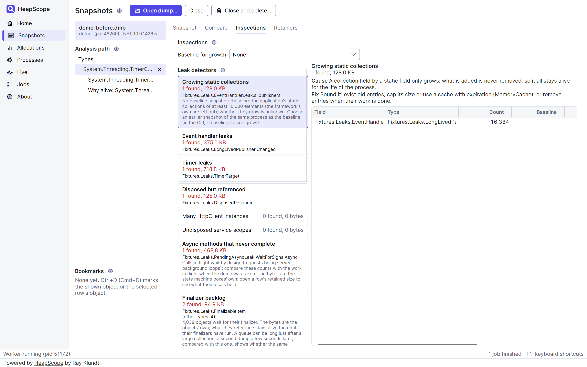
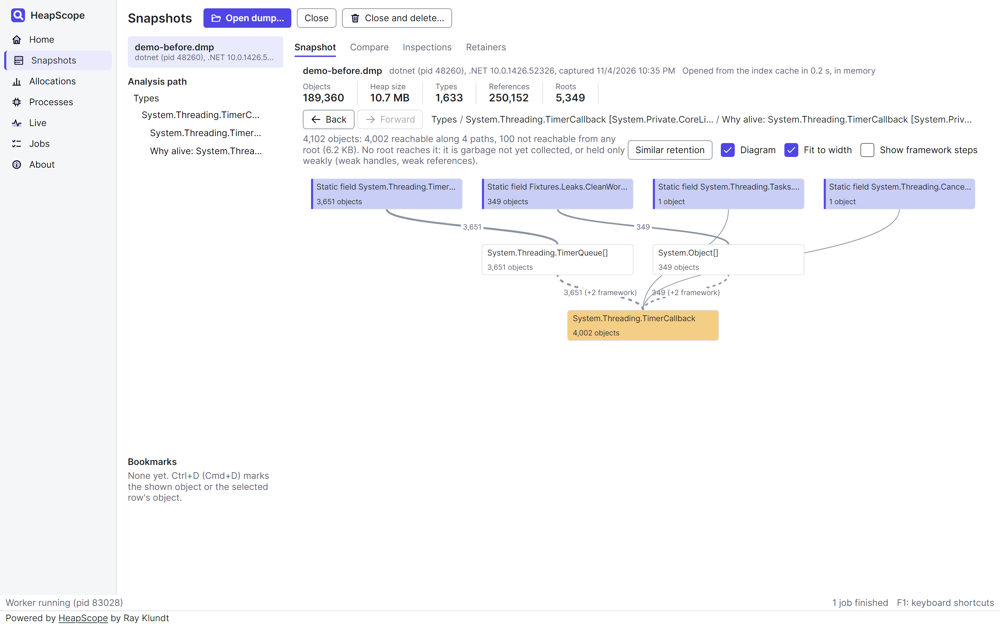
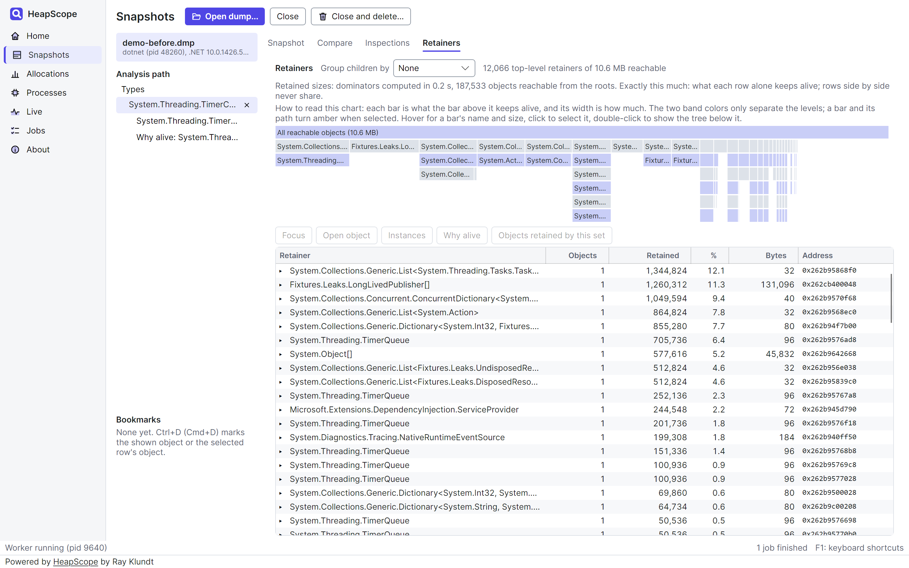
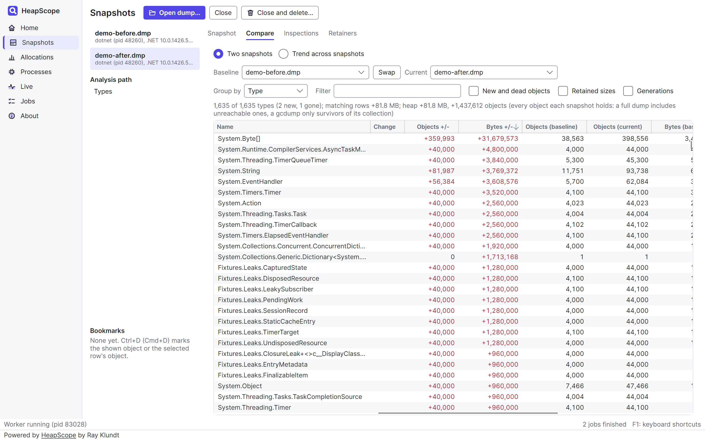
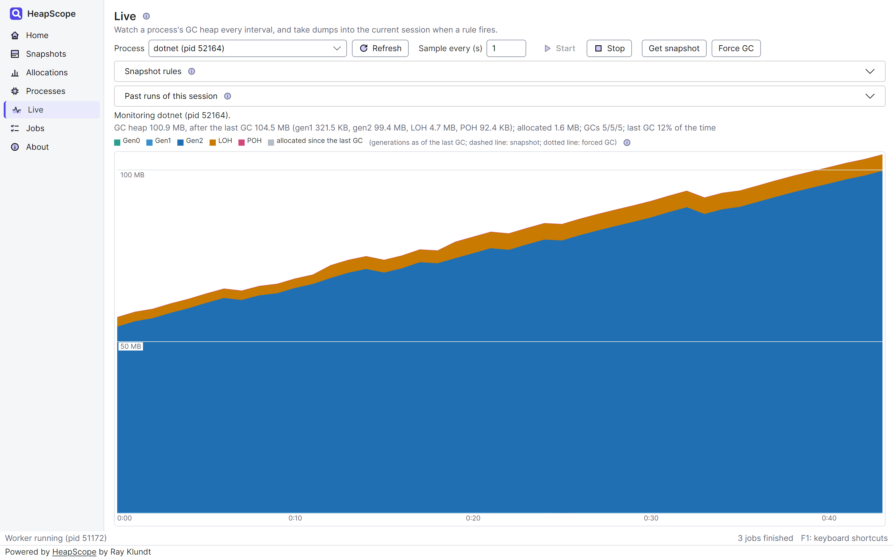

<p align="center"></p>

# HeapScope

**See what is filling your .NET heap, why it is still there, and what grew.**

Powered by [HeapScope](https://github.com/rklundt/HeapScope) by Ray Klundt.

A free, open source memory profiler for .NET 5 and later, as a desktop app and a command line tool. It runs on Windows and
Linux, with untested macOS packages, and your memory dumps never leave your machine.

[Install it](INSTALL.md) | [User guide](docs/USER-GUIDE.md) | [Release notes](RELEASE-NOTES.md)

<picture>
  <source media="(prefers-color-scheme: dark)" srcset="docs/images/inspections-dark.png">
  
</picture>

<sub>The pictures here are real captures of HeapScope. The app in them is its test fixture, a small service that leaks on
purpose.</sub>

## What it does

### Leak detectors: memory keeps climbing, and you don't know why?

Open a dump and read the list. HeapScope looks for event handler leaks, timers, disposed objects still referenced, growing
static collections, undisposed service scopes, piles of `HttpClient`, async methods that never complete and a finalizer
backlog.

It checks for waste too: duplicate strings, oversized collections, sparse arrays and fragmentation. Each finding gives you
the likely cause and a fix, and a leak detector's row opens the objects behind it (for a growing collection, the collection
itself, not its elements). A finding is a lead to check, not a verdict, and it says so where a pattern can also be normal.

### Why alive: this object should be gone, so who is holding it?

Follow the chain from the GC roots down to any object or type, as a list or as one merged diagram. Framework steps fold
away, so your own types stand out.

<picture>
  <source media="(prefers-color-scheme: dark)" srcset="docs/images/why-alive-dark.png">
  
</picture>

### Retainers: which objects are really holding the memory?

The biggest type is not always the culprit. The dominator tree ranks the objects that alone keep the most memory alive, and
the icicle chart shows the shape of it at a glance. Click down until you reach the one reference worth removing.

<picture>
  <source media="(prefers-color-scheme: dark)" srcset="docs/images/retainers-dark.png">
  
</picture>

### Compare: what grew between this morning and now?

Put two dumps side by side and sort by growth, per type, in objects and bytes, retained bytes or generation. Two dumps of
the same process also match objects by address, so you can open what is new, what died and what survived. That is an estimate,
most reliable for older objects, since a GC moves young ones. Trend view lines
up to 20 snapshots side by side and shows how often each type grew.

<picture>
  <source media="(prefers-color-scheme: dark)" srcset="docs/images/compare-dark.png">
  
</picture>

### Allocations: which code is creating all this?

Record a trace while your app runs, then see the top types and their call stacks. Drag across the timeline to look at just
the moment that matters. Byte counts are estimated from allocation samples, and the page says so.

### Live: the leak only shows up after hours?

Watch a process's heap by generation, and let rules catch it for you: capture a dump on a schedule, when the heap passes a
size, or when it has grown by a set amount. Come back to dumps from before and after, ready to compare.

<picture>
  <source media="(prefers-color-scheme: dark)" srcset="docs/images/live-dark.png">
  
</picture>

### Command line: want memory checks in CI?

`heapscope-cli` does the analysis without a window, with table, CSV and JSON output. Fail a build when a dump grows too much:

```bash
heapscope-cli diff before.dmp after.dmp --fail-on-growth 50MB
```

It exits with code 2 when the growth is over your limit, and 0 when it is not. A full dump also counts garbage not yet
collected, so for a stable gate capture after a full GC in the target, or compare gcdumps.

### Private by design: dumps are full of secrets?

A dump holds everything the process had in memory, passwords included, so HeapScope never uploads one. Analysis runs on your
machine, and the logs never hold values from a dump. The one thing it can fetch is a runtime component a dump needs, from
Microsoft's symbol server, and only if you allow it. That request sends module identifiers, never dump contents.

### Built for big dumps: tired of your profiler freezing?

Analysis runs in a separate worker process, so the window keeps responding, and if the worker crashes you can restart it
from a banner. Measured on 3.10, three runs each, on a 24-core machine with 32 GB of RAM:

| Dump | First load | Reopen | Peak memory, first load |
|---|---|---|---|
| 4.0 GB, 55 million objects | 35 to 48 s | about 1 s | 2.2 to 2.5 GB |
| 4.0 GB, 49 million objects, as densely linked as a real application | 54 to 75 s | about 1 s | 2.4 GB |

Retained sizes take more: computing them in memory peaked at about 3.3 and 3.9 GB on dumps of this size when last measured.

### Results you can check: someone doubts a number?

The log records why each result was produced, with no values from the dump in it, so a finding can be backed up later. The
test suite checks results against fixture dumps whose answers are known.

## What to expect

HeapScope is in pre-release. Plainly:

- **Windows: everything.** Capture dumps, record allocations, watch the Live page and analyze the results.
- **Linux: dump analysis.** Take a dump with `dotnet-dump` and open it in the app or the CLI. Capturing from HeapScope,
  recording allocations and the Live page need Windows.
- **macOS: untested.** Each release has macOS packages, but they are built on Linux, not on a Mac, and have not been run.
  They are not signed or notarized, so macOS may refuse them. You can also build one on your Mac with `build/publish.sh`,
  which is untested too.
- **Unsigned builds.** Windows SmartScreen will warn you. [INSTALL.md](INSTALL.md) shows how to check a download against its
  checksums and build provenance.
- **Modern .NET only.** It analyzes .NET 5 and later, not .NET Framework.
- **A size limit.** It is built for dumps up to about 8 GB and 50 million objects, and measured so far up to 4.4 GB and 57.5
  million objects. Larger ones are not a target yet.

## Get started

Download a release for Windows or Linux, with no .NET needed, or get the CLI as a `dotnet tool`. Untested macOS packages
are there too. [INSTALL.md](INSTALL.md) takes you from download to your first snapshot.

Or build it from source:

- Build: `dotnet build HeapScope.sln`
- Test: `dotnet test --solution HeapScope.sln`
- UI: `dotnet run --project src/HeapScope.UI`
- CLI: `dotnet run --project src/HeapScope.Cli -- --help`

## Documentation

- [User guide](docs/USER-GUIDE.md): how each part works, every shortcut and filter, logs and getting help.
- [Install](INSTALL.md) and [release notes](RELEASE-NOTES.md).
- [Developer guide](docs/DEVELOPER.md), [architecture](docs/ARCHITECTURE.md) and [how to contribute](CONTRIBUTING.md).
- [Security policy](SECURITY.md).

## License

Copyright (C) 2026 Ray Klundt.

HeapScope is licensed under the [GNU Affero General Public License, version 3 only](LICENSE), with
[additional terms](ADDITIONAL-TERMS.md) under Section 7 of that license. In short, and the files themselves govern:

- **Copyleft, including over a network.** If you distribute a modified version, or let people use one over a network, you
  must offer it under the same license with its source code.
- **Attribution.** Every work based on HeapScope must keep the notice "Powered by HeapScope by Ray Klundt" (or "Based
  on HeapScope by Ray Klundt"), with HeapScope linked to https://github.com/rklundt/HeapScope. In a user interface it
  must be readable on the main screen (or a splash screen shown for at least five seconds): real text on an opaque
  background, at least 4.5:1 contrast, no smaller than the body text. Command line tools show it in help, version and
  startup output where applicable, and in their primary documentation. Modified versions must be marked as such.
- **AI and machine learning (Section 6).** Models trained, fine-tuned or evaluated with HeapScope code, screens, or
  processes must credit it in their documentation, and code that an AI system produces from HeapScope is a work based on
  it, carrying the attribution and the same license. Text and data mining rights are reserved.
- **Commercial licenses** that waive some or all of these requirements are available; see [COMMERCIAL.md](COMMERCIAL.md).

Third-party components keep their own licenses; see [THIRD-PARTY-NOTICES.md](THIRD-PARTY-NOTICES.md).
