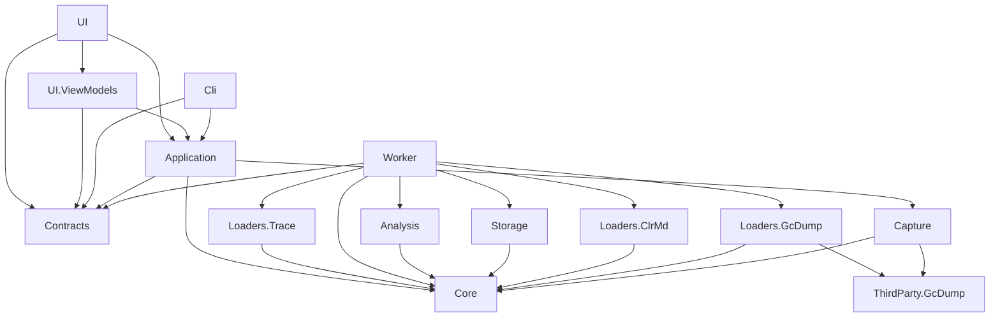

# HeapScope Architecture

Status: living document. Every sprint updates it to match what was actually built. Sections marked
"(planned)" describe designs whose code does not exist yet.

## 1. Purpose, scope, non-goals

**Purpose.** HeapScope is a desktop memory profiler for modern .NET applications, on Windows today and on Linux and
macOS
after the Avalonia port (ADR-025; the engine, worker and CLI already run there). It replaces the
core of JetBrains dotMemory for one primary workflow: a memory leak is suspected in an ASP.NET Core API, the
developer runs the API locally, replays representative traffic, takes snapshots over time, and uses HeapScope
to find what is growing and why it is retained.

**In scope (1.x and 2.x).**
- Discovering local .NET processes and capturing full dumps and gcdumps.
- Loading snapshots into a compact in-memory object graph, cached on disk for fast reopen.
- Type summaries, snapshot diffs, object inspection, simple inspections (duplicate strings, LOH, collections).
- Live counters and timed snapshots.
- Reverse references, retention paths, dominator tree, retained sizes, smart leak detectors.
- A CLI with the same capabilities as the UI, usable in automation.
- Linux and macOS core dumps read on the system that took them (sprint 2.3.5, ADR-025); capture there is a backlog item.
- Sharing results as an exported analysis the user writes and passes on (ADR-026).

**Non-goals (for now).**
- .NET Framework targets (backlog).
- Reading a dump on another system than the one that took it, containers' own tooling, remote machines (backlog).
- Native memory analysis beyond an overview (backlog).
- Uploading anything. HeapScope never sends data off the machine; a shared result is a file the user passes on.
- Dumps larger than the Medium tier (see section 10). The Large tier is a backlog item.

## 2. Context


Capture (process discovery, dump writing, live counters) runs in the UI or CLI process through the
Application layer, because it is light and needs the caller's elevation. Everything that touches snapshot
contents runs in the worker.

Capture and sessions (sprint 1.1):
- `HeapScope.Capture`: `ProcessDiscovery` lists processes with a diagnostics port
  (`DiagnosticsClient.GetPublishedProcesses`) with name, working set, private bytes, start time, command line
  (`NtQueryInformationProcess`, limited query rights), runtime version and folder (the loaded `coreclr.dll`; single-file
  apps have none) and elevation. HeapScope's own processes (this pid, and executables under its installation folder,
  the worker included) are never listed or captured, matched by path, not name. A detail that cannot be read stays
  empty. `WindowsElevationProbe` reads token elevation for targets and for HeapScope itself (one rule): a token that
  cannot be opened for query (elevated, or another user's, such as services running as SYSTEM) or that reports
  elevation means only an elevated HeapScope can dump it. Capture is Windows only (ADR-025): off Windows,
  `CapturePlatform.EnsureSupported` refuses discovery and capture with a message naming `dotnet-dump`, and
  `CapturePlatform.ElevationProbe()` gives `UnixElevationProbe` (`Environment.IsPrivilegedProcess`) [2.3.5].
- `DumpCapturer`: checks elevation and free space before asking the runtime for a full dump (`DumpType.Full`: module
  images are in the dump, so it never depends on finding the exact module files). The estimate is measured, not
  guessed: the target's committed readable pages from a `VirtualQueryEx` walk plus 16 MB of streams; when the walk is
  denied, private bytes x 1.1 + 384 MB for images and mapped files + 16 MB. Free space comes from
  `GetDiskFreeSpaceEx` on the folder itself (UNC paths and mount points), and 1 GB is always left free. The dump is
  written to `<name>.dmp.partial` and renamed only on success; an existing file is never overwritten. The runtime's
  createdump runs inside the target under the target's account and cannot be stopped safely, so a cancel waits until
  it has written the file and then deletes it (measured: a 200 ms cancel used to leave a complete 203 MB dump). The
  front ends keep the process alive for that: the CLI gives Ctrl+C up to an hour (System.CommandLine's
  `ProcessTerminationTimeout`; its 2 second default would exit with the dump on disk, and null would turn Ctrl+C off),
  and closing the UI cancels running jobs and waits for them. As a safety net for killed runs, half-written
  `*.dmp.partial` files older than 10 minutes and no longer held are removed when capture starts.
  Failures are specific: `ElevationRequiredException`, `InsufficientDiskSpaceException`, `TargetUnavailableException`,
  `DumpFileExistsException`, `DumpWriteFailedException` (runtime errors decoded: disk full, or the target's account
  cannot write the folder, with `--out` as the next step). Progress says the target is paused while its memory is
  written.
- Application: `SessionLibrary` keeps sessions under `%LOCALAPPDATA%\HeapScope\sessions` (`Sessions:Root`; a relative
  root is under `%LOCALAPPDATA%\HeapScope`), one folder per session (`yyyyMMdd-HHmmss[-name]`, claimed by creating its
  `session.json` exclusively, so parallel runs never share one) with `session.json` (format version 1: name, created,
  last opened, snapshots with id, file, label, kind, source, process, runtime version and folder, capture time, size;
  since 3.4 `Runs`, the monitoring runs with their process, interval, rules, kind, start and end, timeline and trace
  files and the ids of their snapshots and forced collections; unknown members are kept on save, on the document and on
  each run, so an older build never drops what a newer one wrote). Since 3.4 a snapshot of a session is deleted with
  its index caches and sidecars (next to it and in the fallback folder, named by Core's `IndexCachePaths`), and a session
  whole; only files inside the session folder are deleted (no link is followed; dumps a session records elsewhere are
  kept and listed), a session written into by a capture or a run (`MarkInUse`) or the current one is refused, the
  front end refuses open snapshots, shows the files (`PlanSnapshotDeletion`, `PlanSessionDeletion`) and confirms every
  deletion, and a file that cannot be deleted is reported with `session.json` kept so the session stays listed. Every change is a
  read-modify-write under a cross-process lock file (`session.lock`) with a unique temporary file flushed to disk.
  Since 3.6 (peer review P1) one type, `SessionDocumentFile`, owns the document's file protocol: readers take no lock
  and open it sharing read, write and delete (a reader never makes a writer's replace fail; before, a reader made the
  replace fail on Windows and the capture or run went unrecorded) and retry briefly when another program holds it; the
  replace retries for up to 5 seconds; `Read` says whether a folder's document is read, missing or unreadable and why.
  The current session is replaced by a new one only when its folder or document is gone: an unreadable one (damaged,
  held, another format version) fails with `SessionUnreadableException` and a next step instead of moving the next
  captures into a new session. The current folder has its own gate, never held across file work, so `CurrentFolder`
  answers while an update waits for `session.lock`.
  The current session is created when the first capture passes its checks (a refused capture leaves no folder), or
  chosen with `Open` (Home's Open, CLI `--session`). `CaptureService` (behind `ICaptureService`) lists processes off
  the calling thread, runs captures as tracked jobs with collision-free file names into the session that was current
  when the capture started, copies the target's `mscordaccore.dll` to `dac\<file version>\` next to the dump (the
  loader searches it; the dump stays readable after the runtime on this machine is updated, for self-contained apps,
  and with several runtimes in one session) and, since 3.6, trusts that copy by its SHA-256 (`TrustedDacs`, ADR-035),
  records the snapshot, and logs start, end and failures. Every capture states that the dump
  contains secrets and where it was written. Front ends see only Application types: `ICaptureService`, `ProcessEntry`
  (with `ProcessElevation` and `NeedsAdministrator`) and `CaptureFailedException` with a `CaptureFailure` reason (the
  architecture test caught the first draft using Capture types in UI and CLI).

## 3. Solution layout and layers

```
HeapScope.sln
build/                         Shared MSBuild targets (worker deployment next to UI and CLI); the gate, test, fixture
dump,
                               publish, license and package scripts shared by CI and the local gate (sprint 3.6)
src/
  HeapScope.Core               Domain model: snapshot abstraction, capability model, compact graph,
                               type table, root model, string table. No dependencies at all.
  HeapScope.Analysis           Algorithms over the compact graph.
  HeapScope.Storage            On-disk index cache format, versioning, read/write.
  HeapScope.Capture            Process discovery, dump/gcdump capture, live counters, timed snapshots.
  HeapScope.Loaders.ClrMd      Full dump -> compact graph.
  HeapScope.Loaders.GcDump     gcdump -> compact graph (sprint 1.8).
  HeapScope.Loaders.Trace      EventPipe trace -> sampled allocations (sprint 2.5, ADR-028).
  HeapScope.ThirdParty.GcDump  Vendored MIT gcdump reader and writer from dotnet/diagnostics (PerfView code), sprint 1.8.
  HeapScope.Contracts          IPC DTOs and service interfaces shared by UI, worker and CLI.
  HeapScope.Worker             Out-of-process analysis host (64-bit).
  HeapScope.Application        Use cases: worker client and lifecycle, job tracking, sessions, capture
                               orchestration. UI-agnostic.
  HeapScope.UI.ViewModels      View models and the services they use, without a UI toolkit (sprint 2.3.6).
  HeapScope.UI                 The desktop app on Avalonia (Windows, Linux, macOS; sprint 2.3.6, ADR-025): shell,
                               views, controls, smoke runs. Executable HeapScope.
  HeapScope.Cli                Command line front end.
tests/
  Shared/                      Helpers compiled into every test project (the repository root finder, sprint 1.9)
  HeapScope.Core.Tests
  HeapScope.Analysis.Tests     Synthetic graphs with known answers.
  HeapScope.Storage.Tests
  HeapScope.Loaders.ClrMd.Tests DAC lookup (local only) with real PE files; the loader itself runs in Integration.Tests.
  HeapScope.Capture.Tests      Capture preflight (elevation, disk, partial files) with fakes; the real probe.
  HeapScope.Application.Tests  Job tracking, logging and worker client logic with fakes.
  HeapScope.Cli.Tests          The CLI in process: usage errors, tables as text, cells by name (sprint 3.8).
  HeapScope.Worker.Tests       Worker internals: result set store, progress throttling, error mapping.
  HeapScope.UI.ViewModels.Tests View model tests (no windows are shown; they run on every system).
  HeapScope.UI.Tests           The app's views on Avalonia's headless platform: every page, the grids over 1.5 million
                               rows, the attribution markup and the themes (sprint 2.3.6).
  HeapScope.Architecture.Tests Enforces the dependency rules below.
  HeapScope.Integration.Tests  Real worker processes, fixtures, real dumps, known answers (ClrMD and the loader).
                               References Loaders.ClrMd and Storage to test them in process.
perf/
  HeapScope.Benchmarks         Console benchmarks against the budgets (synthetic 50M-object graph etc.).
.github/workflows/ci.yml       CI on GitHub's runners: Windows, Linux, macOS, and the builds per system (sprints 2.3.5,
2.3.6).
fixtures/
  Leaks                        Shared leak implementations and semantic fixtures (namespace Fixtures.Leaks).
  LeakyApi                     ASP.NET Core API with switchable, scalable leaks.
  LeakyConsole                 Minimal console leaker for fast tests.
  LoadGen                      Load generator for LeakyApi; also captures dumps for the scripts.
  DenseHeap                    Grows a dense heap of real Roslyn compiler objects (about 3 references per object)
                               to a target size and waits to be dumped (sprint 1.2).
  KnownAnswers                 One JSON file per leak: what the analysis must find.
  scripts/                     Scripts producing Small and Medium sample dumps.
```

Changes from the kickoff layout, with reasons:
- `HeapScope.Application.Tests`, the UI tests and `HeapScope.Architecture.Tests` were added so
  that each concern has a fast, focused test project. The architecture test is its own project so that it
  can reference every source project without blurring any other test project's purpose.
- `perf/HeapScope.Benchmarks` holds measurements that are too slow or too memory hungry for the unit test run.
- `fixtures/KnownAnswers` makes the known answers a first-class, shared input of tests and detectors.
- `build/` holds the target that places the worker beside the UI and CLI executables (section 3.1).

The code map, what each project holds and the sprint that added it, is in
[architecture/code-map.md](architecture/code-map.md).

### 3.1 Dependency rules



| Project | May reference (solution) | May reference (packages, besides Microsoft.Extensions.*) |
|---|---|---|
| Core | nothing | nothing |
| Analysis | Core | System.IO.Hashing (duplicate strings, sprint 1.6) |
| Storage | Core | System.IO.Hashing |
| Capture | Core, ThirdParty.GcDump | Microsoft.Diagnostics.NETCore.Client, TraceEvent |
| Loaders.ClrMd | Core | Microsoft.Diagnostics.Runtime |
| Loaders.GcDump | Core, ThirdParty.GcDump | Microsoft.Diagnostics.Tracing.TraceEvent |
| Loaders.Trace | Core | Microsoft.Diagnostics.Tracing.TraceEvent (sprint 2.5) |
| ThirdParty.GcDump | nothing | Microsoft.Diagnostics.NETCore.Client, TraceEvent (vendored code, sprint 1.8) |
| Contracts | nothing (ADR-016) | StreamJsonRpc attributes only (no transport code) |
| Worker | Core, Contracts, Analysis, Storage, Loaders.* | StreamJsonRpc |
| Application | Core, Contracts, Capture | StreamJsonRpc |
| Cli | Application, Contracts | System.CommandLine |
| UI.ViewModels | Application, Contracts | CommunityToolkit.Mvvm |
| UI | Application, Contracts, UI.ViewModels | Avalonia, Avalonia.Desktop, Avalonia.Themes.Fluent, Avalonia.Controls.DataGrid, Avalonia.Headless, CommunityToolkit.Mvvm (MIT only, ADR-025) |

Rules:
- Core references nothing, not even Microsoft.Extensions.*. It is pure domain types and data structures.
- UI and UI.ViewModels never reference Loaders, Analysis, Storage, Capture, Worker or any diagnostics library directly
  (diagnostics libraries do load into the UI process, through Capture via Application). UI.ViewModels references no
  UI toolkit, so its tests run on every system.
- UI, UI.ViewModels and Cli use no Core types. Everything they show comes through Application or Contracts, whose wire
  vocabulary (snapshot kind, capabilities, capability descriptions) is defined in Contracts (ADR-016).
- A build-order-only reference (`ReferenceOutputAssembly="false"`) to the Worker project is allowed from
  UI, Cli and Integration.Tests; it ensures the worker is built and deployed next to them, without making
  any worker type visible.
- `HeapScope.Architecture.Tests` checks every `src/**/*.csproj` against the table using the evaluated restore
  graph (`obj/project.assets.json`, so references added by imported props and targets count) plus build-order-only
  references from the project and the shared targets it imports. It also checks every compiled assembly reference
  (solution assemblies and the governed package assemblies) against the same table.

## 4. Process model and IPC

Three kinds of process (the app, the CLI, the analysis worker), how the worker is started, watched and restarted, the
JSON-RPC transport and its contracts with the protocol version history, progress and cancellation, and large result sets
read in pages. Full text: [architecture/process-model.md](architecture/process-model.md).

- 4.1 Processes
- 4.2 Lifecycle
- 4.3 Crash handling
- 4.4 Transport and contracts
- 4.5 Progress and cancellation
- 4.6 Large result sets

## 5. Snapshot abstraction and capability model

The snapshot abstraction every loader implements, the capability model that decides what a snapshot kind can answer, and
what a gcdump can and cannot show. Full text: [architecture/snapshots.md](architecture/snapshots.md).

- 5.1 Abstraction (HeapScope.Core)
- 5.2 Capabilities
- 5.3 gcdumps (sprint 1.8)

## 6. Compact graph format (ADR-005)

The compact struct-of-arrays object graph (ADR-005) with its root and reference semantics, the memory budget per object,
how it is built, how it extends, the in-memory and mapped modes (ADR-015) and its limits. Full text:
[architecture/graph-format.md](architecture/graph-format.md).

- 6.1 Data structures
- 6.2 Memory budget per object
- 6.3 Building
- 6.4 Extending without redesign (2.x)
- 6.5 Memory modes (ADR-015)
- 6.6 Limits

## 7. Index cache (ADR-006)

The index cache next to a dump (ADR-006): its layout, location, atomic writing, validation on open, signature (ADR-036),
memory modes and sidecars. Full text: [architecture/index-cache.md](architecture/index-cache.md).

## 8. Threading model

Which thread does what in the app, the CLI and the worker, and the rules that keep the UI responsive. Full text:
[architecture/threading.md](architecture/threading.md).

## 9. Worker memory and GC settings

The worker's GC settings, heap count and memory reservations. Full text:
[architecture/worker-memory.md](architecture/worker-memory.md).

## 10. Scale targets and budgets

The Small, Medium and Large tiers and the time and memory budgets measured against them. Full text:
[architecture/budgets.md](architecture/budgets.md).

## 11. Error handling and logging

Error codes and messages, the log files and what each area logs so a contested result can be backed up, and what is
never logged. Full text: [architecture/logging.md](architecture/logging.md).

## 12. Security and privacy

Dumps as sensitive and untrusted input, local-only operation, DAC trust (ADR-035), crafted input, signed caches, private
files, session paths, the supply chain and releases. Full text:
[architecture/security-privacy.md](architecture/security-privacy.md).

## 13. Architecture Decision Records

One file per ADR in [adr/](adr/README.md):

- [ADR-001](adr/ADR-001-platform-net-10-wpf-windows-x64.md) Platform: .NET 10, WPF, Windows x64
- [ADR-002](adr/ADR-002-target-processes-modern-net-only.md) Target processes: modern .NET only
- [ADR-003](adr/ADR-003-snapshot-types-full-dumps-and-gcdumps-behind-one-abstraction.md) Snapshot types: full dumps and gcdumps behind one abstraction
- [ADR-004](adr/ADR-004-scale-target-medium.md) Scale target: Medium (amended 2026-10-22)
- [ADR-005](adr/ADR-005-compact-struct-of-arrays-object-graph.md) Compact, struct-of-arrays object graph
- [ADR-006](adr/ADR-006-on-disk-index-cache.md) On-disk index cache
- [ADR-007](adr/ADR-007-out-of-process-worker.md) Out-of-process worker
- [ADR-008](adr/ADR-008-headless-core-and-cli.md) Headless core and CLI
- [ADR-009](adr/ADR-009-application-stack.md) Application stack
- [ADR-010](adr/ADR-010-diagnostics-libraries.md) Diagnostics libraries
- [ADR-011](adr/ADR-011-build-hygiene.md) Build hygiene
- [ADR-012](adr/ADR-012-git.md) Git
- [ADR-013](adr/ADR-013-leaky-fixtures-as-source-of-truth.md) Leaky fixtures as source of truth
- [ADR-014](adr/ADR-014-elevation.md) Elevation
- [ADR-015](adr/ADR-015-adaptive-memory-modes.md) Adaptive memory modes (added 2026-10-22, follows from the ADR-004 amendment)
- [ADR-016](adr/ADR-016-contracts-owns-the-wire-vocabulary.md) Contracts owns the wire vocabulary (added in sprint 0.1)
- [ADR-017](adr/ADR-017-no-network-access-for-symbols-or-dac-by-default.md) No network access for symbols or DAC by default (added in sprint 0.1)
- [ADR-018](adr/ADR-018-diffs-compare-per-type-totals-no-object-identity-across-dump.md) Diffs compare per-type totals; no object identity across dumps (added in sprint 1.4; amended by ADR-032)
- [ADR-019](adr/ADR-019-the-ui-process-is-never-power-throttled.md) The UI process is never power-throttled (added in sprint 1.5)
- [ADR-020](adr/ADR-020-inspections-are-analysis-plugins-with-declared-capabilities.md) Inspections are Analysis plugins with declared capabilities (added in sprint 1.6)
- [ADR-021](adr/ADR-021-live-monitoring-reads-eventcounters-in-the-front-end-s-proce.md) Live monitoring reads EventCounters in the front end's process (added in sprint 1.7)
- [ADR-022](adr/ADR-022-license-agplv3-only-with-additional-terms-attribution-on-the.md) License: AGPLv3 only with additional terms, attribution on the main screen (added before sprint 1.8)
- [ADR-023](adr/ADR-023-gcdump-capture-moves-to-the-worker.md) gcdump capture moves to the worker (added in sprint 1.9, amended by ADR-037:
  it stays in the front end)
- [ADR-024](adr/ADR-024-retention-semantics-shared-by-paths-and-dominators.md) Retention semantics shared by paths and dominators (added in sprint 2.3)
- [ADR-025](adr/ADR-025-ui-platform-avalonia-on-windows-linux-and-macos.md) UI platform: Avalonia on Windows, Linux and macOS (added in sprint 2.3.5, amends ADR-001)
- [ADR-026](adr/ADR-026-sharing-results-an-exported-analysis-analysis-only-by-defaul.md) Sharing results: an exported analysis, analysis only by default (added in sprint 2.3.5)
- [ADR-027](adr/ADR-027-dominator-children-kept-the-tree-served-flattened.md) Dominator children kept; the tree served flattened (added in sprint 2.4)
- [ADR-028](adr/ADR-028-allocation-traces-read-in-the-worker-from-eventpipe-allocati.md) Allocation traces read in the worker from EventPipe allocation ticks (added in sprint 2.5)
- [ADR-029](adr/ADR-029-analysis-path-per-snapshot-bookmarks-by-snapshot-file.md) Analysis path per snapshot; bookmarks by snapshot file (added in sprint 2.7)
- [ADR-030](adr/ADR-030-object-sets-as-the-analysis-subject.md) Object sets as the analysis subject (added in sprint 3.1)
- [ADR-031](adr/ADR-031-similar-retention-and-the-key-paths-diagram.md) Similar Retention and the key paths diagram (added in sprint 3.2)
- [ADR-032](adr/ADR-032-objects-of-two-snapshots-matched-by-address.md) Objects of two snapshots matched by address (added in sprint 3.3, amends ADR-018)
- [ADR-033](adr/ADR-033-one-capture-per-process-at-a-time-runs-recorded-in-their-ses.md) One capture per process at a time; runs recorded in their session (added in sprint 3.4)
- [ADR-034](adr/ADR-034-runtime-leak-detectors-and-the-unreachable-set.md) Runtime leak detectors and the unreachable set (added in sprint 3.5)
- [ADR-035](adr/ADR-035-a-dac-next-to-a-dump-is-loaded-only-once-trusted.md) A DAC next to a dump is loaded only once trusted (added in sprint 3.6, amends ADR-017)
- [ADR-036](adr/ADR-036-index-caches-signed-with-a-per-user-key.md) Index caches signed with a per-user key (added in sprint 3.7)
- [ADR-037](adr/ADR-037-live-sources.md) Live sources (added in sprint 3.8, amends ADR-023)

## 14. Package versions
Latest stable versions verified on nuget.org at sprint 0.1 (2026-10-22). `Directory.Packages.props` is the
authoritative list.

| Package | Version | License | Used by |
|---|---|---|---|
| Microsoft.Extensions.Hosting (+ Abstractions, Logging.Abstractions, Options) | 10.0.14 | MIT | Worker, Application, Cli, UI |
| System.IO.Hashing | 10.0.14 | MIT | Storage, Analysis |
| StreamJsonRpc | 2.26.150 | MIT | Worker, Application |
| CommunityToolkit.Mvvm | 8.4.2 | MIT | UI.ViewModels, UI |
| Avalonia, Avalonia.Desktop, Avalonia.Themes.Fluent, Avalonia.Headless | 12.1.4 | MIT (natives: ANGLE BSD-3, SkiaSharp and HarfBuzzSharp MIT) | UI, UI tests (2.3.6) |
| Avalonia.Controls.DataGrid | 12.1.2 | MIT | UI (2.3.6) |
| System.CommandLine | 2.0.14 | MIT | Cli |
| Microsoft.Diagnostics.Runtime (ClrMD) | 4.2.751201 | MIT | Loaders.ClrMd |
| Microsoft.Diagnostics.NETCore.Client | 0.2.750501 | MIT | Capture |
| Microsoft.Diagnostics.Tracing.TraceEvent | 4.0.0 | MIT | Capture (Loaders.GcDump in 1.8, Loaders.Trace in 2.5) |
| xunit.v3 | 4.0.2 | Apache 2.0 | tests |
| Shouldly | 4.3.0 | BSD 3-Clause | tests |

Tests run on Microsoft.Testing.Platform (`global.json` opts in), which xunit.v3 4.x requires with the .NET 10
SDK; `Microsoft.NET.Test.Sdk` and the VSTest adapter are therefore not used.

## 15. Shared product information
`HeapScope.Contracts.ProductInfo` holds the product name and version (from the informational version without
source revision). It lives in Contracts because UI, CLI and worker all reference Contracts, and UI and CLI may not
reference Core directly. `heapscope-cli --version` prints exactly this value.

Executable names: the desktop app is `HeapScope` (`HeapScope.exe` on Windows), the CLI is `heapscope-cli`, the worker is
`HeapScope.Worker` (each with `.exe` on Windows). The UI and CLI names must differ by more than case, because Windows
file names are case insensitive and both assemblies meet in the architecture test's output folder.
