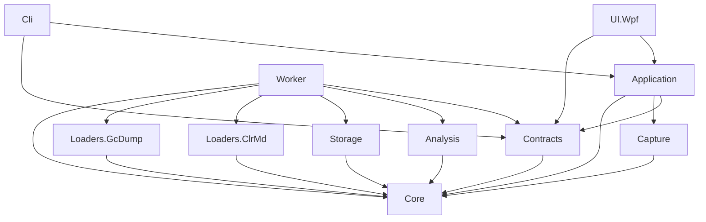

# HeapScope Architecture

Status: living document. Every sprint updates it to match what was actually built. Sections marked
"(planned)" describe designs whose code does not exist yet.

## 1. Purpose, scope, non-goals

**Purpose.** HeapScope is a Windows desktop memory profiler for modern .NET applications. It replaces the
core of JetBrains dotMemory for one primary workflow: a memory leak is suspected in an ASP.NET Core API, the
developer runs the API locally, replays representative traffic, takes snapshots over time, and uses HeapScope
to find what is growing and why it is retained.

**In scope (1.x and 2.x).**
- Discovering local .NET processes and capturing full dumps and gcdumps.
- Loading snapshots into a compact in-memory object graph, cached on disk for fast reopen.
- Type summaries, snapshot diffs, object inspection, simple inspections (duplicate strings, LOH, collections).
- Live counters and timed snapshots.
- Reverse references, retention paths, dominator tree, retained sizes, smart leak detectors.
- A CLI with the same capabilities as the UI, usable in automation.

**Non-goals (for now).**
- .NET Framework targets (backlog).
- Linux dumps, containers, remote machines (backlog).
- Native memory analysis beyond an overview (backlog).
- Uploading or sharing anything. HeapScope never sends data off the machine.
- Dumps larger than the Medium tier (see section 10). The Large tier is a backlog item.

## 2. Context


Capture (process discovery, dump writing, live counters) runs in the UI or CLI process through the
Application layer, because it is light and needs the caller's elevation. Everything that touches snapshot
contents runs in the worker.

## 3. Solution layout and layers

```
HeapScope.sln
build/                         Shared MSBuild targets (worker deployment next to UI and CLI)
src/
  HeapScope.Core               Domain model: snapshot abstraction, capability model, compact graph,
                               type table, root model, string table. No dependencies at all.
  HeapScope.Analysis           Algorithms over the compact graph.
  HeapScope.Storage            On-disk index cache format, versioning, read/write.
  HeapScope.Capture            Process discovery, dump/gcdump capture, live counters, timed snapshots.
  HeapScope.Loaders.ClrMd      Full dump -> compact graph.
  HeapScope.Loaders.GcDump     gcdump -> compact graph (created in sprint 1.8).
  HeapScope.Contracts          IPC DTOs and service interfaces shared by UI, worker and CLI.
  HeapScope.Worker             Out-of-process analysis host (x64).
  HeapScope.Application        Use cases: worker client and lifecycle, job tracking, sessions, capture
                               orchestration. UI-agnostic.
  HeapScope.UI.Wpf             WPF shell, views, view models.
  HeapScope.Cli                Command line front end.
tests/
  HeapScope.Core.Tests
  HeapScope.Analysis.Tests     Synthetic graphs with known answers.
  HeapScope.Storage.Tests
  HeapScope.Application.Tests  Job tracking and worker client logic with fakes.
  HeapScope.UI.Wpf.Tests       View model tests (no windows are shown).
  HeapScope.Architecture.Tests Enforces the dependency rules below.
  HeapScope.Integration.Tests  Real worker processes, fixtures, real dumps, known answers.
perf/
  HeapScope.Benchmarks         Console benchmarks against the budgets (synthetic 50M-object graph etc.).
fixtures/
  LeakyApi                     ASP.NET Core API with switchable, scalable leaks.
  LeakyConsole                 Minimal console leaker for fast tests.
  LoadGen                      Load generator for LeakyApi; also captures dumps for the scripts.
  KnownAnswers                 One JSON file per leak: what the analysis must find.
  scripts/                     Scripts producing Small and Medium sample dumps.
```

Changes from the kickoff layout, with reasons:
- `HeapScope.Application.Tests`, `HeapScope.UI.Wpf.Tests` and `HeapScope.Architecture.Tests` were added so
  that each concern has a fast, focused test project. The architecture test is its own project so that it
  can reference every source project without blurring any other test project's purpose.
- `perf/HeapScope.Benchmarks` holds measurements that are too slow or too memory hungry for the unit test run.
- `fixtures/KnownAnswers` makes the known answers a first-class, shared input of tests and detectors.
- `build/` holds the target that places the worker beside the UI and CLI executables (section 5.1).

### 3.1 Dependency rules



| Project | May reference (solution) | May reference (packages, besides Microsoft.Extensions.*) |
|---|---|---|
| Core | nothing | nothing |
| Analysis | Core | none |
| Storage | Core | System.IO.Hashing |
| Capture | Core | Microsoft.Diagnostics.NETCore.Client, TraceEvent |
| Loaders.ClrMd | Core | Microsoft.Diagnostics.Runtime |
| Loaders.GcDump | Core | Microsoft.Diagnostics.Tracing.TraceEvent |
| Contracts | Core | StreamJsonRpc attributes only (no transport code) |
| Worker | Core, Contracts, Analysis, Storage, Loaders.* | StreamJsonRpc |
| Application | Core, Contracts, Capture | StreamJsonRpc |
| Cli | Application, Contracts | System.CommandLine |
| UI.Wpf | Application, Contracts | CommunityToolkit.Mvvm |

Rules:
- Core references nothing, not even Microsoft.Extensions.*. It is pure domain types and data structures.
- UI.Wpf never references Loaders, Analysis, Storage, Capture, Worker or any diagnostics library.
- A build-order-only reference (`ReferenceOutputAssembly="false"`) to the Worker project is allowed from
  UI.Wpf, Cli and Integration.Tests; it ensures the worker is built and deployed next to them, without making
  any worker type visible.
- `HeapScope.Architecture.Tests` parses every `src/**/*.csproj` and fails on any reference not in the table,
  and also checks compiled assembly references.

## 4. Process model and IPC

### 4.1 Processes
- **UI process** (WPF, x64): shell, view models, Application services, capture.
- **CLI process** (x64): same Application services, console output.
- **Worker process** (x64, `HeapScope.Worker.exe`): one per UI or CLI instance. Holds every loaded snapshot
  of the session (a diff needs both snapshots in one address space). Uses Server GC, non-concurrent
  (section 9).

### 4.2 Lifecycle
1. Application's `WorkerHost` starts the worker with `--pipe <name> --parent-pid <pid>`. The pipe name is
   `HeapScope.Worker.<guid>`; the pipe is created with `PipeOptions.CurrentUserOnly`.
2. The worker creates the pipe server and waits up to 30 s for the client; the client connects with a
   timeout and calls `GetInfoAsync` as a handshake, which also checks the protocol version.
3. The worker exits when the pipe disconnects or when the parent process exits (it watches the parent's
   process handle), so a crashed UI never leaves orphaned workers holding gigabytes.
4. On orderly shutdown the client calls `ShutdownAsync`, then waits up to 5 s before killing the process.

### 4.3 Crash handling
- The client watches both `Process.Exited` and `JsonRpc.Disconnected`. Either one moves the worker to
  `Crashed`, faults every in-flight call with `WorkerCrashedException` (exit code included), and raises a
  `WorkerStateChanged` event the UI shows as a banner.
- The next request restarts the worker transparently. Snapshots the session had loaded are reopened on demand
  from the index cache, so a restart costs seconds, not minutes.
- Worker stderr is captured by the client and forwarded into the client's log (category `Worker`), so the
  last log lines before a crash are never lost.

### 4.4 Transport and contracts
- StreamJsonRpc over the named pipe, with `HeaderDelimitedMessageHandler` and the default JSON formatter.
  The default formatter is used because it supports `IProgress<T>` and `CancellationToken` marshaling with no
  extra configuration. The formatter can be swapped later without changing service interfaces.
- `HeapScope.Contracts` defines `IWorkerService` (methods called by clients) and the DTOs. DTOs are records of
  primitive types, strings and arrays; no Core graph types ever cross the pipe.
- `ProtocolVersion` is a constant in Contracts; a mismatch at handshake is a hard error with a clear message.

### 4.5 Progress and cancellation
- Every long-running worker method takes `IProgress<JobProgress>` and `CancellationToken` as its last two
  parameters. StreamJsonRpc turns cancellation into a `$/cancelRequest` message and progress into
  notifications.
- `JobProgress` carries `Phase`, `Completed`, `Total` (nullable when unknown) and `Message`. The worker
  throttles reports to at most 10 per second per call.
- Worker loops check the token at least every 64K items and pass it into every nested call.
- Application's `JobTracker` gives each call a `JobId`, keeps its status (Queued, Running, Completed, Failed,
  Canceled), latest progress and a `Cancel()` handle, and exposes them to the UI's jobs panel and to the CLI.

### 4.6 Large result sets
Large results are never sent whole. A query creates a result set in the worker and returns a
`ResultSetInfo { Id, TotalCount, Columns }`. Clients then call `GetRowsAsync(id, offset, count)` with
`count` capped at 10,000, and `ReleaseResultSetAsync(id)` when done. Sorting and filtering happen in the
worker, producing a new result set. The WPF grids use data virtualization and fetch pages on scroll. Result
sets are held with a LRU limit per worker so a forgetful client cannot leak memory in the worker.

## 5. Snapshot abstraction and capability model

### 5.1 Abstraction (HeapScope.Core)
```csharp
public interface ISnapshot : IDisposable
{
    SnapshotInfo Info { get; }                 // kind, source path, process name/id, runtime version,
                                               // pointer size, capture time
    SnapshotCapabilities Capabilities { get; } // what this snapshot can answer
    HeapGraph Graph { get; }                   // compact object graph, types, roots, strings
}
```
- Loaders produce a `HeapGraph` through `HeapGraphBuilder` and wrap it in an `ISnapshot`.
- Capabilities that need the original file (field values, string contents) are exposed through optional
  services obtained with `snapshot.TryGetService<IFieldValueReader>(out var reader)`. A gcdump snapshot
  simply does not provide them.

### 5.2 Capabilities
`SnapshotCapabilities` is a `[Flags]` enum. Feature matrix:

| Capability | Meaning | Full dump | gcdump |
|---|---|---|---|
| `ObjectGraph` | Objects, types, references, roots | yes | yes |
| `CompleteGraph` | Every object is present (not sampled) | yes | only when the gcdump was not sampled |
| `ExactCounts` | Counts and sizes are exact, not scaled estimates | yes | only when not sampled |
| `ObjectAddresses` | Real object addresses | yes | yes (as recorded) |
| `Generations` | Gen0/1/2, LOH, POH, frozen per object | yes | no |
| `FieldValues` | Read primitive and nested struct field values | yes | no |
| `StringContents` | Read string text (needed for duplicate strings) | yes | no |
| `RootDetails` | Static field names, thread ids for stack roots | yes | partial (root kind only) |
| `ThreadStacks` | Managed thread stacks | yes | no |

Rules:
- The UI disables any feature whose capability is missing and shows the reason from
  `CapabilityDescriptions` (for example "Field values are not stored in a gcdump. Capture a full dump to
  inspect fields."). Features are never faked or approximated silently.
- Analysis entry points declare their required capabilities; calling one without them throws
  `CapabilityNotSupportedException` and the CLI reports it with a non-zero exit code.
- Diffs across snapshot kinds are allowed on type summaries; the result carries the intersection of both
  snapshots' capabilities.

## 6. Compact graph format (ADR-005)

The object graph is a struct-of-arrays, CSR-style structure indexed by `ObjectIndex` (a 32-bit integer,
0..N-1). There is never one managed object per heap object.

### 6.1 Data structures

Every array below is a `Column<T>` (a read-only, span-producing column of unmanaged values), not a raw
`T[]`. A column is backed either by a managed array or by a read-only memory-mapped view of an index cache
section (ADR-015). Algorithms only ever see `ReadOnlySpan<T>`, so they do not care which backing is used.

| Array | Element | Bytes per object | Notes |
|---|---|---|---|
| `Addresses` | `ulong` | 8 | Sorted ascending, so address -> index is a binary search. |
| `TypeIndices` | `int` | 4 | Index into the type table. |
| `Sizes` | `uint` | 4 | Shallow size. `uint.MaxValue` means "look up in `LargeSizes`" (objects of 4 GiB or more). |
| `HeapKinds` | `byte` | 1 | Gen0, Gen1, Gen2, LOH, POH, Frozen, Unknown. |
| `Flags` | `byte` | 1 | Reserved bits (e.g. is-root, has-finalizer) for later sprints. |
| `EdgeStarts` | `int` | 4 (+4 once) | CSR row offsets: outgoing references of object `i` are `Edges[EdgeStarts[i]..EdgeStarts[i+1]]`. |
| `Edges` | `int` | 4 per reference | Target `ObjectIndex`. References to non-objects are dropped and counted in `DroppedReferenceCount`. |

Supporting tables:
- **Type table**: struct-of-arrays per type: name (string table id), method table address, base size,
  component size, module (string table id), `TypeKind` flags (Array, String, ValueTypeBox, Free, Delegate,
  Exception). Types are interned: one entry per method table.
- **Root table**: array of `GcRoot { int ObjectIndex; RootKind Kind; RootFlags Flags; int DetailId }`,
  sorted by object index. `RootKind`: StaticField, ThreadStack, StrongHandle, PinnedHandle, AsyncPinnedHandle,
  RefCountedHandle, DependentHandle, FinalizerQueue, WeakHandle (kept for display, never retains), Other.
  `DetailId` points into the string table (e.g. `LeakyApi.Leaks.StaticCacheLeak.s_cache`, `thread 0x1a2c`).
- **String table**: interned strings for names and details. Never contains object field values.

### 6.2 Memory budget per object
- Fixed: 8 + 4 + 4 + 1 + 1 + 4 = **22 bytes per object** plus **4 bytes per reference**.
- Typical heaps average 2 to 4 references per object, so about **30 to 38 bytes per object**.
- 50M objects with 150M references: 1.1 GB + 0.6 GB = **about 1.7 GB**, well under the worker budget for a
  ~4 GB managed heap (6 GB at 1.5x).
- The 50M benchmark (sprint 0.2) measures this and the result is recorded in section 10.

### 6.3 Building
`HeapGraphBuilder` is two-phase so peak memory stays near the final size:
1. Objects are appended (address, type, size, heap kind) into chunked buffers (1M-element chunks, so growth
   never copies a huge array), then sorted by address once and frozen.
2. References are appended per source object in index order as address spans; each target address is
   resolved by binary search. Chunked edge buffers are copied once into the final `Edges` array.
Full dump loaders enumerate the heap twice (objects, then references) for exactly this reason.

### 6.4 Extending without redesign (2.x)
- **Reverse references**: a second CSR (`InEdgeStarts`, `InEdges`) built by counting in-degrees and filling,
  +4 bytes per object and +4 per reference. Stored as an optional index cache section.
- **Dominators**: `int[] ImmediateDominator` and `ulong[] RetainedSize`, +12 bytes per object, computed
  with an iterative (non-recursive) Lengauer-Tarjan or Cooper-Harvey-Kennedy over the CSR arrays and a
  virtual super-root connected to all roots.
- **Field names on paths**: not stored. Retention paths resolve the referencing field on demand from the
  dump (full dumps only, capability `FieldValues`).
- Worst case with all 2.x indices for 50M objects: about 62 bytes per object, about 3.1 GB.

### 6.5 Memory modes (ADR-015)
- **In-memory**: columns are managed arrays. Fastest. Used while the projected worker footprint fits in the
  memory budget.
- **Mapped**: columns are read-only memory-mapped views of the index cache. The OS pages data in on demand and
  can drop it under pressure, so the worker's committed memory stays small. Used when the projected footprint
  does not fit, or when forced by configuration.
- The memory budget defaults to 50% of total physical memory, capped by currently available memory at open
  time (`Worker:MemoryBudget`, configurable). On a 16 GB laptop running the target API and an IDE, a Medium
  snapshot will usually open mapped; on 32 GB it opens in memory.
- First load always builds in memory, then writes the cache. If the projected build footprint exceeds the
  budget, the Application layer warns before starting (ADR-004).

### 6.6 Limits
- At most 2^31 - 1 objects and 2^31 - 1 references per snapshot (32-bit indices; a span holds at most 2^31 - 1
  elements). The Medium tier needs at most ~50M objects and a few hundred million references. The Large tier
  (backlog) would move to 64-bit edge offsets and chunked, disk-backed building.

## 7. Index cache (ADR-006) (planned, sprint 0.5)

- Location: `<snapshot path>.hsidx` next to the snapshot. If that folder is not writable, fall back to
  `%LOCALAPPDATA%\HeapScope\cache\<sha256 of full path>.hsidx`.
- Layout: little-endian binary file.
  - Header: magic `HSIDX` plus padding, `FormatVersion` (int), `HeaderLength`, snapshot fingerprint
    (source length, last write time UTC, XxHash3 of the first and last 1 MiB), snapshot kind, capabilities,
    `SnapshotInfo`, writer version, section count.
  - Section directory: id, offset, byte length, element count, XxHash3 checksum per section.
  - Sections, each aligned to 4096 bytes (ready for memory mapping in the Large tier): objects arrays,
    edges, types, roots, strings, then optional sections (reverse references, dominators) added later.
- Versioning: any change to the layout bumps `FormatVersion`. A version mismatch, a fingerprint mismatch or a
  checksum failure means the cache is ignored and rebuilt; it is never patched.
- Section payloads use exactly the in-memory element layout (little-endian, unmanaged structs, no
  compression), so mapped mode (ADR-015) can hand a view straight to a `Column<T>`.
- Optional sections are independent: adding the dominator section later does not invalidate base sections.
- Writes go to a temp file in the same folder, then an atomic rename, so a crash never leaves a half file.

## 8. Threading model
- **UI**: view models are touched only on the dispatcher thread. All Application calls are `async` and
  awaited from view models; `.Result`, `.Wait()` and `Dispatcher.Invoke` for long work are forbidden. Progress
  arrives through `IProgress<T>` created on the dispatcher. No dispatcher work item may block more than
  100 ms.
- **Libraries** (everything below UI): `ConfigureAwait(false)` on every await; every async method takes a
  `CancellationToken`.
- **Worker**: StreamJsonRpc dispatches requests concurrently. Loading or building an index for a snapshot is
  serialized per snapshot (`SemaphoreSlim`); read-only queries on a loaded snapshot run concurrently.
  CPU-heavy algorithms may use `Parallel.For` with explicit partitioning, never per-object tasks.

## 9. Worker memory and GC settings
- Server GC, non-concurrent (`ServerGarbageCollector=true`, `ConcurrentGarbageCollection=false`):
  throughput matters more than pause times in the worker, and background GC adds memory overhead. DATAS
  (dynamic adaptation, on by default for Server GC since .NET 9) stays enabled so the worker does not reserve
  a large heap per core on a 16 GB laptop.
- Large arrays are allocated once at their final size. No `List<T>` doubling for per-object data; chunked
  buffers during building, exact arrays after.
- Hot loops avoid LINQ, closures, boxing and per-item allocations. `ArrayPool<T>` for temporary buffers.

## 10. Scale targets and budgets

Tiers:
- **Small**: dump under 1 GB, about 5M objects.
- **Medium**: dump up to about 8 GB, about 50M objects. Baseline developer laptop: 16 GB RAM (mapped mode
  when tight). With 32 GB or more, snapshots open fully in memory.
- **Large**: 8 GB+, 100M+ objects. Backlog.

Initial budgets (sprints refine them with measurements):

| Budget | Target | Measured |
|---|---|---|
| Medium (~4 GB, ~50M objects) first load on a 16 GB laptop | < 3 min | sprint 1.2 |
| Medium reopen from index cache | < 20 s in memory; < 2 s mapped | sprint 0.5 (synthetic) |
| Worker peak memory, Medium, in-memory mode | < 1.5x the dump's managed heap size | sprint 1.2 |
| Worker private memory, Medium, mapped mode (after load) | < 1 GB | sprint 0.5 (synthetic) |
| UI dispatcher block | never > 100 ms | every UI sprint |
| Type summary and diff on loaded Medium | < 5 s | sprints 1.3, 1.4 |
| Compact graph cost | ~30 to 38 bytes per object | sprint 0.2 |

Before opening a snapshot the Application layer estimates the worker memory needed (dump size and the
per-object budget) and warns when it exceeds available physical memory.

## 11. Error handling and logging
- Microsoft.Extensions.Logging everywhere. UI and CLI log to a daily file under
  `%LOCALAPPDATA%\HeapScope\logs` (planned, sprint 0.3) and to debug output; the worker logs to stderr, which
  the client forwards into its own log.
- Exceptions are caught at boundaries only: worker RPC methods, view model commands, CLI command handlers.
  Inner code throws specific exceptions (`CapabilityNotSupportedException`, `SnapshotFormatException`,
  `ElevationRequiredException`, `WorkerCrashedException`) and does not swallow them.
- Worker errors cross the pipe as JSON-RPC errors with a `HeapScopeErrorCode` in the error data so clients
  can show a precise message.
- Users always see a plain-language message and a next step. Stack traces go to the log only.
- Logs never contain field values or string contents from a snapshot.

## 12. Security and privacy
- Full dumps contain everything in the process memory: connection strings, tokens, personal data. HeapScope
  treats every dump and every index cache as sensitive.
- Nothing is ever uploaded. There is no telemetry.
- The pipe is restricted to the current user. The worker accepts no other connection.
- The index cache stores type names, static field names, addresses and sizes, not field values or string
  contents.
- The UI warns once per capture that the dump may contain secrets and shows where it was written.
- Elevated targets require HeapScope to run elevated (ADR-014). HeapScope never tries to elevate silently.

## 13. Architecture Decision Records

Each ADR: context, decision, consequences. ADR-001 to ADR-014 were decided with the product owner before
sprint 0.1.

### ADR-001 Platform: .NET 10, WPF, Windows x64
- Context: the users are Windows .NET developers; a desktop app gives rich, fast grids and charts.
- Decision: .NET 10, WPF, Windows 10/11 x64 only.
- Consequences: no macOS or Linux UI. Core libraries stay platform neutral where cheap, which keeps Linux
  dump analysis possible later.

### ADR-002 Target processes: modern .NET only
- Context: the primary use case is ASP.NET Core; .NET Framework adds a second runtime model and attach path.
- Decision: support .NET 5 and later targets. .NET Framework is a backlog item.
- Consequences: process discovery uses the diagnostics IPC of modern runtimes only.

### ADR-003 Snapshot types: full dumps and gcdumps behind one abstraction
- Context: full dumps are complete but large and sensitive; gcdumps are small but lack field values.
- Decision: one `ISnapshot` abstraction with a capability model. Full dumps ship first, gcdumps later in 1.x.
  Unsupported features are disabled with an explanation, never faked.
- Consequences: every feature declares required capabilities; the UI binds availability to them.

### ADR-004 Scale target: Medium (amended 2026-10-22)
- Context: real leak investigations on API servers produce multi-gigabyte dumps.
- Decision: support up to ~8 GB dumps and ~50M objects; test on Small and Medium; warn before opening a
  snapshot that likely exceeds available memory. Amendment by the product owner on 2026-10-22: assume
  developer laptops have 16 GB RAM, and use more when it is available (originally "32 GB recommended").
- Consequences: compact data structures are mandatory (ADR-005); adaptive memory modes (ADR-015); Large is
  backlog.

### ADR-005 Compact, struct-of-arrays object graph
- Context: one managed object per heap object would cost 50 to 100+ bytes each and stress the GC.
- Decision: CSR adjacency, integer object indices, interned type table, struct-of-arrays (section 6).
- Consequences: algorithms work on arrays and indices; changing this later is a rewrite.

### ADR-006 On-disk index cache
- Context: parsing a Medium dump takes minutes; investigations reopen the same snapshots many times.
- Decision: persist the parsed graph next to the snapshot, versioned, invalidated on format change.
- Consequences: a binary format to maintain; sensitive data on disk (section 12).

### ADR-007 Out-of-process worker
- Context: huge dumps can exhaust memory or crash a parser; the UI must never freeze or die with them.
- Decision: a separate x64 worker; named pipes with StreamJsonRpc; progress and cancellation on every long
  operation.
- Consequences: DTO contracts, paging of large results, crash detection and restart.

### ADR-008 Headless core and CLI
- Context: correctness needs automated tests; CI leak checks need a scriptable tool.
- Decision: the engine has zero UI dependencies; a CLI exposes the same capabilities.
- Consequences: every feature lands in Application or the worker first, then gets a UI and a CLI command.

### ADR-009 Application stack
- Context: standard, well supported, license-free building blocks.
- Decision: CommunityToolkit.Mvvm, Microsoft.Extensions.Hosting (DI, configuration, logging), xUnit,
  Shouldly. No commercially licensed libraries (FluentAssertions 8+ excluded).
- Consequences: one composition style across UI, worker and CLI.

### ADR-010 Diagnostics libraries
- Context: reading dumps and talking to runtimes is complex; Microsoft's libraries are the reference.
- Decision: ClrMD, Microsoft.Diagnostics.NETCore.Client, TraceEvent, latest stable at sprint 0.1.
- Consequences: versions verified at 0.1 (section 14); upgrades are deliberate.

### ADR-011 Build hygiene
- Decision: Central Package Management, shared `Directory.Build.props`, nullable enabled, warnings as
  errors, `.editorconfig` enforced at build.
- Consequences: zero-warning builds are part of the Definition of Done.

### ADR-012 Git
- Decision: local repository, work on `main`, annotated tag `sprint-X.Y` per closed sprint. Remote,
  branches and CI are backlog items.

### ADR-013 Leaky fixtures as source of truth
- Context: analysis correctness can only be proven against known leaks.
- Decision: fixture apps with switchable, scalable leaks and a known-answers file per leak.
- Consequences: every analysis and detector feature adds or extends integration tests against them.

### ADR-014 Elevation
- Decision: dumping or attaching to elevated processes requires HeapScope to run elevated. Detect this and
  explain it clearly; never fail silently.

### ADR-015 Adaptive memory modes (added 2026-10-22, follows from the ADR-004 amendment)
- Context: on a 16 GB laptop the target API, an IDE and the worker compete for memory; a Medium snapshot with
  2.x indices needs about 3 GB of graph data on top of everything else.
- Decision: graph data lives in `Column<T>` values backed by either managed arrays (in-memory mode) or
  read-only memory-mapped index cache sections (mapped mode). The worker picks the mode per snapshot from a
  memory budget derived from physical and available memory; configuration can force either mode.
- Consequences: index cache sections are page aligned and stored in the in-memory layout so they can be mapped
  without conversion; algorithms take spans only; the index cache moves from "nice to have" to required for
  mapped mode.

## 14. Package versions
Recorded at sprint 0.1 (see `Directory.Packages.props` for the authoritative list).
