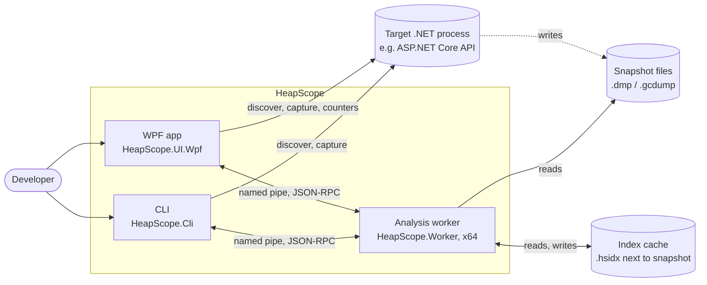
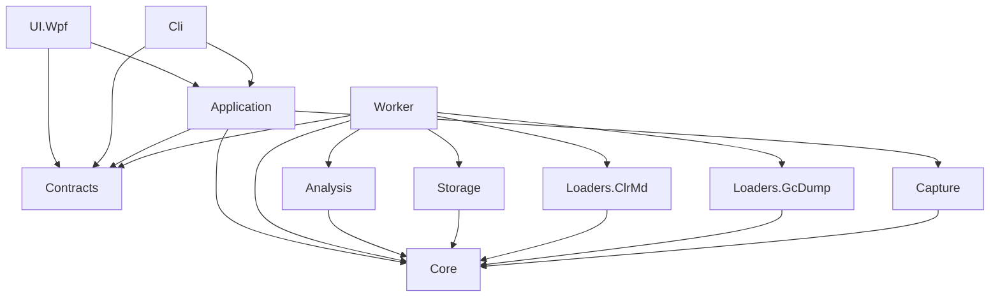

# HeapScope Architecture

Status: living document. Every sprint updates it to match what was actually built. Sections marked
"(planned)" describe designs whose code does not exist yet.

## 1. Purpose, scope, non-goals

**Purpose.** HeapScope is a Windows desktop memory profiler for modern .NET applications. It replaces the
core of JetBrains dotMemory for one primary workflow: a memory leak is suspected in an ASP.NET Core API, the
developer runs the API locally, replays representative traffic, takes snapshots over time, and uses HeapScope
to find what is growing and why it is retained.

**In scope (1.x and 2.x).**
- Discovering local .NET processes and capturing full dumps and gcdumps.
- Loading snapshots into a compact in-memory object graph, cached on disk for fast reopen.
- Type summaries, snapshot diffs, object inspection, simple inspections (duplicate strings, LOH, collections).
- Live counters and timed snapshots.
- Reverse references, retention paths, dominator tree, retained sizes, smart leak detectors.
- A CLI with the same capabilities as the UI, usable in automation.

**Non-goals (for now).**
- .NET Framework targets (backlog).
- Linux dumps, containers, remote machines (backlog).
- Native memory analysis beyond an overview (backlog).
- Uploading or sharing anything. HeapScope never sends data off the machine.
- Dumps larger than the Medium tier (see section 10). The Large tier is a backlog item.

## 2. Context



Capture (process discovery, dump writing, live counters) runs in the UI or CLI process through the
Application layer, because it is light and needs the caller's elevation. Everything that touches snapshot
contents runs in the worker.

Capture and sessions (sprint 1.1):
- `HeapScope.Capture`: `ProcessDiscovery` lists processes with a diagnostics port
  (`DiagnosticsClient.GetPublishedProcesses`) with name, working set, private bytes, start time, command line
  (`NtQueryInformationProcess`, limited query rights), runtime version and folder (the loaded `coreclr.dll`; single-file
  apps have none) and elevation. HeapScope's own processes (this pid, and executables under its installation folder,
  the worker included) are never listed or captured, matched by path, not name. A detail that cannot be read stays
  empty. `WindowsElevationProbe` reads token elevation for targets and for HeapScope itself (one rule): a token that
  cannot be opened for query (elevated, or another user's, such as services running as SYSTEM) or that reports
  elevation means only an elevated HeapScope can dump it.
- `DumpCapturer`: checks elevation and free space before asking the runtime for a full dump (`DumpType.Full`: module
  images are in the dump, so it never depends on finding the exact module files). The estimate is measured, not
  guessed: the target's committed readable pages from a `VirtualQueryEx` walk plus 16 MB of streams; when the walk is
  denied, private bytes x 1.1 + 384 MB for images and mapped files + 16 MB. Free space comes from
  `GetDiskFreeSpaceEx` on the folder itself (UNC paths and mount points), and 1 GB is always left free. The dump is
  written to `<name>.dmp.partial` and renamed only on success; an existing file is never overwritten. The runtime's
  createdump runs inside the target under the target's account and cannot be stopped safely, so a cancel waits until
  it has written the file and then deletes it (measured: a 200 ms cancel used to leave a complete 203 MB dump). The
  front ends keep the process alive for that: the CLI gives Ctrl+C up to an hour (System.CommandLine's
  `ProcessTerminationTimeout`; its 2 second default would exit with the dump on disk, and null would turn Ctrl+C off),
  and closing the UI cancels running jobs and waits for them. As a safety net for killed runs, half-written
  `*.dmp.partial` files older than 10 minutes and no longer held are removed when capture starts.
  Failures are specific: `ElevationRequiredException`, `InsufficientDiskSpaceException`, `TargetUnavailableException`,
  `DumpFileExistsException`, `DumpWriteFailedException` (runtime errors decoded: disk full, or the target's account
  cannot write the folder, with `--out` as the next step). Progress says the target is paused while its memory is
  written.
- Application: `SessionLibrary` keeps sessions under `%LOCALAPPDATA%\HeapScope\sessions` (`Sessions:Root`; a relative
  root is under `%LOCALAPPDATA%\HeapScope`), one folder per session (`yyyyMMdd-HHmmss[-name]`, claimed by creating its
  `session.json` exclusively, so parallel runs never share one) with `session.json` (format version 1: name, created,
  last opened, snapshots with id, file, label, kind, source, process, runtime version and folder, capture time, size;
  unknown members are kept on save, so an older build never drops what a newer one wrote). Every change is a
  read-modify-write under a cross-process lock file (`session.lock`) with a unique temporary file flushed to disk.
  The current session is created when the first capture passes its checks (a refused capture leaves no folder), or
  chosen with `Open` (Home's Open, CLI `--session`). `CaptureService` (behind `ICaptureService`) lists processes off
  the calling thread, runs captures as tracked jobs with collision-free file names into the session that was current
  when the capture started, copies the target's `mscordaccore.dll` to `dac\<file version>\` next to the dump (the
  loader searches it; the dump stays readable after the runtime on this machine is updated, for self-contained apps,
  and with several runtimes in one session), records the snapshot, and logs start, end and failures. Every capture states that the dump
  contains secrets and where it was written. Front ends see only Application types: `ICaptureService`, `ProcessEntry`
  (with `ProcessElevation` and `NeedsAdministrator`) and `CaptureFailedException` with a `CaptureFailure` reason (the
  architecture test caught the first draft using Capture types in UI and CLI).

## 3. Solution layout and layers

```
HeapScope.sln
build/                         Shared MSBuild targets (worker deployment next to UI and CLI)
src/
  HeapScope.Core               Domain model: snapshot abstraction, capability model, compact graph,
                               type table, root model, string table. No dependencies at all.
  HeapScope.Analysis           Algorithms over the compact graph.
  HeapScope.Storage            On-disk index cache format, versioning, read/write.
  HeapScope.Capture            Process discovery, dump/gcdump capture, live counters, timed snapshots.
  HeapScope.Loaders.ClrMd      Full dump -> compact graph.
  HeapScope.Loaders.GcDump     gcdump -> compact graph (created in sprint 1.8).
  HeapScope.Contracts          IPC DTOs and service interfaces shared by UI, worker and CLI.
  HeapScope.Worker             Out-of-process analysis host (x64).
  HeapScope.Application        Use cases: worker client and lifecycle, job tracking, sessions, capture
                               orchestration. UI-agnostic.
  HeapScope.UI.Wpf             WPF shell, views, view models.
  HeapScope.Cli                Command line front end.
tests/
  HeapScope.Core.Tests
  HeapScope.Analysis.Tests     Synthetic graphs with known answers.
  HeapScope.Storage.Tests
  HeapScope.Loaders.ClrMd.Tests DAC lookup (local only) with real PE files; the loader itself runs in Integration.Tests.
  HeapScope.Capture.Tests      Capture preflight (elevation, disk, partial files) with fakes; the real probe.
  HeapScope.Application.Tests  Job tracking, logging and worker client logic with fakes.
  HeapScope.Worker.Tests       Worker internals: result set store, progress throttling, error mapping.
  HeapScope.UI.Wpf.Tests       View model tests (no windows are shown).
  HeapScope.Architecture.Tests Enforces the dependency rules below.
  HeapScope.Integration.Tests  Real worker processes, fixtures, real dumps, known answers (ClrMD and the loader).
                               References Loaders.ClrMd and Storage to test them in process.
perf/
  HeapScope.Benchmarks         Console benchmarks against the budgets (synthetic 50M-object graph etc.).
fixtures/
  Leaks                        Shared leak implementations and semantic fixtures (namespace Fixtures.Leaks).
  LeakyApi                     ASP.NET Core API with switchable, scalable leaks.
  LeakyConsole                 Minimal console leaker for fast tests.
  LoadGen                      Load generator for LeakyApi; also captures dumps for the scripts.
  DenseHeap                    Grows a dense heap of real Roslyn compiler objects (about 3 references per object)
                               to a target size and waits to be dumped (sprint 1.2).
  KnownAnswers                 One JSON file per leak: what the analysis must find.
  scripts/                     Scripts producing Small and Medium sample dumps.
```

Changes from the kickoff layout, with reasons:
- `HeapScope.Application.Tests`, `HeapScope.UI.Wpf.Tests` and `HeapScope.Architecture.Tests` were added so
  that each concern has a fast, focused test project. The architecture test is its own project so that it
  can reference every source project without blurring any other test project's purpose.
- `perf/HeapScope.Benchmarks` holds measurements that are too slow or too memory hungry for the unit test run.
- `fixtures/KnownAnswers` makes the known answers a first-class, shared input of tests and detectors.
- `build/` holds the target that places the worker beside the UI and CLI executables (section 3.1).

Code map of the process layers (sprint 0.3): Contracts holds `IWorkerService`, `WorkerProtocol`, the DTOs,
`HeapScopeErrorCode`, the wire enums and `CapabilityDescriptions`. The worker has `Rpc/` (`WorkerRpcServer`,
`WorkerService`, `ResultSetStore`, `ThrottledProgress`). Application has `Workers/` (`WorkerHost`,
`IWorkerClient`, exceptions, log forwarding), `Jobs/JobTracker`, `Logging/FileLoggerProvider` and
`WorkerOperations`. UI.Wpf has `ViewModels/` (shell, pages, jobs), `Views/` and `Services/` (dispatcher
abstraction and watchdog). The CLI has `CliCommands` (`worker ping`, `worker info`, `synthetic`).

Code map additions in sprint 1.3 (types summary): Analysis has `TypeAggregation` (one parallel pass over the objects:
count, shallow bytes and bytes per heap kind for every type, computed once per snapshot and kept on the snapshot's
entry in the worker's `SnapshotStore`) and `TypeGroups` (rows by type, namespace or assembly). Type rows are one per type
table entry (method table), never merged by name: distinct types that share a name (one assembly in two load contexts,
same-named types in different modules) keep their own rows, named `Name [Module.dll]` and then `#n` in type index order (stable for a snapshot, not across snapshots), so a stale copy of
a plugin's types is visible on its own row. Namespace and assembly rows merge by design. Totals count every object in
the dump, unreachable ones included (the UI and CLI say so); a live and dead split comes with the retention analysis
(2.x). Contracts has `TypeSummaryRequest`,
`TypeSummaryResult` and `NameFilter`, the one filter rule set shared by the worker (matching) and the UI
(highlighting): an all lower-case filter is a case-insensitive substring; a filter with capitals matches as typed,
then as CamelHumps within one identifier (`SCE` finds `StaticCacheEntry`); `*` matches any run of characters. The
worker's `TypeSummarySource` groups, filters and sorts the cached aggregation per query, so a re-query costs
microseconds per type. The worker keeps per-snapshot derived data in `Snapshots/DerivedData` on the snapshot's entry,
dropped in one step when the snapshot closes; each slot is one shared computation with its own lease and a token tied to
the snapshot's lifetime, so a caller that cancels only stops waiting (reverse references and dominators get slots here
in 2.x). Application has `ResultSetHandle` (section 4.6). UI.Wpf has `TypeSummaryViewModel` with
`VirtualRowList` (data virtualization; `TypeRowLayout` maps cells by column name), `Controls/GridHelpers` (header
click sorting with the arrows driven by the view model's `SortState`, match highlighting, the heap kinds bar) and
`Themes/` with `Services/ThemeManager`. Only the latest query owns the view: `Show`, a re-query or closing the snapshot
cancel the running query and the pending filter, and the replaced row list stops its page requests.

Code map additions in sprint 1.4 (snapshot diff, ADR-018): Analysis has `TypeDiff` (rows matched by type name plus module
file name, summed per key, grouped like the summary). The worker has `TypeDiffSource` (sort by any column name, ties
by name) and `QueryTypeDiffAsync`, which leases both snapshots and reuses their cached aggregations. Application has
`SnapshotSession.QueryTypeDiffAsync` (both snapshots reopened after a restart, through `UseBothAsync`) and the
`SnapshotDiff` record. UI.Wpf has `GridQueryViewModel<TRow>` (the query lifecycle shared by the types and comparison
grids: debounce, latest query wins, release), the generic `VirtualRowList<TRow>`, and `CompareViewModel` behind the
Snapshots page's Compare tab (two pickers, the earlier capture as default baseline, swap). The CLI has `diff`.

### 3.1 Dependency rules



| Project | May reference (solution) | May reference (packages, besides Microsoft.Extensions.*) |
|---|---|---|
| Core | nothing | nothing |
| Analysis | Core | none |
| Storage | Core | System.IO.Hashing |
| Capture | Core | Microsoft.Diagnostics.NETCore.Client, TraceEvent |
| Loaders.ClrMd | Core | Microsoft.Diagnostics.Runtime |
| Loaders.GcDump | Core | Microsoft.Diagnostics.Tracing.TraceEvent |
| Contracts | nothing (ADR-016) | StreamJsonRpc attributes only (no transport code) |
| Worker | Core, Contracts, Analysis, Storage, Loaders.* | StreamJsonRpc |
| Application | Core, Contracts, Capture | StreamJsonRpc |
| Cli | Application, Contracts | System.CommandLine |
| UI.Wpf | Application, Contracts | CommunityToolkit.Mvvm |

Rules:
- Core references nothing, not even Microsoft.Extensions.*. It is pure domain types and data structures.
- UI.Wpf never references Loaders, Analysis, Storage, Capture, Worker or any diagnostics library directly
  (diagnostics libraries do load into the UI process, through Capture via Application).
- UI.Wpf and Cli use no Core types. Everything they show comes through Application or Contracts, whose wire
  vocabulary (snapshot kind, capabilities, capability descriptions) is defined in Contracts (ADR-016).
- A build-order-only reference (`ReferenceOutputAssembly="false"`) to the Worker project is allowed from
  UI.Wpf, Cli and Integration.Tests; it ensures the worker is built and deployed next to them, without making
  any worker type visible.
- `HeapScope.Architecture.Tests` checks every `src/**/*.csproj` against the table using the evaluated restore
  graph (`obj/project.assets.json`, so references added by imported props and targets count) plus build-order-only
  references from the project and the shared targets it imports. It also checks every compiled assembly reference
  (solution assemblies and the governed package assemblies) against the same table.

## 4. Process model and IPC

### 4.1 Processes
- **UI process** (WPF, x64): shell, view models, Application services, capture.
- **CLI process** (x64): same Application services, console output.
- **Worker process** (x64, `HeapScope.Worker.exe`): one per UI or CLI instance. Holds every loaded snapshot
  of the session (a diff needs both snapshots in one address space). Uses Server GC, non-concurrent
  (section 9), and runs at below-normal process priority so its ordinary threads yield to the UI and the profiled
  application. This does not cover Server GC threads, which the runtime creates at highest thread priority (they
  end up at normal priority in a below-normal process); taming GC threads (job object CPU rate, EcoQoS, heap
  affinity) is a backlog item to be decided with a trace.

### 4.2 Lifecycle
1. Application's `WorkerHost` starts the worker with `--pipe <name> --parent-pid <pid>`. The pipe name is
   `HeapScope.Worker.<guid>`; the pipe is created with `PipeOptions.CurrentUserOnly`.
2. The worker creates the pipe server and waits up to 30 s for the client; the client connects with a
   timeout and calls `GetInfoAsync` as a handshake, which also checks the protocol version.
3. The worker exits when the pipe disconnects or when the parent process exits (it watches the parent's
   process handle), so a crashed UI never leaves orphaned workers holding gigabytes.
4. On orderly shutdown (the host stopping, since `WorkerHost` is a hosted service) the client calls
   `ShutdownAsync`, then waits up to 5 s before killing the process.
5. For debugging, a worker can be started by hand with `--pipe <name>` and a client attached to it with the
   `Worker:AttachPipeName` option (CLI: `--pipe <name>`); an attached worker is disconnected, not shut down.
6. Test hooks (`CrashForTestingAsync`, `HangForTestingAsync`) exist only when the worker is started with
   `--enable-test-hooks` (`Worker:EnableTestHooks`); otherwise they fail with `TestHooksDisabled`.

### 4.3 Crash handling
- The client watches both `Process.Exited` and `JsonRpc.Disconnected`. Either one moves the worker to
  `Crashed`, faults every in-flight call with `WorkerCrashedException` (exit code included), and raises a
  `WorkerStateChanged` event the UI shows as a banner.
- The next request restarts the worker transparently. Every worker has an `InstanceId` (in `WorkerInfo`) and
  `IWorkerClient.Generation` increases with each connected worker, so callers can tell that worker-owned ids
  (result sets, snapshots) belong to a dead worker. Application's `SnapshotSession` owns a stable `SnapshotHandle` per
  opened file (keyed by the path that was opened, never by the path recorded in the cache), maps it to the worker's
  snapshot id for one worker generation and reopens it lazily (`UseAsync`: before a call when the generation changed,
  and once more when the worker answers `SnapshotNotLoaded`); a stale id fails with `SnapshotNotLoaded` (sprint 1.2).
  A reopen asks for the index cache only (`OpenSnapshotRequest.RequireCache`) and keeps the mode the user chose: it
  is cheap and silent, never an unrequested dump load, and a changed or uncached file fails with `SnapshotChanged` so
  the user opens it again. A closed handle is never reopened; a reopen that finishes after a close closes its worker
  snapshot again.
- Error contract of `IWorkerClient`: calls fail only with `WorkerStartException`, `WorkerCrashedException`,
  `WorkerOperationException` or `OperationCanceledException`. A stopped or disposed host refuses to start a
  worker. The handshake is bounded by the connect timeout. In the worker, `WorkerErrors.GuardAsync` maps domain
  exceptions to codes in one place (`CapabilityNotSupported`, `InsufficientMemory`, `InvalidArgument`,
  `RuntimeComponentMissing`, `SnapshotFormat`, `SnapshotUnavailable` for I/O and access failures with a next step,
  `SnapshotChanged`) and logs every failure with its stack trace in the worker (warnings for coded errors, errors for
  unexpected ones), so the client's message stays plain and the log keeps the details. The UI
  adds last-chance handlers (dispatcher, app domain, unobserved tasks) that log and show a plain message; the
  CLI command boundary prints a plain message and logs the stack trace.
- Worker stderr is captured by the client and forwarded into the client's log (category `Worker`), so the
  last log lines before a crash are never lost. The worker writes single-line records
  (`HH:mm:ss.fff level: Category[id] message`); the forwarder keeps the level and logs lines without one (for
  example a stack trace) as warnings.
- Transport failures (`ConnectionLostException`, broken pipe, disposed connection) become
  `WorkerCrashedException`; worker errors become `WorkerOperationException` with the `HeapScopeErrorCode`;
  startup failures (missing executable, no pipe within 30 s, exit during startup) become `WorkerStartException`.

### 4.4 Transport and contracts
- StreamJsonRpc over the named pipe, with `HeaderDelimitedMessageHandler` and the default JSON formatter.
  The default formatter is used because it supports `IProgress<T>` and `CancellationToken` marshaling with no
  extra configuration. The formatter can be swapped later without changing service interfaces.
- `HeapScope.Contracts` defines `IWorkerService` (methods called by clients) and the DTOs. DTOs are records of
  primitive types, strings, arrays and Contracts enums; Contracts references no solution project, so no Core type
  can cross the pipe (ADR-016). The worker maps Core values (for example `SnapshotCapabilities`) to their
  Contracts counterparts (`SnapshotFeatures`); a test keeps the numeric values of mirrored enums identical.
- `WorkerProtocol.Version` is a constant in Contracts; a mismatch at handshake is a hard error with a clear
  message. Version 2 (sprint 1.2) added `ProbeSnapshotAsync` (file size, index cache state from its header and
  fingerprint, open or not), `OpenSnapshotAsync`, `CloseSnapshotAsync`, `GetTypeSummaryAsync`, the snapshot DTOs
  (`OpenSnapshotRequest` with `RequireCache`, `SnapshotDescriptor`, `SnapshotMemoryMode`, `SnapshotProbe`,
  `SnapshotCacheState`) and the codes `RuntimeComponentMissing`, `SnapshotUnavailable` and `SnapshotChanged`.
  Version 3 (sprint 1.3) added `QueryTypeSummaryAsync` (`TypeSummaryRequest`: group by, filter, sort and
  direction, validated; `TypeSummaryResult`: a result set, totals per heap kind (Unknown listed only when present),
  whether generations exist, and the rows before the filter), the wire enums `TypeGrouping`, `TypeSummarySort` and
  `HeapKindDto` (mirrors `HeapKind`), the column kinds `Percent`, `Address` and `SignedInteger`, and the key flag on
  `ResultColumn`. `NameFilter` lives in Contracts because it defines what the `Filter` field means to worker and UI
  alike; changing it changes the protocol's meaning.
  Version 4 (sprint 1.4) added `QueryTypeDiffAsync` (`TypeDiffRequest` with a sort column named by
  `TypeDiffColumns`, validated by the worker; `TypeDiffResult` with both sides' totals, new and gone row counts, the
  matching rows' baseline bytes and delta, and `ExactCounts`).
- `HeapScopeErrorCode` values start at 1000: JSON-RPC and StreamJsonRpc reserve -32768 to -32000 (an early
  version used that range and StreamJsonRpc reinterpreted -32003 as a serialization failure).

### 4.5 Progress and cancellation
- Every long-running worker method takes `IProgress<JobProgress>` and `CancellationToken` as its last two
  parameters. StreamJsonRpc turns cancellation into a `$/cancelRequest` message and progress into
  notifications.
- `JobProgress` carries `Phase`, `Completed`, `Total` (nullable when unknown) and `Message`. The worker
  throttles reports to at most 10 per second per call.
- Worker loops check the token at least every 64K items and pass it into every nested call.
- Application's `JobTracker` gives each job an id, keeps its status (Running, Completed, Failed, Canceled), latest
  progress and a `Cancel()` handle, and raises `JobAdded` and `JobChanged` on any thread. The UI marshals them
  through `IUiDispatcher`; the CLI prints them to stderr. `WorkerOperations` is the shared use-case facade for UI
  and CLI.

### 4.6 Large result sets
Large results are never sent whole. A query creates a result set in the worker and returns a
`ResultSetInfo { Id, TotalCount, Columns }`. Clients then call `GetRowsAsync(id, offset, count)` with
`count` capped at 10,000, and `ReleaseResultSetAsync(id)` when done. Sorting and filtering happen in the
worker, producing a new result set. The WPF grids use data virtualization and fetch pages on scroll. Result
sets are typed sources (`IResultSource`: compact arrays such as indices, counts and sizes) formatted to strings only
for the requested page, never stored as one string per cell. The store evicts least recently used sets beyond 32
sets or an estimated 256 MB, whichever comes first (the newest set is always kept). A set can carry an owner, for
example a snapshot lease, disposed on release or eviction. Producers must stay compact (indices, counts, sizes),
because the newest set is kept even when it alone exceeds the byte budget; a source that reads graph columns takes
its own snapshot lease for each page it formats. Cells cross the pipe as invariant-culture strings with
typed column descriptors (`ResultColumn`: Text, Integer, Bytes, Percent, Address, SignedInteger; one column may be
flagged as the row key), which keeps paging generic. Unknown, released or evicted sets fail with `ResultSetNotFound`.
Application's `ResultSetHandle` keeps the query that produced a set and re-runs it once when paging fails that way
(eviction, or a worker restart through the snapshot session's reopen), so front ends page without knowing about
eviction. A released handle is finished: paging throws and never re-runs the query, and a re-query in progress at the
release has its new set released too, so no set is orphaned. The grids (types and compare) fetch pages of 200 rows as they scroll; each row object is filled with one property change
notification, which keeps a page under the dispatcher budget.

Paging cost with the default JSON formatter (sprint 1.3, Release): a 10,000-row page (the maximum, used by the CLI's
`--all`) arrives in 70 to 80 ms (median) with 7.6 MB allocated in the client; deserializing a page of ten-column type
summary rows alone takes 58 ms and 8.2 MB; the grid's 200-row page takes 1.5 ms and 163 KB. The threshold for
changing the formatter was 50 MB or 200 ms per 10,000-row page, so it stays (tests
`A_full_page_costs_little_to_receive_in_the_client_process` and `ResultPageJsonCostTests`).

## 5. Snapshot abstraction and capability model

### 5.1 Abstraction (HeapScope.Core)
```csharp
public interface ISnapshot : IDisposable
{
    SnapshotInfo Info { get; }                 // kind, source path, process name/id, runtime version,
                                               // pointer size, capture time
    SnapshotCapabilities Capabilities { get; } // what this snapshot can answer
    HeapGraph Graph { get; }                   // compact object graph, types, roots, strings
    bool TryGetService<TService>(out TService? service) where TService : class; // optional services
}
```
- Loaders produce a `HeapGraph` through `HeapGraphBuilder` and wrap it in an `ISnapshot`.
- Capabilities that need the original file (field values, string contents) are exposed through optional
  services obtained with `snapshot.TryGetService<IFieldValueReader>(out var reader)`. A gcdump snapshot
  simply does not provide them.
- `GraphSnapshot` (an `ISnapshot` with no services) strips `FieldValues`, `StringContents` and `ThreadStacks`
  from whatever capabilities it is given, so it can never claim what it cannot answer. In sprint 1.2 every snapshot,
  first load or index cache, is a `GraphSnapshot`, so full dumps report those three as missing; a full-dump
  `ISnapshot` that reopens the dump for those services is planned for 1.5. `CapabilityDescriptions.ExplainMissing`
  takes the snapshot kind, so a full dump says "not available in this version yet" instead of "capture a full dump".
- A full dump whose heap could not be read completely (unreadable objects, or a segment walk that covered noticeably
  less than the segment, for example a truncated file) loses `CompleteGraph` and `ExactCounts` and carries a note.
  A minidump without heap memory (MINIDUMP_TYPE without full or private read-write memory) is refused at open.

### 5.2 Capabilities
`SnapshotCapabilities` is a `[Flags]` enum. Feature matrix:

| Capability | Meaning | Full dump | gcdump |
|---|---|---|---|
| `ObjectGraph` | Objects, types, references, roots | yes | yes |
| `CompleteGraph` | Every object is present (not sampled) | yes | only when the gcdump was not sampled |
| `ExactCounts` | Counts and sizes are exact, not scaled estimates | yes | only when not sampled |
| `ObjectAddresses` | Real object addresses | yes | yes (as recorded) |
| `Generations` | Gen0/1/2, LOH, POH, frozen per object | yes | no |
| `FieldValues` | Read primitive and nested struct field values | yes | no |
| `StringContents` | Read string text (needed for duplicate strings) | yes | no |
| `RootDetails` | Static field names, thread ids for stack roots | yes | partial (root kind only) |
| `ThreadStacks` | Managed thread stacks | yes | no |

Rules:
- The UI disables any feature whose capability is missing and shows the reason from the Contracts copy of
  `CapabilityDescriptions` (for example "Field values are not stored in a gcdump. Capture a full dump to
  inspect fields."). Features are never faked or approximated silently.
- Analysis entry points declare their required capabilities; calling one without them throws
  `CapabilityNotSupportedException` and the CLI reports it with a non-zero exit code.
- Diffs across snapshot kinds are allowed on type summaries; the result carries the intersection of both
  snapshots' capabilities.

## 6. Compact graph format (ADR-005)

The object graph is a struct-of-arrays, CSR-style structure indexed by `ObjectIndex` (a 32-bit integer,
0..N-1). There is never one managed object per heap object.

### 6.1 Data structures

Every array below is a `Column<T>` (a read-only, span-producing column of unmanaged values), not a raw
`T[]`. A column is backed either by a managed array or by a read-only memory-mapped view of an index cache
section (ADR-015). Algorithms only ever see `ReadOnlySpan<T>`, so they do not care which backing is used.

| Array | Element | Bytes per object | Notes |
|---|---|---|---|
| `Addresses` | `ulong` | 8 | Sorted ascending, so address -> index is a binary search. |
| `TypeIndices` | `int` | 4 | Index into the type table. |
| `Sizes` | `uint` | 4 | Shallow size. `uint.MaxValue` means "look up in `LargeSizes`" (objects of 4 GiB or more). |
| `HeapKinds` | `byte` | 1 | Gen0, Gen1, Gen2, LOH, POH, Frozen, Unknown. |
| `Flags` | `byte` | 1 | `ObjectFlags`: `HasFinalizer` (registered for finalization and not suppressed); other bits reserved. |
| `EdgeStarts` | `int` | 4 (+4 once) | CSR row offsets: outgoing references of object `i` are `Edges[EdgeStarts[i]..EdgeStarts[i+1]]`. |
| `Edges` | `int` | 4 per reference | Target `ObjectIndex`. References to non-objects are dropped and counted in `DroppedReferenceCount`. |

Supporting tables:
- **Type table**: struct-of-arrays per type: name (string table id), method table address, base size,
  component size, module (string table id), `TypeKind` flags (Array, String, ValueTypeBox, Delegate,
  Exception). Types are interned: one entry per method table.
- **Root table**: array of `GcRoot { int ObjectIndex; RootKind Kind; RootFlags Flags; int DetailId }`,
  sorted by object index. `RootKind`: StaticField, ThreadStack, StrongHandle, PinnedHandle, AsyncPinnedHandle,
  RefCountedHandle, FinalizerQueue, WeakHandle, Other. `DetailId` points into the string table (e.g.
  `LeakyApi.Leaks.StaticCacheLeak.s_cache`, `thread 0x1a2c`). `RootFlags`: `Retaining` (the root keeps its
  object alive), `Pinned`, `Interior`.
- **String table**: interned strings for names and details. Never contains object field values.

#### Root and reference semantics (CLR rules every loader and algorithm follows)
- **Retaining roots.** Only roots with `RootFlags.Retaining` keep objects alive in retention paths, dominators
  and retained sizes. Weak handles are never retaining. Ref-counted handles are retaining only while their count
  is above zero (ClrMD `IsStrong`). Roots shown for information only keep the flag clear.
- **Dependent handles are edges, not roots.** A dependent handle (used by `ConditionalWeakTable`) keeps its
  secondary alive only while its primary is reachable. Loaders add an ordinary edge primary -> secondary in the
  CSR during the reference pass and never record the secondary as a root. Exactly one mechanism is used: either
  ClrMD's reference enumeration including dependent handles, or explicit edges from the handle table, not both.
- **Static fields.** On modern .NET the GC sees no static field roots: reference statics live in runtime
  allocated `object[]` storage. Measured on .NET 10 with the sprint 0.4 fixtures, that storage is reached through a
  **strong handle** (`StrongHandle -> System.Object[] -> static value`), not a pinned handle. The full dump loader
  builds `StaticField` roots itself by enumerating static fields per module and app domain (ClrMD
  `ClrStaticField`) and records the field name as the root detail. The strong handle roots of the static storage
  arrays stay retaining (marking them non-retaining would make the storage arrays look unreachable); retention
  paths prefer a `StaticField` root over the storage handle, so they say `s_cache` and not
  `StrongHandle -> Object[]`. Statics of collectible types (unloadable `AssemblyLoadContext`) live as long as their
  loader allocator, so their `StaticField` roots are recorded without `Retaining`; the runtime's own references keep
  them alive while the context is alive (a collectible fixture is a backlog item).
- **Frozen objects.** Objects in frozen (NonGC) segments, such as string literals and `RuntimeType` objects, are never
  collected. They have no root; reachability, dominator and garbage analyses (2.x) treat every `HeapKind.Frozen`
  object as alive (a virtual root), so a literal referenced by nothing live is not reported as garbage.
- **Finalizer queue.** Only the f-reachable queue (objects ready for finalization) produces `FinalizerQueue`
  roots. Objects merely registered for finalization are not roots; that fact is kept in the object `Flags`
  (`HasFinalizer`). `GC.SuppressFinalize` does not remove an object from the finalization queue (measured in 0.4:
  every finalizable instance stays registered); it sets bit 0x40000000 in the object header word. `HasFinalizer`
  is therefore "registered and that bit clear", read from the header by the loader.
- **Interior pointers.** Stack roots may point inside an object (byrefs). Roots flagged `Interior` are resolved
  with a floor search: the object with the largest address not above the pointer, accepted only when the pointer
  is below that object's address plus size. All other roots and references use an exact match. The loader passes
  the raw pointer read from the stack slot, not ClrMD's resolved object, so this bounds check decides and a byref
  into a free gap, a stack local or native memory is dropped.
- **Stack roots of debuggable code.** In frames compiled as debuggable code (Debug builds), ClrMD reports no stack
  roots for some frames (measured in 0.4: the locals of parked fixture threads were missing in Debug and present,
  including an interior pointer, in Release). Objects held only by such frames can look unreachable. The UI states
  this when a snapshot's process ran Debug assemblies (sprint 1.2), and the fixtures are always optimized.
- **Unresolvable targets.** References and roots that do not resolve to an object (stale handles, corrupt slots,
  pointers outside the heap) are dropped and counted: `DroppedReferenceCount` and `DroppedRootCount` are part of
  the graph and shown as a data quality note.
- **Embedded value types.** References inside value types embedded in objects and arrays (struct fields, arrays
  of structs such as `KeyValuePair<,>[]`) are edges of the containing object. Loaders use GCDesc based reference
  enumeration, which covers them.

### 6.2 Memory budget per object
- Fixed: 8 + 4 + 4 + 1 + 1 + 4 = **22 bytes per object** plus **4 bytes per reference**.
- Typical heaps average 2 to 4 references per object, so about **30 to 38 bytes per object**.
- 50M objects with 150M references: 1.1 GB + 0.6 GB = **about 1.7 GB**, well under the worker budget for a
  ~4 GB managed heap. On a 16 GB laptop the absolute first-load budget in section 10 (< 4 GB) is the one that binds.
- Measured in sprint 0.2 (`graph-build`, 50M objects, 150M references, Release, 24 logical cores, 32 GB RAM):
  1,621 MB of columns, **34.0 bytes per object**; managed heap growth identical (no hidden per-object overhead).
  Peak working set 2.5 to 2.7 GB for the build alone (varies by run). Build time: 1.9 s with address-ordered
  input and references by index; 3.8 s with unsorted input (in-place permutation, no LOH temporaries); **46 s
  with unsorted input and references resolved by address**, the loader path, with uniformly random targets as
  the worst case for cache locality (217 s with a plain binary search, before the address index below). The
  unsorted, by-address number is the binding one for first-load budgets (section 10); real heaps have much more
  locality.

### 6.3 Building
`HeapGraphBuilder` is two-phase so peak memory stays near the final size:
1. Objects are appended (address, type, size, heap kind) into chunked buffers (1M-element chunks, so growth
   never copies a huge array), then sorted by address once and frozen.
2. References are appended per source object in strictly increasing index order as address spans, walking
   `FrozenAddresses`; each target address is resolved through an `AddressIndex`, a bucket table over the address
   range (about 8 objects per bucket, at most 2^26 buckets, about 25 MB for 50M objects) followed by a binary
   search within the bucket. Dependent-handle edges enter only through `AddDependentHandle`, never through
   `AddReferences`. Any exception thrown while state changes faults the builder, and a builder that never
   reaches `Build` is disposed to release allocator memory. The builder throws if a source index is not greater than the previous
   one, because an out-of-order row would silently corrupt `EdgeStarts`. Chunked edge buffers are copied once
   into the final `Edges` array.
Full dump loaders enumerate the heap twice (objects, then references) for exactly this reason. Because heap
enumeration order is not address order with regions (.NET 7+), the reference pass walks the sorted `Addresses`
column and reads each object by address (`heap.GetObject(address)`), not `EnumerateObjects`.

Final columns are obtained from an `IColumnAllocator` given to the builder. Sprint 0.2 provides the managed
array allocator; a file-backed allocator that writes columns straight into index cache sections can be added
later (first load on memory constrained machines, Large tier) without changing the builder.

Full dump loader (sprint 1.2, `HeapScope.Loaders.ClrMd`: `ClrMdDumpLoader`, `DacLocator`, `LocalOnlyFileLocator`):
- ClrMD reads the dump through its lock-free memory-mapped reader (`DataTargetOptions.UseLockFreeMemoryMapReader`):
  dump pages are file-backed, not private memory, and the walk is about twice as fast as the default cached reader
  (Medium: 15.8 s and 2.4 GB peak, against 36.6 s and 4.2 GB). ClrMD's data cache stays capped at 512 MB.
- Object pass per segment (`ClrSegment.EnumerateObjects`): the heap kind comes from the segment kind, or from
  `GetGeneration` on ephemeral and region segments; types are interned by method table on first sight;
  `HasFinalizer` is `EnumerateFinalizableObjects` minus `ClrType.IsFinalizeSuppressed`.
- After `FreezeObjects` the loader runs one aggressive, compacting collection: the phase-one chunks (about 20 bytes
  per object) are garbage then, and otherwise stay committed through the reference pass, which is where a load peaks.
- Dependent handles become edges before the reference pass; weak handles become non-retaining `WeakHandle` roots.
- Reference pass in address order (`GetObject` per frozen address, `EnumerateReferenceAddresses` without dependent
  handles), into a pooled buffer.
- Roots: `ClrHeap.EnumerateRoots` (strong, pinned, async pinned and live ref-counted handles, stacks with the thread
  as detail, the f-reachable queue). On .NET 9 and 10 it also reports the static storage bucket as `StaticVar` and
  thread statics as `ThreadStaticVar`: the bucket maps to `StrongHandle` with the detail "static storage" and is kept
  once; thread statics map to `Other`. `StaticField` roots come from `ClrModule.EnumerateTypesWithStaticFields` per
  module and app domain (initialized reference statics, detail `Namespace.Type.field`). Statics of generic
  instantiations missing from a module's type map are not reported; their values stay reachable through the storage
  handle.
- Modules compiled as debuggable code are recorded (cache metadata `DebuggableModules`) and shown as a note.
- The snapshot's capture time is the minidump header's time stamp.

Code map (sprint 0.2, namespace `HeapScope.Core.Graph`): `HeapGraphBuilder` (`AddObject`, `FreezeObjects`,
`AddDependentHandle`, `AddReferences` / `AddReferenceIndices`, `AddRoot` / `AddRootIndex`, `Build`),
`HeapGraph` (columns, `GetSize`, `GetReferences`, `TryGetIndex`, `TryGetIndexContaining`, `TotalSize`,
`ColumnBytes`, `FromColumns` for the index cache), `TypeTable`, `RootTable`, `StringTable`, `Column<T>`,
`IColumnAllocator`. `HeapScope.Core.Synthetic` holds `SyntheticGraphBuilder` (hand-made graphs) and
`SyntheticGraphs` (chain, cycle, tree, diamond, seeded random up to 50M objects). `GraphSnapshot` is the
`ISnapshot` for graphs without optional services.

### 6.4 Extending without redesign (2.x)
- **Reverse references**: a second CSR (`InEdgeStarts`, `InEdges`) built by counting in-degrees and filling,
  +4 bytes per object and +4 per reference. Stored as an optional index cache section.
- **Dominators**: `int[] ImmediateDominator` and `ulong[] RetainedSize`, +12 bytes per object, computed
  with an iterative (non-recursive) Lengauer-Tarjan or Cooper-Harvey-Kennedy over the CSR arrays and a
  virtual super-root connected to all roots.
- **Field names on paths**: not stored. Retention paths resolve the referencing field on demand from the
  dump (full dumps only, capability `FieldValues`).
- Worst case with all 2.x indices for 50M objects: about 62 bytes per object, about 3.1 GB.

### 6.5 Memory modes (ADR-015)
- **In-memory**: columns are managed arrays. Fastest. Used while the projected worker footprint fits in the
  memory budget.
- **Mapped**: columns are read-only memory-mapped views of the index cache. The OS pages data in on demand and
  can drop it under pressure, so the worker's committed memory stays small. Used when the projected footprint
  does not fit, or when forced by configuration.
- The memory budget (`MemoryBudget.Current`) defaults to 50% of total physical memory, capped by the memory available
  at that moment (read live from the operating system, with a GC hard limit as an extra cap), at open
  time. A request can force a mode; a configurable fraction is a backlog item. The synthetic job checks against the
  same budget. On a 16 GB laptop running the target API and an IDE, a Medium snapshot will usually open mapped; on
  32 GB it opens in memory.
- First load builds in memory, then writes the cache. If the projected build footprint exceeds the budget,
  the Application layer warns before starting (ADR-004). The projection counts the graph columns, the builder's
  transient buffers and ClrMD's own caches; the ClrMD loader caps ClrMD's data cache explicitly.
- When a snapshot switches to mapped mode after its first load, the worker drops the built arrays and runs one
  blocking, compacting gen2 collection with `GCLargeObjectHeapCompactionMode.CompactOnce`, so the memory really
  returns to the OS. Measured in 1.2 (`load-dump`, Medium): 0.5 s, private bytes down to 59 MB after the drop and
  66 MB with the graph mapped.
- The worker's `SnapshotStore` applies this policy: a valid index cache is opened in the mode the budget chooses;
  otherwise the dump is loaded, the cache written, and the graph either kept in memory or switched to mapped. After a
  load, the mode is chosen once the load's garbage is collected, counting the graph's own memory as available (it
  would be freed by going mapped), so a first load and a later reopen decide the same way. The clean-up collection
  runs only after dump loads (and failed or canceled ones), never after a cache hit, because it pauses queries on
  other snapshots. When the cache cannot be written the graph stays in memory, with a note. A request can force
  either mode.
- The Application layer may start the worker with `DOTNET_GCHeapHardLimit` derived from the budget, so an
  oversize load fails with a clear out-of-memory error instead of paging the laptop to a standstill.

#### Lifetime of mapped data
A span over an unmapped view is an access violation that kills the worker, so mapped data has an explicit
lifetime rule (implemented in sprint 0.5: `LeaseTracker`, `ISnapshot.AcquireLease`). A mapped snapshot owns its views through the graph's owner. Every query takes a lease
(`using var lease = snapshot.AcquireLease()`), works on spans only inside that scope and never stores a span or a
pointer beyond it. Disposing a snapshot (explicitly or by LRU) returns at once; the mapping is released when the last
lease is returned. `Column<T>` wraps `ReadOnlyMemory<T>`; a native backing is a `MemoryManager<T>` over the mapped
view, owned by the snapshot, so the column's shape does not change between 0.2 and 0.5.

### 6.6 Limits
- At most 2^31 - 1 objects and 2^31 - 1 references per snapshot (32-bit indices; a span holds at most 2^31 - 1
  elements). The Medium tier needs at most ~50M objects and a few hundred million references. The Large tier
  (backlog) would move to 64-bit edge offsets and chunked, disk-backed building.

## 7. Index cache (ADR-006)

Implemented in sprint 0.5 (`HeapScope.Storage`: `IndexCacheWriter`, `IndexCacheReader`, `IndexCacheLocator`,
`SnapshotFingerprint`, `MemoryModeSelector`), hardened by its review.

- Location (`IndexCacheLocator`): `<snapshot path>.hsidx` next to the snapshot when that folder accepts a probe
  file; otherwise `%LOCALAPPDATA%\HeapScope\cache\<sha256 of the full path>.hsidx` (root configurable).
- Layout (format version 1, little-endian):
  - Header region (4096 bytes): a 64 byte fixed header (magic `HSIDX`, format version, header region length,
    section count, snapshot fingerprint, XxHash3 checksum over header and directory), then the section
    directory (40 bytes per section: id, element size, offset, byte length, element count, XxHash3 checksum).
  - Sections, each aligned to 4096 bytes (ready for mapping): Addresses, TypeIndices, Sizes, HeapKinds,
    ObjectFlags, EdgeStarts, Edges, LargeSizes, Roots, the six type table columns, Strings (count, offsets,
    UTF-8 bytes) and Metadata (UTF-8 JSON: `SnapshotInfo`, capabilities, writer version, dropped counts).
  - Section payloads use exactly the in-memory element layout (unmanaged structs with explicit padding fields,
    no compression), so mapped mode (ADR-015) hands a view straight to a `Column<T>`. Writing the same graph
    twice produces identical bytes.
- Identity: the header checksum covers every section checksum, so it identifies the cache's content
  (`IndexCacheOpenResult.Identity`).
- Optional indices (reverse references in 2.1, dominators in 2.3) go into **sidecar files** next to the base
  cache (`<cache>.rev.hsidx`, `<cache>.dom.hsidx`), in the same header and directory format, each recording the
  identity of the base cache it extends. The base file is never rewritten to add them: a mapped base cache is open
  and cannot be replaced, and rewriting would break the header-last crash safety. A sidecar whose base identity does
  not match is ignored and rebuilt; a missing sidecar means "not built yet". (Decided in the 0.5 review; the
  public API for opened caches and optional sections, and an incremental section writer, arrive with 2.1.)
- Fingerprint (`SnapshotFingerprint`): snapshot length, last write time UTC and an XxHash3 of the first and last
  MiB; any difference invalidates the cache.
- Writing: sections go to a temporary file in the target folder, the header is written last, the file is flushed
  to disk and renamed over the target. A process that dies at any point leaves either the previous cache or a
  temporary file without a valid magic; a canceled or failed write deletes its temporary file, and temporary
  files of this cache older than 10 minutes (left by a crashed writer) are removed before writing. Replacing a
  cache that is open (for example mapped) fails with `IndexCacheInUseException` and keeps the previous cache.
- Opening (`IndexCacheReader.Open(path, expected fingerprint, mode)`): one file handle, shared for reading only, is
  used from the first header byte to the last section byte and becomes the mapping in mapped mode, so the file that
  was validated is the file that is used and nobody can replace it meanwhile. Magic, version, header checksum,
  every directory entry (known ids only, no repeats, element size, non-negative counts, page-aligned offsets past
  the header, overflow-safe bounds against the file length), fingerprint and every section checksum are verified
  before a graph is returned. Invalid caches return a reason (`Missing`, `Truncated`, `BadMagic`,
  `VersionMismatch`, `HeaderCorrupted`, `Malformed`, `FingerprintMismatch`, `ChecksumMismatch`, `IoError`) and a
  plain-language detail, never an exception and never a read outside the file; they are rebuilt, never patched.
- Modes: in memory, every section is read into exact-size arrays and verified in the same pass (nothing more is
  allocated after a failure). Mapped, the sections are first verified with a sequential read (pooled 4 MB buffer,
  several times faster than hashing through the mapping and without growing the working set), then the
  per-object columns, edges and roots become views of a read-only mapping (`MappedMemoryManager<T>` behind
  `Column<T>`); the small tables (types, large sizes, strings) are copied. A mapped file stays open, and cannot be
  replaced, until the graph is disposed.
- Lifetime: `GraphSnapshot.Dispose` never blocks or throws. It refuses new leases and the last released lease
  disposes the graph (and unmaps the file), so queries and result sets that page over a snapshot can hold leases
  safely (6.5).
- Versioning: any layout change of the base file bumps the format version. Optional JSON fields in the metadata
  section do not: 1.2 added `DebuggableModules` and `UnreadableObjects`, which read as null and 0 from older caches.
- Measured (`index-cache`, synthetic 50M objects with 150M references, 1.6 GB file, reopened in a fresh process,
  mapped first, warm page cache): write 3.2 s; reopen mapped 0.6 s (+9 MB private, +202 MB working set),
  scanning all edges of the mapped graph 0.2 s; reopen in memory 0.6 s (+1.6 GB private). Cold page cache (standby
  list purged with administrator rights, run by the product owner on 2026-10-23): reopen mapped 1.0 s (+9 MB
  private), in memory 0.8 s. Antivirus scanning of a freshly written cache is not measured separately.

## 8. Threading model
- **UI**: view models are touched only on the dispatcher thread. All Application calls are `async` and
  awaited from view models; `.Result`, `.Wait()` and `Dispatcher.Invoke` for long work are forbidden.
  Application events (job progress, worker state) arrive on any thread and are marshaled with `IUiDispatcher`
  (`WpfUiDispatcher` in the app, `ImmediateUiDispatcher` in tests). No dispatcher work item may block more than
  100 ms.
- **Responsiveness measurement**: `DispatcherWatchdog` posts an input-priority probe every 25 ms and logs any
  delay over 100 ms (with UI-process GC pause time), and times each dispatcher operation (nested operations
  included) to name the priority of any single operation over budget. Since sprint 1.3 each lag warning also gives the
  UI thread's own CPU time in the lag and what ran meanwhile (operations and time per priority, plus the time outside
  any dispatcher operation): a lag with little UI thread CPU means the thread was waiting or not scheduled, not working. `HeapScope.exe --smoke-synthetic <n>` runs
  a warm-up job, then an n-object synthetic job, and exits 0 when no single dispatcher operation exceeded 100 ms
  and the probe lag stayed under the smoke gate
  (2x budget), 3 when it did not, 4 when the job failed. Measured in sprint 0.3, steady state during a 5M job:
  2 to 16 ms (Debug) and 43 ms (Release, cold); intermittently 105 to 130 ms in Debug at job completion while the
  full integration suite runs (backlog item). One-time cold costs are not covered by the budget yet: first window
  render about 1 s, first job row about 130 to 190 ms, first showing of the Compare tab with rows 97 to 238 ms (1.4)
  (backlog: UI cold start). `--smoke-compare <dump>` (with `--smoke-open`) logs that first show and checks a warm
  re-query of the comparison.
- **Leases**: `GraphSnapshot.Dispose` never blocks; the last lease released disposes the graph (section 7).
- **Libraries** (everything below UI): `ConfigureAwait(false)` on every await; every async method takes a
  `CancellationToken`.
- **Worker**: StreamJsonRpc dispatches requests concurrently. Loading or building an index for a snapshot is
  serialized per snapshot (`SemaphoreSlim`); read-only queries on a loaded snapshot run concurrently.
  CPU-heavy algorithms may use `Parallel.For` with explicit partitioning, never per-object tasks. Queries on
  mapped snapshots hold a lease for their whole duration (section 6.5). The per-snapshot type aggregation
  (sprint 1.3) is computed once, behind its own per-snapshot `SemaphoreSlim`, with `Parallel.For` over 1M-object
  partitions and thread-local arrays merged at the end; it is dropped when the snapshot closes.
- **Host lifecycle**: UI and CLI start their generic host with `StartAsync` and stop it with a bounded
  `StopAsync` (UI 5 s, CLI 10 s) before exit, so hosted services such as the worker client shut down in order; the
  worker host honors that bound and kills the worker when it is reached. In the WPF app,
  closing the main window cancels the close once, awaits the stop on the dispatcher without blocking, disposes
  the host and then shuts the application down; a stop requested by the host closes the window through the same
  path.

## 9. Worker memory and GC settings
- Server GC, non-concurrent (`ServerGarbageCollector=true`, `ConcurrentGarbageCollection=false`):
  throughput matters more than pause times in the worker, and background GC adds memory overhead. DATAS
  (dynamic adaptation, on by default for Server GC since .NET 9) stays enabled so the worker does not reserve
  a large heap per core on a 16 GB laptop.
- GC heaps capped at half the logical processors (sprint 1.3): the client starts the worker with
  `DOTNET_GCHeapCount` (`Worker:GcHeapCount` overrides it; a value already in the environment wins). With one heap per
  core, the worker's blocking collections occupied every core and starved the UI thread: on the Medium smoke open
  (24 logical cores) input lag of 550 to 760 ms in most runs, with the UI thread using only 16 to 94 ms of CPU in that
  time; with 12 heaps 8 of 8 runs passed (lag 86 to 193 ms) at the same load time (0.8 s from the index cache).
- After a job that dropped large transient state (completed, failed or canceled), the worker runs one blocking,
  compacting, aggressive gen2 collection before replying: an idle worker allocates nothing, so otherwise
  gigabytes would stay committed.
- Work whose size the client chooses is checked against the memory budget before it starts (the synthetic job
  projects its peak and fails with `InsufficientMemory`), and large jobs of the same kind are serialized.
- Large arrays are allocated once at their final size. No `List<T>` doubling for per-object data; chunked
  buffers during building, exact arrays after.
- Hot loops avoid LINQ, closures, boxing and per-item allocations. `ArrayPool<T>` for temporary buffers.

## 10. Scale targets and budgets

Tiers:
- **Small**: dump under 1 GB, about 5M objects.
- **Medium**: dump up to about 8 GB, about 50M objects. Baseline developer laptop: 16 GB RAM (mapped mode
  when tight). With 32 GB or more, snapshots open fully in memory.
- **Large**: 8 GB+, 100M+ objects. Backlog.

Initial budgets (sprints refine them with measurements):

| Budget | Target | Measured |
|---|---|---|
| Medium (~4 GB, ~50M objects) first load on a 16 GB laptop | < 3 min | 15.8 s on the fixture Medium dump (1.2, `load-dump`, 32 GB machine); about 20 s end to end in the UI smoke run |
| Medium reopen from index cache | < 20 s in memory; < 2 s mapped | 0.6 s in memory, 0.6 s mapped warm; 0.8 s and 1.0 s cold (0.5, synthetic 50M); 0.6 s for the fixture Medium (1.2) |
| Worker peak memory, Medium, in-memory mode (machines with room, e.g. 32 GB) | < 1.5x the dump's managed heap size | 2.4 GB for a 3.36 GB managed heap, 0.71x (1.2) |
| Worker peak memory, Medium first load on a 16 GB laptop (graph, builder buffers and ClrMD caches) | < 4 GB | 2.4 GB (1.2, fixture Medium at 1.14 references per object) |
| Worker private memory, Medium, mapped mode (after load) | < 1 GB | +9 MB private, +202 MB working set for the mapped graph (sprint 0.5, synthetic 50M) |
| UI dispatcher block | never > 100 ms | every UI sprint |
| Type summary and diff on loaded Medium | < 5 s | type aggregation 0.05 s on Medium, 0.03 s on DenseHeap (54M objects); CLI `summary` end to end from the index cache 1.9 s and 2.0 s (1.3); CLI `diff` of Medium against DenseHeap end to end from the index caches 2.8 to 2.9 s, of which the aggregations 0.05 to 0.08 s each (1.4) |
| Compact graph cost | ~30 to 38 bytes per object | 34.0 bytes per object at 3 references (sprint 0.2, synthetic 50M) |

Baseline measured in sprint 0.4 on the fixture sample dumps (`dump-stats`, raw ClrMD walk, no HeapScope graph yet;
reference pass by address as the loader will do it; 24 logical cores, 32 GB RAM, Release). Memory is peak private
bytes (committed memory, the budget's metric); the benchmark's own sorted address list (8 bytes per object) is
included.

| Dump | Size | Objects | Managed heap (live + dead) | References per object | Object pass | Reference pass | Peak private bytes |
|---|---|---|---|---|---|---|---|
| Small | 568 MB | 5.6M | 317 MB | 1.23 | 1.5 s | 1.6 s | 189 MB |
| Medium, ClrMD cache default | 4,022 MB | 57.5M | 3,359 MB | 1.14 | 41 s | 42 s | 3,475 MB |
| Medium, ClrMD cache 512 MB | 4,022 MB | 57.5M | 3,359 MB | 1.14 | 30 s | 51 s | 2,079 MB |

Readings for 1.2: the two ClrMD passes take about 80 s, leaving about 100 s of the 3 minute first-load budget for
reference resolution and the cache write. Uncapped, ClrMD commits about as much as the managed heap; capped at
512 MB the total is about 2.1 GB at the same speed, so graph columns (about 1.55 GB at 1.14 references) plus a capped
ClrMD fit the 4 GB first-load budget. Caveat: the fixture heaps have 1.14 to 1.23 references per object, against the
2 to 4 assumed in 6.2 for real applications; 1.2 also measures a denser heap (for example a dump of a real
ASP.NET Core application under load) before signing off its budgets.

Measured in sprint 1.2 with HeapScope's loader (`load-dump`, Release, 24 logical cores, 32 GB RAM, ClrMD cache 512 MB,
memory-mapped dump reader):

| Dump | Objects | References per object | Object pass | Reference pass | First load (with cache write) | Peak private bytes | Graph columns |
|---|---|---|---|---|---|---|---|
| Small (568 MB) | 5.6M | 1.23 | 1.3 s | 1.0 s | 3.7 s | 227 MB | 142 MB |
| Medium (4,022 MB) | 57.5M | 1.14 | 7.0 s | 6.7 s | 15.8 s | 2,395 MB | 1,457 MB |
| Roslyn compiler server (423 MB, a real application) | 0.35M | 2.01 | 0.4 s | 0.2 s | 1.7 s | 130 MB | 10 MB |
| DenseHeap (4,440 MB; 3.4 GB heap of real Roslyn objects) | 54.1M | 3.03 | 27.5 s | 29.2 s | 64.4 s | 2,636 MB | 1,759 MB |

The leak fixture heaps are sparse (1.1 to 1.2 references per object). The DenseHeap fixture (`fixtures/DenseHeap`,
captured with `fixtures/scripts/New-DenseDump.ps1`) builds a Medium-size heap at real-application density out of the
Roslyn compiler's own objects: first load 64 s against the 3 minute budget, peak 2.6 GB (0.78x the managed heap)
against 4 GB, 34.1 bytes per object, nothing dropped, mapped transition 1.4 s down to 34 MB private. The benchmark ran
right after the capture (the dump file partly cold); opened through the UI a minute later the worker loaded it in
29.0 s, and reopened it from the index cache in 1.0 s, with the longest dispatcher operation 44 ms.

Cancellation (acceptance criterion: a load stops within 2 s), measured on the DenseHeap dump with
`load-dump --cancel-at <phase>`: canceled as "Opening dump" and "Reading objects" start 0.2 s, "Reading references"
0.8 s (it includes the collection after freezing), "Reading roots" 1.1 s, "Building graph" 1.1 s. `load-dump` checks
the budgets of this section (the 1.5x heap check passes any peak under 512 MB, so small dumps are not failed by fixed
costs) and returns 1 when one is missed; the DenseHeap run met all of them (first load 58.9 s,
peak 2.6 GB, mapped transition 1.0 s down to 33 MB private).

Before opening a dump without an index cache, the Application layer estimates the first-load peak
(`SnapshotMemoryEstimate`: 0.55 bytes per dump byte plus 768 MB, calibrated on the samples above; for the dense dump it
gives 3.2 GB against the measured 2.6 GB) and warns when it exceeds available physical memory: the UI asks to
continue, the CLI prints the warning (or fails with `--no-overcommit`). `SnapshotSession.GetOpenWarningAsync` holds the
rule for both front ends; it asks the worker (`ProbeSnapshotAsync`) whether a valid index cache exists where the
locator puts it, so a reopen from cache never warns.

## 11. Error handling and logging
- Microsoft.Extensions.Logging everywhere. UI and CLI log to a daily file
  `%LOCALAPPDATA%\HeapScope\logs\heapscope-yyyyMMdd.log` (`FileLoggerProvider` in Application; directory
  overridable with `Logging:File:Directory`), the UI also to debug output and the CLI to stderr from Warning up;
  the worker logs single-line records to stderr, which the client forwards into its own log.
- Exceptions are caught at boundaries only: worker RPC methods, view model commands, CLI command handlers.
  Inner code throws specific exceptions (`CapabilityNotSupportedException`, `SnapshotFormatException`,
  `ElevationRequiredException`, `WorkerCrashedException`) and does not swallow them.
- Worker errors cross the pipe as JSON-RPC errors with a `HeapScopeErrorCode` as the JSON-RPC error code so clients
  can show a precise message.
- Users always see a plain-language message and a next step. Stack traces go to the log only.
- Logs never contain field values or string contents from a snapshot.

## 12. Security and privacy
- Full dumps contain everything in the process memory: connection strings, tokens, personal data. HeapScope
  treats every dump and every index cache as sensitive.
- Nothing is ever uploaded. There is no telemetry. Symbol and DAC downloads are off by default (ADR-017).
- A dump is untrusted input. Paths recorded in it (the runtime's folder, module paths) never lead the worker to a
  network share: the DAC lookup and ClrMD's file locator accept local fixed-drive paths only, and the dumped runtime's
  folder only when it is an installed shared runtime folder. A DAC placed next to the dump or in `Symbols:DacFolder`
  is native code the user chooses to trust, loaded only when its PE image matches the dump's index (or, when the dump
  records none, its file version equals the runtime's). This local-only guarantee holds while the symbol server
  opt-in is off; with it on, ClrMD's own locator is used.
- The pipe is restricted to the current user. The worker accepts no other connection.
- The index cache stores type names, static field names, addresses and sizes, not field values or string
  contents.
- The UI and the CLI say once per capture that the dump contains secrets and where it was written.
- Dumps live in the session folders under `%LOCALAPPDATA%\HeapScope\sessions` (inheriting the user-only ACL of the
  user's profile) unless `--out` puts them elsewhere; HeapScope never moves them. Deleting snapshots and sessions from
  the UI and CLI, and a retention rule, are backlog items; until then, the folders can be deleted by hand.
- Elevated targets require HeapScope to run elevated (ADR-014). HeapScope never tries to elevate silently.

## 13. Architecture Decision Records

Each ADR: context, decision, consequences. ADR-001 to ADR-014 were decided with the product owner before
sprint 0.1.

### ADR-001 Platform: .NET 10, WPF, Windows x64
- Context: the users are Windows .NET developers; a desktop app gives rich, fast grids and charts.
- Decision: .NET 10, WPF, Windows 10/11 x64 only.
- Consequences: no macOS or Linux UI. Core libraries stay platform neutral where cheap, which keeps Linux
  dump analysis possible later.

### ADR-002 Target processes: modern .NET only
- Context: the primary use case is ASP.NET Core; .NET Framework adds a second runtime model and attach path.
- Decision: support .NET 5 and later targets. .NET Framework is a backlog item.
- Consequences: process discovery uses the diagnostics IPC of modern runtimes only.

### ADR-003 Snapshot types: full dumps and gcdumps behind one abstraction
- Context: full dumps are complete but large and sensitive; gcdumps are small but lack field values.
- Decision: one `ISnapshot` abstraction with a capability model. Full dumps ship first, gcdumps later in 1.x.
  Unsupported features are disabled with an explanation, never faked.
- Consequences: every feature declares required capabilities; the UI binds availability to them.

### ADR-004 Scale target: Medium (amended 2026-10-22)
- Context: real leak investigations on API servers produce multi-gigabyte dumps.
- Decision: support up to ~8 GB dumps and ~50M objects; test on Small and Medium; warn before opening a
  snapshot that likely exceeds available memory. Amendment by the product owner on 2026-10-22: assume
  developer laptops have 16 GB RAM, and use more when it is available (originally "32 GB recommended").
- Consequences: compact data structures are mandatory (ADR-005); adaptive memory modes (ADR-015); Large is
  backlog.

### ADR-005 Compact, struct-of-arrays object graph
- Context: one managed object per heap object would cost 50 to 100+ bytes each and stress the GC.
- Decision: CSR adjacency, integer object indices, interned type table, struct-of-arrays (section 6).
- Consequences: algorithms work on arrays and indices; changing this later is a rewrite.

### ADR-006 On-disk index cache
- Context: parsing a Medium dump takes minutes; investigations reopen the same snapshots many times.
- Decision: persist the parsed graph next to the snapshot, versioned, invalidated on format change.
- Consequences: a binary format to maintain; sensitive data on disk (section 12). Decided in sprint 0.5: the header is written last and
  the file renamed atomically; every section is verified on open; a mapped cache stays open and cannot be replaced;
  optional 2.x indices live in sidecar files that name the base cache by its identity (section 7).

### ADR-007 Out-of-process worker
- Context: huge dumps can exhaust memory or crash a parser; the UI must never freeze or die with them.
- Decision: a separate x64 worker; named pipes with StreamJsonRpc; progress and cancellation on every long
  operation.
- Consequences: DTO contracts, paging of large results, crash detection and restart.

### ADR-008 Headless core and CLI
- Context: correctness needs automated tests; CI leak checks need a scriptable tool.
- Decision: the engine has zero UI dependencies; a CLI exposes the same capabilities.
- Consequences: every feature lands in Application or the worker first, then gets a UI and a CLI command.

### ADR-009 Application stack
- Context: standard, well supported, license-free building blocks.
- Decision: CommunityToolkit.Mvvm, Microsoft.Extensions.Hosting (DI, configuration, logging), xUnit,
  Shouldly. No commercially licensed libraries (FluentAssertions 8+ excluded).
- Consequences: one composition style across UI, worker and CLI.

### ADR-010 Diagnostics libraries
- Context: reading dumps and talking to runtimes is complex; Microsoft's libraries are the reference.
- Decision: ClrMD, Microsoft.Diagnostics.NETCore.Client, TraceEvent, latest stable at sprint 0.1.
- Consequences: versions verified at 0.1 (section 14); upgrades are deliberate.

### ADR-011 Build hygiene
- Decision: Central Package Management, shared `Directory.Build.props`, nullable enabled, warnings as
  errors, `.editorconfig` enforced at build.
- Consequences: zero-warning builds are part of the Definition of Done.

### ADR-012 Git
- Decision: local repository, work on `main`, annotated tag `sprint-X.Y` per closed sprint. Remote,
  branches and CI are backlog items.

### ADR-013 Leaky fixtures as source of truth
- Context: analysis correctness can only be proven against known leaks.
- Decision: fixture apps with switchable, scalable leaks and a known-answers file per leak.
- Consequences: every analysis and detector feature adds or extends integration tests against them.

### ADR-014 Elevation
- Decision: dumping or attaching to elevated processes requires HeapScope to run elevated. Detect this and
  explain it clearly; never fail silently.
- Implemented in sprint 1.1: the process list marks such targets ("Needs administrator", with a hint), and a capture
  is refused before the runtime is asked, with "Run HeapScope as administrator". Tested with a fake probe, and against
  the real elevated .NET services on the development machine. HeapScope never elevates itself.

### ADR-015 Adaptive memory modes (added 2026-10-22, follows from the ADR-004 amendment)
- Context: on a 16 GB laptop the target API, an IDE and the worker compete for memory; a Medium snapshot with
  2.x indices needs about 3 GB of graph data on top of everything else.
- Decision: graph data lives in `Column<T>` values backed by either managed arrays (in-memory mode) or
  read-only memory-mapped index cache sections (mapped mode). The worker picks the mode per snapshot from a
  memory budget derived from physical and available memory; configuration can force either mode.
- Consequences: index cache sections are page aligned and stored in the in-memory layout so they can be mapped
  without conversion; algorithms take spans only; the index cache moves from "nice to have" to required for
  mapped mode.

### ADR-016 Contracts owns the wire vocabulary (added in sprint 0.1)
- Context: the UI must bind feature availability to snapshot capabilities (ADR-003), but UI.Wpf may only use
  Application and Contracts. If DTOs carried Core enums, the UI would compile against Core and the layering rule
  would break the first time a DTO field was read.
- Decision: Contracts references no solution project. It defines its own wire enums (for example
  `SnapshotFeatures` mirroring Core's `SnapshotCapabilities`, `SnapshotKindDto`) and the user-facing capability
  descriptions. The worker maps Core values to Contracts values; a test asserts that mirrored enums keep
  identical numeric values. Core keeps its own types for the engine.
- Consequences: a small amount of mapping code in the worker; the protocol can evolve independently of the
  engine's internal types; UI and CLI never load a Core type through a DTO.

### ADR-017 No network access for symbols or DAC by default (added in sprint 0.1)
- Context: ClrMD can download the data access component (DAC) and symbols from Microsoft's symbol server, and it
  ships Azure.Identity and MSAL for that purpose. A download sends module identifiers off the machine, which
  conflicts with "never send anything" (section 12), yet a dump from a runtime version not installed locally
  cannot be read without the matching DAC.
- Decision: the ClrMD loader configures its symbol locator explicitly with no remote servers. It looks for the
  DAC in the locally installed runtimes, next to the dump, and in a user-configured folder. When the DAC is
  missing, the user gets a message naming the exact runtime version needed and how to obtain it. A per-user
  opt-in setting (`Symbols:AllowMicrosoftSymbolServer`, default off) may later enable downloads, with a privacy
  note shown when it is turned on.
- Consequences: dumps from machines with other runtime versions need a manual step unless the user opts in.
- Implemented in sprint 1.2 and confirmed by the product owner: `DacLocator` searches the dumped runtime's folder
  (only inside an installed runtime folder, see the amendment), the installed shared runtimes, the dump's folder and
  `Symbols:DacFolder`, and
  accepts a file only when its PE time stamp and image size match the dump's index. `LocalOnlyFileLocator` replaces
  ClrMD's default locator. The opt-in `Symbols:AllowMicrosoftSymbolServer` restores ClrMD's own lookup. A missing DAC
  fails with `RuntimeComponentMissing` (1009) naming the runtime version, the file and the folders searched. The UI and
  CLI read the `Symbols` section (the CLI also takes `--dac-folder` and `--allow-symbol-server`) and pass it to the
  worker on its command line; the worker reads options from its command line only, never from environment variables
  or settings files.
- Amended in the 1.2 review: the opt-in is per installation (appsettings next to the executable, or the CLI options),
  not per user. The privacy note is a warning logged by the client (shown on the CLI's stderr) and by the worker
  whenever downloads are on. Candidate folders are local fixed-drive paths only; the dumped runtime's folder counts only
  inside an installed runtime folder; `dac\<runtime file version>` next to the dump is a candidate (where capture keeps
  the target's DAC, sprint 1.1); every installed runtime folder is a candidate (the dump records the file
  version, folders use the product version) and the PE match picks the right one; when the dump records no index the
  file version must equal the runtime version.

### ADR-018 Diffs compare per-type totals; no object identity across dumps (added in sprint 1.4)
- Context: dotMemory's comparison splits objects into survived, new and dead, using its profiler's allocation
  tracking. Two dumps carry no object identity: compaction moves objects between snapshots and freed addresses are
  reused, so matching by address would report wrong survivors with confidence. Dumps and gcdumps have no allocation
  stream.
- Decision: a snapshot diff matches rows by type name plus module file name and shows each side's objects and bytes with
  signed deltas, new and gone rows, and how many distinct types (method tables) each side summed into the row. Method
  tables sharing a key are summed (the types view keeps them apart, sprint 1.3), and a type row whose number of copies
  changed is marked "copies", so a stale load context next to its reloaded copy stays visible even when the summed
  counts are flat. Results say whether the counts are exact (`ExactCounts`, false when a side is a sampled gcdump).
- Consequences: growth is per type, which is what leak hunting across replayed traffic needs (the known answers grow by
  exact counts). Both sides count unreachable objects the GC has not collected yet, so a CI gate should compare dumps
  captured after a full GC in the target. Drilling into a row opens that type's objects in either snapshot (1.5), not
  "the new ones". An allocation-tracking live session (2.x at the earliest) could add identity later as a separate
  source.

## 14. Package versions
Latest stable versions verified on nuget.org at sprint 0.1 (2026-10-22). `Directory.Packages.props` is the
authoritative list.

| Package | Version | License | Used by |
|---|---|---|---|
| Microsoft.Extensions.Hosting (+ Abstractions, Logging.Abstractions, Options) | 10.0.13 | MIT | Worker, Application, Cli, UI.Wpf |
| System.IO.Hashing | 10.0.13 | MIT | Storage |
| StreamJsonRpc | 2.26.150 | MIT | Worker, Application |
| CommunityToolkit.Mvvm | 8.4.2 | MIT | UI.Wpf |
| System.CommandLine | 2.0.13 | MIT | Cli |
| Microsoft.Diagnostics.Runtime (ClrMD) | 4.2.751201 | MIT | Loaders.ClrMd |
| Microsoft.Diagnostics.NETCore.Client | 0.2.750501 | MIT | Capture |
| Microsoft.Diagnostics.Tracing.TraceEvent | 4.0.0 | MIT | Capture (Loaders.GcDump in 1.8) |
| xunit.v3 | 4.0.2 | Apache 2.0 | tests |
| Shouldly | 4.3.0 | BSD 3-Clause | tests |

Tests run on Microsoft.Testing.Platform (`global.json` opts in), which xunit.v3 4.x requires with the .NET 10
SDK; `Microsoft.NET.Test.Sdk` and the VSTest adapter are therefore not used.

## 15. Shared product information
`HeapScope.Contracts.ProductInfo` holds the product name and version (from the informational version without
source revision). It lives in Contracts because UI, CLI and worker all reference Contracts, and UI and CLI may not
reference Core directly. `heapscope-cli --version` prints exactly this value.

Executable names: the WPF app is `HeapScope.exe`, the CLI is `heapscope-cli.exe`, the worker is
`HeapScope.Worker.exe`. The UI and CLI names must differ by more than case, because Windows file names are case
insensitive and both assemblies meet in the architecture test's output folder.
