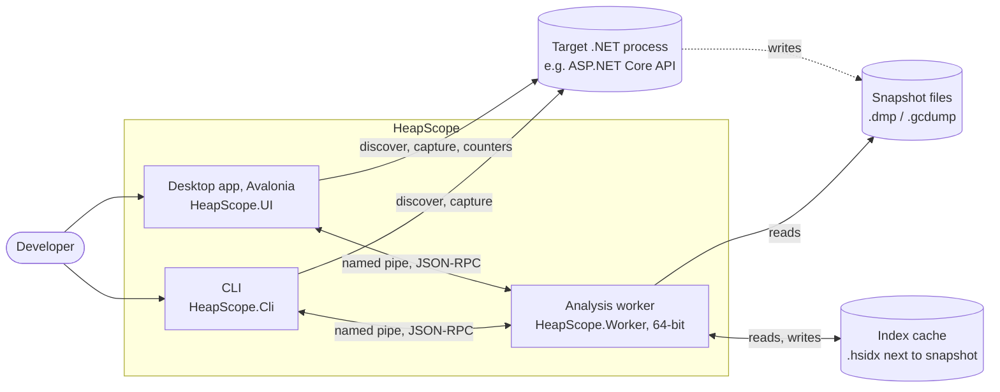
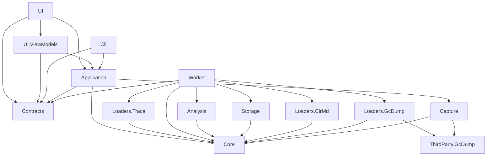

# HeapScope Architecture

Status: living document. Every sprint updates it to match what was actually built. Sections marked
"(planned)" describe designs whose code does not exist yet.

## 1. Purpose, scope, non-goals

**Purpose.** HeapScope is a desktop memory profiler for modern .NET applications, on Windows today and on Linux and macOS
after the Avalonia port (ADR-025; the engine, worker and CLI already run there). It replaces the
core of JetBrains dotMemory for one primary workflow: a memory leak is suspected in an ASP.NET Core API, the
developer runs the API locally, replays representative traffic, takes snapshots over time, and uses HeapScope
to find what is growing and why it is retained.

**In scope (1.x and 2.x).**
- Discovering local .NET processes and capturing full dumps and gcdumps.
- Loading snapshots into a compact in-memory object graph, cached on disk for fast reopen.
- Type summaries, snapshot diffs, object inspection, simple inspections (duplicate strings, LOH, collections).
- Live counters and timed snapshots.
- Reverse references, retention paths, dominator tree, retained sizes, smart leak detectors.
- A CLI with the same capabilities as the UI, usable in automation.
- Linux and macOS core dumps read on the system that took them (sprint 2.3.5, ADR-025); capture there is a backlog item.
- Sharing results as an exported analysis the user writes and passes on (ADR-026).

**Non-goals (for now).**
- .NET Framework targets (backlog).
- Reading a dump on another system than the one that took it, containers' own tooling, remote machines (backlog).
- Native memory analysis beyond an overview (backlog).
- Uploading anything. HeapScope never sends data off the machine; a shared result is a file the user passes on.
- Dumps larger than the Medium tier (see section 10). The Large tier is a backlog item.

## 2. Context



Capture (process discovery, dump writing, live counters) runs in the UI or CLI process through the
Application layer, because it is light and needs the caller's elevation. Everything that touches snapshot
contents runs in the worker.

Capture and sessions (sprint 1.1):
- `HeapScope.Capture`: `ProcessDiscovery` lists processes with a diagnostics port
  (`DiagnosticsClient.GetPublishedProcesses`) with name, working set, private bytes, start time, command line
  (`NtQueryInformationProcess`, limited query rights), runtime version and folder (the loaded `coreclr.dll`; single-file
  apps have none) and elevation. HeapScope's own processes (this pid, and executables under its installation folder,
  the worker included) are never listed or captured, matched by path, not name. A detail that cannot be read stays
  empty. `WindowsElevationProbe` reads token elevation for targets and for HeapScope itself (one rule): a token that
  cannot be opened for query (elevated, or another user's, such as services running as SYSTEM) or that reports
  elevation means only an elevated HeapScope can dump it. Capture is Windows only (ADR-025): off Windows,
  `CapturePlatform.EnsureSupported` refuses discovery and capture with a message naming `dotnet-dump`, and
  `CapturePlatform.ElevationProbe()` gives `UnixElevationProbe` (`Environment.IsPrivilegedProcess`) [2.3.5].
- `DumpCapturer`: checks elevation and free space before asking the runtime for a full dump (`DumpType.Full`: module
  images are in the dump, so it never depends on finding the exact module files). The estimate is measured, not
  guessed: the target's committed readable pages from a `VirtualQueryEx` walk plus 16 MB of streams; when the walk is
  denied, private bytes x 1.1 + 384 MB for images and mapped files + 16 MB. Free space comes from
  `GetDiskFreeSpaceEx` on the folder itself (UNC paths and mount points), and 1 GB is always left free. The dump is
  written to `<name>.dmp.partial` and renamed only on success; an existing file is never overwritten. The runtime's
  createdump runs inside the target under the target's account and cannot be stopped safely, so a cancel waits until
  it has written the file and then deletes it (measured: a 200 ms cancel used to leave a complete 203 MB dump). The
  front ends keep the process alive for that: the CLI gives Ctrl+C up to an hour (System.CommandLine's
  `ProcessTerminationTimeout`; its 2 second default would exit with the dump on disk, and null would turn Ctrl+C off),
  and closing the UI cancels running jobs and waits for them. As a safety net for killed runs, half-written
  `*.dmp.partial` files older than 10 minutes and no longer held are removed when capture starts.
  Failures are specific: `ElevationRequiredException`, `InsufficientDiskSpaceException`, `TargetUnavailableException`,
  `DumpFileExistsException`, `DumpWriteFailedException` (runtime errors decoded: disk full, or the target's account
  cannot write the folder, with `--out` as the next step). Progress says the target is paused while its memory is
  written.
- Application: `SessionLibrary` keeps sessions under `%LOCALAPPDATA%\HeapScope\sessions` (`Sessions:Root`; a relative
  root is under `%LOCALAPPDATA%\HeapScope`), one folder per session (`yyyyMMdd-HHmmss[-name]`, claimed by creating its
  `session.json` exclusively, so parallel runs never share one) with `session.json` (format version 1: name, created,
  last opened, snapshots with id, file, label, kind, source, process, runtime version and folder, capture time, size;
  unknown members are kept on save, so an older build never drops what a newer one wrote). Every change is a
  read-modify-write under a cross-process lock file (`session.lock`) with a unique temporary file flushed to disk.
  The current session is created when the first capture passes its checks (a refused capture leaves no folder), or
  chosen with `Open` (Home's Open, CLI `--session`). `CaptureService` (behind `ICaptureService`) lists processes off
  the calling thread, runs captures as tracked jobs with collision-free file names into the session that was current
  when the capture started, copies the target's `mscordaccore.dll` to `dac\<file version>\` next to the dump (the
  loader searches it; the dump stays readable after the runtime on this machine is updated, for self-contained apps,
  and with several runtimes in one session), records the snapshot, and logs start, end and failures. Every capture states that the dump
  contains secrets and where it was written. Front ends see only Application types: `ICaptureService`, `ProcessEntry`
  (with `ProcessElevation` and `NeedsAdministrator`) and `CaptureFailedException` with a `CaptureFailure` reason (the
  architecture test caught the first draft using Capture types in UI and CLI).

## 3. Solution layout and layers

```
HeapScope.sln
build/                         Shared MSBuild targets (worker deployment next to UI and CLI); gate.ps1, the local full gate
src/
  HeapScope.Core               Domain model: snapshot abstraction, capability model, compact graph,
                               type table, root model, string table. No dependencies at all.
  HeapScope.Analysis           Algorithms over the compact graph.
  HeapScope.Storage            On-disk index cache format, versioning, read/write.
  HeapScope.Capture            Process discovery, dump/gcdump capture, live counters, timed snapshots.
  HeapScope.Loaders.ClrMd      Full dump -> compact graph.
  HeapScope.Loaders.GcDump     gcdump -> compact graph (sprint 1.8).
  HeapScope.Loaders.Trace      EventPipe trace -> sampled allocations (sprint 2.5, ADR-028).
  HeapScope.ThirdParty.GcDump  Vendored MIT gcdump reader and writer from dotnet/diagnostics (PerfView code), sprint 1.8.
  HeapScope.Contracts          IPC DTOs and service interfaces shared by UI, worker and CLI.
  HeapScope.Worker             Out-of-process analysis host (64-bit).
  HeapScope.Application        Use cases: worker client and lifecycle, job tracking, sessions, capture
                               orchestration. UI-agnostic.
  HeapScope.UI.ViewModels      View models and the services they use, without a UI toolkit (sprint 2.3.6).
  HeapScope.UI                 The desktop app on Avalonia (Windows, Linux, macOS; sprint 2.3.6, ADR-025): shell,
                               views, controls, smoke runs. Executable HeapScope.
  HeapScope.Cli                Command line front end.
tests/
  Shared/                      Helpers compiled into every test project (the repository root finder, sprint 1.9)
  HeapScope.Core.Tests
  HeapScope.Analysis.Tests     Synthetic graphs with known answers.
  HeapScope.Storage.Tests
  HeapScope.Loaders.ClrMd.Tests DAC lookup (local only) with real PE files; the loader itself runs in Integration.Tests.
  HeapScope.Capture.Tests      Capture preflight (elevation, disk, partial files) with fakes; the real probe.
  HeapScope.Application.Tests  Job tracking, logging and worker client logic with fakes.
  HeapScope.Worker.Tests       Worker internals: result set store, progress throttling, error mapping.
  HeapScope.UI.ViewModels.Tests View model tests (no windows are shown; they run on every system).
  HeapScope.UI.Tests           The app's views on Avalonia's headless platform: every page, the grids over 1.5 million
                               rows, the attribution markup and the themes (sprint 2.3.6).
  HeapScope.Architecture.Tests Enforces the dependency rules below.
  HeapScope.Integration.Tests  Real worker processes, fixtures, real dumps, known answers (ClrMD and the loader).
                               References Loaders.ClrMd and Storage to test them in process.
perf/
  HeapScope.Benchmarks         Console benchmarks against the budgets (synthetic 50M-object graph etc.).
.github/workflows/ci.yml       CI on GitHub's runners: Windows, Linux, macOS, and the builds per system (sprints 2.3.5, 2.3.6).
fixtures/
  Leaks                        Shared leak implementations and semantic fixtures (namespace Fixtures.Leaks).
  LeakyApi                     ASP.NET Core API with switchable, scalable leaks.
  LeakyConsole                 Minimal console leaker for fast tests.
  LoadGen                      Load generator for LeakyApi; also captures dumps for the scripts.
  DenseHeap                    Grows a dense heap of real Roslyn compiler objects (about 3 references per object)
                               to a target size and waits to be dumped (sprint 1.2).
  KnownAnswers                 One JSON file per leak: what the analysis must find.
  scripts/                     Scripts producing Small and Medium sample dumps.
```

Changes from the kickoff layout, with reasons:
- `HeapScope.Application.Tests`, the UI tests and `HeapScope.Architecture.Tests` were added so
  that each concern has a fast, focused test project. The architecture test is its own project so that it
  can reference every source project without blurring any other test project's purpose.
- `perf/HeapScope.Benchmarks` holds measurements that are too slow or too memory hungry for the unit test run.
- `fixtures/KnownAnswers` makes the known answers a first-class, shared input of tests and detectors.
- `build/` holds the target that places the worker beside the UI and CLI executables (section 3.1).

Code map by project (reorganized in sprint 1.9 from the per-sprint notes; the sprint that added a piece is in brackets):

- **Core.** `ISnapshot`, `GraphSnapshot` and `DumpSnapshot` (a full dump: the graph plus a reader, section 5.1) [1.5];
  `SnapshotInfo` with `FreeBytes` and `SnapshotFacts` [1.6]; the capability model; `IObjectReader` (fields as a tree of
  `ObjectField`, typed `ObjectValue`s with `ObjectValueKind` and `EnumMember`, `ReadField` by path, `ReadStrings` in bulk,
  string text, reference paths) [1.5, 1.6]. `Graph/`: the compact graph, `HeapGraphBuilder`, `TypeKind.ReferenceArray`
  [1.6] and `TypeNameForms` (a full dump's type name in the form a gcdump records it) [1.8]; types without a method
  table are told apart by name and module [1.8]. `Loading/`: the loader contract both loaders share (`ISnapshotLoader`
  with its `Version`, `LoadResult`, `LoadProgress`, `LoadTimings`, `LoadDiagnostics`) and `SnapshotFileSignature` (a
  file's first bytes tell a minidump, `MDMP`, from a gcdump, a FastSerialization stream whose first object is a
  `GCHeapDump`) [1.8]; a Linux or macOS core file (ELF `ET_CORE`, Mach-O `MH_CORE`) is a full dump too, and
  `IsMinidump` tells the two apart [2.3.5]. `RecordedPath` (a path recorded in a snapshot, split on both separators
  whatever system reads it) [2.3.5]. `Synthetic/`: `SyntheticGraphs` and `SyntheticGraphBuilder`, which also makes arrays and strings
  [1.6]. `Graph/ReverseReferences` (the incoming references CSR, built by counting and filling, or from an index file's
  columns) and `HeapGraph.Attach` (an optional index is disposed with the graph, after the snapshot's last lease) [2.1];
  `DependentHandle` and `HeapGraph.DependentHandles` / `IsDependentHandleEdge` [2.2].
- **Analysis.** `TypeAggregation`: one parallel pass over the objects, counting objects, shallow bytes and bytes per
  heap kind for every type, computed once per snapshot and kept on the snapshot's entry in the worker [1.3].
  `TypeGroups`: rows by type, namespace or assembly. Type rows are one per type table entry (method table), never merged
  by name: distinct types that share a name (one assembly in two load contexts, same-named types in different modules)
  keep their own rows, named `Name [Module.dll]` and then `#n` in type index order (stable for a snapshot, not across
  snapshots), so a stale copy of a plugin's types is visible on its own row; namespace and assembly rows merge by
  design. Totals count every object in the snapshot: a full dump's unreachable ones included, a gcdump's survivors only
  (the UI and CLI say which); a live and dead split comes with the retention analysis (2.x) [1.3, 1.8]. `TypeDiff`: rows
  matched by type name plus module file name, summed per key, grouped like the summary; each side keeps its own names,
  so a row opens on either side by that side's name; across snapshot kinds the full dump's names are matched in their
  gcdump form and the "copies" marker is off [1.4, 1.8]. `Inspections/`: `IInspection`, `InspectionContext`,
  `InspectionResult`, `InspectionTable`, `RowTable<TRow>` and `InspectionCatalog`; the graph-only inspections in
  `GraphInspections.cs` (large object heap, large arrays, sparse arrays, finalizable objects, fragmentation) and the
  reader ones in `ReaderInspections.cs` (empty and oversized collections, duplicate strings) [1.6, ADR-020].
  `IncomingReferences`: an object's distinct referrers with their reference counts, and a type's referrers grouped by
  their type name and module (referring objects, references, targets referenced, referrer bytes); `TypeGroups.MatchTypes`
  finds the method tables of a type key (name and module file name), shared with instances [2.1]. `Retention/`:
  `PathRoots` (where paths start, root priorities, roots in plain language), `RetentionSearch` (one object's paths),
  `RootPathTree` and `KeyPaths` (a type's key retention paths) [2.2]; `DominatorTree` (semi-NCA and retained sizes into
  spans the caller gives), `Dominators` (the kept columns, managed or from a sidecar) and `GroupRetention` (a group's
  retained lower bound), with `TypeGroups.GroupOfType` numbering the groups of a grouping [2.3]; the dominator tree's
  children (`DominatorTree.BuildChildren`, kept with the dominators), `DominatorTreeRows` (the tree flattened for a paged
  grid, with `DominatorRow`, `DominatorTreeView` and `DominatorGrouping`), `IcicleLayout` and `SetRetention` (what a set
  retains together, exactly) [2.4].
- **Storage.** The index cache format, reader and writer (section 7); the metadata records the loader version that
  built the graph [1.8]. `IndexCacheFileWriter` (one index file section by section, header last, rename; the base writer
  uses it and returns the cache identity), `IndexCacheFile` (any index file opened and verified in memory or mapped,
  `TryGetSection<T>`), `IndexFileLayout` (the sections of the base cache and of each sidecar), `IndexFileDirectory` (the
  header and directory checks both readers share) and `IndexCacheLocator.GetSidecarPath` [2.1]. `MappedIndexFileWriter`
  (sections planned up front and filled in place through a read-write mapping of the temporary file, then hashed, header
  last, rename) and the sidecar semantics version (`IndexFileLayout.SemanticsVersion`, checked on open) [2.3].
- **Capture.** Process discovery and elevation, `DumpSizeEstimator` (the disk preflight's estimate) [1.1]; `DumpCapturer` (full dumps written by the runtime) and `GcDumpCapturer`
  (the vendored heap snapshot over EventPipe, failures classified, its log lines sent to the HeapScope log) [1.8], both
  writing through `PartialSnapshotFile` (reserve, never overwrite, commit by rename, discard with retries) [1.9];
  `TraceRecorder` (EventPipe sessions to `.nettrace`, profiles cpu and gc) [1.5]; `CounterMonitor` (an EventPipe session
  on the target's `System.Runtime` EventCounters) and `CounterSampleBuilder` (counter events to one `CounterSample` per
  interval) [1.7].
- **Loaders.ClrMd.** `ClrMdDumpLoader` (truncated dumps refused or marked incomplete: heap creation failures, objects
  without a type, segments whose memory is missing, files shorter than their minidump directory) [1.2, 1.8];
  `ClrMdObjectReader` (opens the dump on first use, serialized, disposed with the snapshot) and `ClrMdDump` (opening
  shared with the loader, runtime creation failures wrapped with a next step) [1.5]; `MinidumpHeader` [1.2, 1.8];
  `CoreFileHeader` (a Linux or macOS core cut short: program headers or load commands, or a segment's file range, past
  the end of the file; such a core loses CompleteGraph and ExactCounts like a truncated minidump), a core's capture time
  from the file's write time marked `SnapshotFacts.CaptureTimeFromFile` with a note, loader version 3 [2.3.5];
  `UnixLocalPath` (the local path rule on Linux and macOS: the mount holding the path, links resolved) [2.3.5];
  `DacLocator` and `LocalOnlyFileLocator` (the matching DAC from local folders only, ADR-017, section 6.3) [0.1, 1.2];
  the DAC of the system HeapScope runs on, matched on Linux and macOS by `ImageIdentity` (ELF GNU build id, Mach-O
  UUID) against the DAC itself or, when the dump archives it under the runtime's identity, against `libcoreclr` in the
  same folder; ClrMD reads a core file's runtime version as 0.0 at times, and the runtime's folder name names it then
  [2.3.5].
- **Loaders.GcDump.** `GcDumpLoader`, `RootClass` (pseudo node names to root kinds), `TypeNames` (names normalized to
  the full dump loader's form), `ObservedReadStream` (progress and cancellation while the vendored reader reads) [1.8].
- **ThirdParty.GcDump.** The vendored dotnet-gcdump code (PerfView's `MemoryGraph`, `GCHeapDump` and the EventPipe heap
  dumper), MIT, with its four changes listed in its `CHANGES.md` [1.8, 1.9].
- **Contracts.** `IWorkerService`, `WorkerProtocol`, `HeapScopeErrorCode`, the wire enums and `CapabilityDescriptions`
  [0.3]; the DTOs, one file per area (`WorkerDtos`, `SnapshotDtos`, `SummaryDtos`, `ObjectDtos`, `InspectionDtos`)
  [1.9]; `NameFilter`, the one filter rule set shared by the worker (matching) and the UI (highlighting): an all lower-case
  filter is a case-insensitive substring; a filter with capitals matches as typed, then as CamelHumps within one
  identifier (`SCE` finds `StaticCacheEntry`); `*` matches any run of characters [1.3]. Summary and diff rows in Type
  grouping carry hidden `TypeName` and `Module` columns, the key that opens a row's instances [1.5]. Referrers:
  `ReferrerColumns`, `TypeReferrerColumns`, `ReverseIndexInfo` (sidecar or built, mode, time, size, saved), the
  requests and results (with `CompleteGraph`), and the descriptor's `CacheIdentity`, which a reopen after a worker
  restart compares (review M10) [2.1]. `RetentionDtos.cs`: `RootKindDto`, `PathRootDto`, `RetentionNodeDto`,
  `PathStepDto`, `KeyPathDto`, the object and type paths requests and results [2.2]. `RetainedDtos.cs`:
  `DominatorIndexInfo`, `RetainedRequest`, `RetainedResult`; the `Retained` columns and `IncludeRetained` flags of type
  summaries and instances [2.3]. `DominatorDtos.cs`: the tree request and result, `DominatorTreeColumns`,
  `DominatorTreeKeys` (the row keys clients link with), the icicle request and segments, the set retention request,
  result and `RetainedBySetColumns`; `ResultColumn.Bound` with `ValueBound` and `ValueBoundTexts` [2.4].
- **Worker.** `Program` and `ParentProcessWatcher` (the worker exits with its front end) [0.3]; `Rpc/`: `WorkerRpcServer`, `ResultSetStore`, `ThrottledProgress` [0.3]; `WorkerService` in partial files
  by area: the worker's own calls and result pages (`WorkerService.cs`), snapshots, summaries and diffs, objects, and
  inspections [1.9]; `ContractMapping` (Core's enums on the wire, one place) [1.9]; the result sources:
  `TypeSummarySource` (groups, filters and sorts the cached aggregation per query, so a re-query costs microseconds per
  type) [1.3], `TypeDiffSource` (leases both snapshots and reuses their aggregations) [1.4], `InstancesSource` (object
  indices of the types with a key, filtered by address prefix, regular expression or text, sorted by any column, holding
  a snapshot lease, scoped by `InstanceScope`) [1.5, 1.6], `ReferencesSource` (graph order, named by field path or array
  index when a reader exists) [1.5], `InspectionSource` [1.6], `ReferrersSource` (an object's referrers, each once, their
  fields named for up to 1,000 referrers) and `TypeReferrersSource` (a type's referrers by type, sortable) with
  `WorkerService.Referrers.cs` [2.1]; `ColumnSort` (sort by column name, ties by name, unknown
  columns refused) shared by the row sources [1.9]; `ObjectFormatter` [1.6]; `InspectionAvailability` [1.6].
  `Snapshots/`: `SnapshotStore` (open, cache, memory mode); `SnapshotKinds` (per kind: the loader and its version, the
  snapshot over a graph, the kind's notes) [1.9]; `DerivedData`, per-snapshot derived data on the snapshot's entry,
  dropped in one step when it closes: each slot is one shared computation with its own lease; a caller that cancels
  only stops waiting, and the computation is canceled when the last waiter leaves before it finishes and nobody joins
  within a 2 s grace period (so a grid's re-query joins it), or when the snapshot closes (`DerivedWaiter`, after the
  2.3 review M13) [1.3]; the reverse references slot [2.1] and the
  dominators slot with the retained lower bounds per grouping [2.3], with `SharedProgress` sending the computation's
  progress to every caller waiting for it (review M7). `ReverseIndexBuilder`: the reverse index opened from its sidecar,
  or built straight into it [2.3] (in managed arrays when there is none), and `ChooseMode` (review M3); `SnapshotStore.ReverseReferences.cs` gives it the snapshot's cache path,
  identity, fingerprint, memory mode and forced mode, and attaches the result to the graph [2.1].
  `SnapshotStore.RootPaths.cs` (the root path tree slot), `WorkerService.Retention.cs` and `RetentionMapping` (roots,
  fields, dependent-handle and framework marks on the wire) [2.2]. `SnapshotStore.Dominators.cs` (the dominators slot and
  the group retention per grouping), `DominatorIndexBuilder` (the dominators opened from their sidecar or computed into
  it, with the fallbacks) and `MemoryReservations` (the worker-wide memory check of the large derived computations,
  with `Refusal`'s next steps) and `WorkerService.Retained.cs`; `TypeSummarySource` and `InstancesSource` add a retained column when
  asked [2.3]. `WorkerService.Dominators.cs` (the tree and the icicle) with `DominatorTreeSource`, and
  `WorkerService.SetRetention.cs` with `RetainedBySetSource` [2.4].
- **Application.** `Workers/` (`WorkerHost`, `IWorkerClient`, exceptions, log forwarding), `Jobs/JobTracker`,
  `Logging/FileLoggerProvider`, `WorkerOperations` [0.3]; `Snapshots/`: `SnapshotSession` (summaries, diffs with both
  snapshots reopened after a restart through `UseBothAsync`, instances, objects, inspections, referrers [2.1], retention paths [2.2], retained sizes [2.3]) and
  `ResultSetHandle` (section 4.6) [1.3 to 1.6]; `Sessions/`: `SessionLibrary`, `CaptureService` (per-kind capture settings in one table)
  [1.1, 1.9] and `TraceService` [1.5]; `Snapshots/GrowthThreshold` (the `--fail-on-growth` CI gate's limit, a size or a
  percent) [1.4]; `Monitoring/`: `HeapSample` (what front ends see), `ICounterSource`
  (`EventPipeCounterSource`, and `SyntheticCounterSource` for the smoke run), `SnapshotRules.cs` (`EveryRule`,
  `AboveRule`, `GrowthRule`, `RearmMode`, `MonitorRules`, `SnapshotRuleEngine` with the GC pressure flag, on
  `HeapSample.RuleBytes`, the heap after the last GC) and `MonitorService` with `MonitorRun` (samples and captures as
  events, one capture at a time, the counters timeline in the session folder) [1.7]. `ICaptureService.StartCapture`
  records a source (`SnapshotSource.Timed` for rules) and takes a `SnapshotKindDto` [1.7, 1.8].
- **UI.ViewModels** (sprint 2.3.6, moved from the WPF app; no UI toolkit). `Services/`: `IUiDispatcher` (post to the UI
  thread, `YieldToRenderAsync`) with `ImmediateUiDispatcher` for tests, `IUserInteraction` (asynchronous dialogs) with
  `AutomaticUserInteraction` for smoke runs. `ViewModels/`: the shell, pages and jobs [0.3]; `GridQueryViewModel<TRow>`
  (the query lifecycle shared by the grids: debounced filter, latest query wins, column-name sort, first page preloaded
  before the grid binds, release) and `TypeGridViewModel<TRow>` (grouping) over the generic `VirtualRowList<TRow>` (data
  virtualization) [1.4, 1.5]; a grid yields to its `UiDispatcher`, set by whoever creates it, before binding rows
  [2.3.6]; `TimelineLayout` and `ChartPoint` (the Live chart's geometry) and `ColumnHeaders` [2.3.6];
  `TypeSummaryViewModel` (only the latest query owns the view: `Show`, a re-query or closing the snapshot cancel the
  running query and the pending filter, and the replaced row list stops its page requests) [1.3]; `CompareViewModel`
  (two pickers, the earlier capture as default baseline, open order when a capture time is only a file's time, swap)
  [1.4, 2.3.6]; `ProcessesViewModel` and `LiveViewModel` show `ICaptureService.UnavailableReason` instead of a list
  where capture is not available [2.3.6]; `InstancesViewModel`, `ObjectViewModel` (field tree
  and references) and `NavigatorViewModel` (types, instances, object; back and forward, mouse buttons and Alt+arrows;
  the views are built once with the window and the navigator swaps their data) [1.5]; the object's references as
  Outgoing and Incoming tabs (incoming loaded when its tab is first shown), the instances view's Referenced by, and
  `TypeReferrersViewModel` (a type's referrer types, whose rows open that type's objects) in `ReferrersViewModels.cs`
  [2.1]; the object view's Retention tab (key paths and the merged tree, framework runs folded unless shown) and the
  instances view's Why alive (`TypePathsViewModel`) in `RetentionViewModels.cs` [2.2]; the Retained sizes switch on the
  types and instances grids (off by default, carried from the types grid into a type's objects) and the object's
  retained size with its immediate dominator as a link in the Retention tab [2.3]; `InspectionsViewModel` (tiles,
  fragmentation bars, rows as `CellRowItem`s, the generic row of any result set since 2.4) [1.6]; `LiveViewModel` and
  `SnapshotCard` [1.7]; `Navigation/` (`NavigationTarget`, `INavigator`, `INavigationSubject`, the tab enums: every link
  of the app is a target the Snapshots page routes), `RetainersViewModel` (the dominator tree grid with
  `DominatorRowItem`, the trail as `TrailItem`s, the icicle with `IcicleGeometry`), `RetainedBySetViewModel`,
  `ColumnGroups`, and `GridQueryViewModel.OnRowsApplied` (what refers to new rows runs after they are bound) [2.4].
- **UI** (Avalonia, sprint 2.3.6, ADR-025). `Program` (the desktop app, or `--headless` on Avalonia's headless platform
  for CI smoke runs), `App` (host start and bounded stop, last-chance handlers, power throttling off on Windows, theme)
  and `UiHost` (DI, `UiOptions`). `Views/`: `MainWindow` (the shell, the attribution strip as `AttributionText`,
  ADR-022; back and forward by mouse buttons and Alt+arrows) and `Pages/`, one user control per page and per Snapshots
  tab, compiled bindings throughout; `LazyContentControl` builds a page when first shown and keeps it (switching pages
  is a visibility change) [1.5]; `MessageWindow` (Avalonia has no message box). `Controls/`: `GridBehaviors` (rows
  through `VirtualCollectionView`, header clicks sent to the view model's sort command with the arrow from its
  `SortState`, open by double-click or Enter, column groups shown from the view model, columns from a result set's
  list), `VirtualCollectionView<TRow>` (the pass-through `IDataGridCollectionView`: the grid reads rows by index and
  never copies or walks the list; whole-list walks are counted in `VirtualCollectionViews.Enumerations`, which the UI
  tests keep at zero), `HighlightedText`, `ProportionalPanel` (the heap kinds bar), `TimelineChart`, converters.
  `Services/`: `AvaloniaUiDispatcher`, `AvaloniaUserInteraction` (the system file picker), `DispatcherWatchdog`,
  `ThemeChooser`, `NativeMethods` (Windows only). `Themes/`: `Light.axaml` and `Dark.axaml` (theme dictionaries with
  the same keys) and `Styles.axaml`. `Smoke/SmokeRunner`: the unattended smoke runs [1.9, 2.3.6]. Sprint 2.4: the Snapshot tab's subjects are views of their own (`Views/Subjects/`), the
  Retainers tab (`RetainersTab`), `Controls/IcicleChart` (drawn in one pass, geometry from the view models),
  `Controls/NoteText` (a status or note line that takes no space when empty), and `GridBehaviors`' `VisibleColumnGroups`,
  `ExpandCommand`, `CollapseCommand` and `ScrollToSelection`.
- **Cli.** `Program` and `CliHost` (the host, the worker attach pipe, symbol options); `CliCommands` (`list`, `capture`, `open`, `summary`, `worker`, `synthetic`), `DiffCommand` [1.4],
  `InspectCommands` (`instances`, `object`) [1.5], `InspectionCommand` (`inspect`) [1.6], `TraceCommand` [1.5],
  `MonitorCommand` [1.7], `ReferrersCommand` (`referrers --address | --type`) [2.1], `PathsCommand` (`paths --address | --type`) [2.2], `--retained` on `summary`, `instances` and `object` with `StderrProgress` [2.3],
  `RetainersCommand` (`retainers`, `retained-by`) [2.4]; `CliCommands.Output.cs` holds the output every command shares: fetching rows, CSV, JSON (one
  writer, rows keyed by column name with typed numbers) [1.9].
- **perf/HeapScope.Benchmarks.** The budget benchmarks, the developer tool `trace-report` [1.5] and `phase2-indices`,
  the Phase 2 index prototype (section 6.4) [1.9]; `reverse-index`, the reverse references index of a real index cache
  (build, sidecar write, reopen in both modes) [2.1]; `retention`, the root path tree, key paths and object searches of
  a real index cache [2.2]; `dominators`, the reverse index and dominators as the worker computes them, in either mode
  [2.3].
- **Allocation traces [2.5, ADR-028].** Capture: `TraceProfile.Allocations` (GC events at verbose with loader and JIT
  events; the rundown on stop). Core: `Allocations/AllocationTrace` (frames, a deduplicated stack tree, types, and per
  sample its time, innermost stack node, type and bytes; `NativeFrame`, `NoStackFrame`). Loaders.Trace:
  `AllocationTraceReader` (the `Nettrace` signature checked first, TraceEvent's `.etlx` written to a private temporary
  folder and deleted, runs of native frames merged, cancellation). Analysis: `Allocations/AllocationProfile` (sample
  ranges by binary search, the timeline, types, totals, top stacks, a stack's frames) and `AllocationTreeRows` (the call
  tree and back traces flattened from open keys like ADR-027, with `AllocationRow`, `AllocationTreeView`,
  `AllocationFilter`). Worker: `Traces/TraceStore` (open traces, a memory reservation while reading,
  `ReadReservation`) and `WorkerService.Allocations` with `AllocationTypesSource` and `AllocationTreeSource`. Application:
  `Allocations/AllocationSession` (`TraceHandle`, reading again after a worker restart, `AllocationScope`, and
  `StartRecord`, which records into the current session's folder and opens the trace). UI.ViewModels:
  `AllocationsViewModel` (the page), `AllocationTraceViewModel` (a trace: interval, type, stacks), `AllocationTypesViewModel`,
  `AllocationTreeViewModel`, `AllocationRowItem`, `AllocationTimelineGeometry`, `TimeInterval`; Record allocations and Stop
  on `ProcessesViewModel`. UI: `Views/Pages/AllocationsPage` and `Controls/AllocationTimeline` (drag selects the
  interval). Cli: `trace --profile allocations` and `AllocationsCommand` (`allocations`). Benchmarks: `allocations`.
- **Fixtures.** The leak fixtures and known answers (ADR-013), `WasteFixtures` (LeakyConsole `--waste`) and `Waste.json`
  [1.6].
- **build/.** The worker deployment targets and `gate.ps1`, the local full gate (DEVELOPER.md 2) [1.9].

### 3.1 Dependency rules



| Project | May reference (solution) | May reference (packages, besides Microsoft.Extensions.*) |
|---|---|---|
| Core | nothing | nothing |
| Analysis | Core | System.IO.Hashing (duplicate strings, sprint 1.6) |
| Storage | Core | System.IO.Hashing |
| Capture | Core, ThirdParty.GcDump | Microsoft.Diagnostics.NETCore.Client, TraceEvent |
| Loaders.ClrMd | Core | Microsoft.Diagnostics.Runtime |
| Loaders.GcDump | Core, ThirdParty.GcDump | Microsoft.Diagnostics.Tracing.TraceEvent |
| Loaders.Trace | Core | Microsoft.Diagnostics.Tracing.TraceEvent (sprint 2.5) |
| ThirdParty.GcDump | nothing | Microsoft.Diagnostics.NETCore.Client, TraceEvent (vendored code, sprint 1.8) |
| Contracts | nothing (ADR-016) | StreamJsonRpc attributes only (no transport code) |
| Worker | Core, Contracts, Analysis, Storage, Loaders.* | StreamJsonRpc |
| Application | Core, Contracts, Capture | StreamJsonRpc |
| Cli | Application, Contracts | System.CommandLine |
| UI.ViewModels | Application, Contracts | CommunityToolkit.Mvvm |
| UI | Application, Contracts, UI.ViewModels | Avalonia, Avalonia.Desktop, Avalonia.Themes.Fluent, Avalonia.Controls.DataGrid, Avalonia.Headless, CommunityToolkit.Mvvm (MIT only, ADR-025) |

Rules:
- Core references nothing, not even Microsoft.Extensions.*. It is pure domain types and data structures.
- UI and UI.ViewModels never reference Loaders, Analysis, Storage, Capture, Worker or any diagnostics library directly
  (diagnostics libraries do load into the UI process, through Capture via Application). UI.ViewModels references no
  UI toolkit, so its tests run on every system.
- UI, UI.ViewModels and Cli use no Core types. Everything they show comes through Application or Contracts, whose wire
  vocabulary (snapshot kind, capabilities, capability descriptions) is defined in Contracts (ADR-016).
- A build-order-only reference (`ReferenceOutputAssembly="false"`) to the Worker project is allowed from
  UI, Cli and Integration.Tests; it ensures the worker is built and deployed next to them, without making
  any worker type visible.
- `HeapScope.Architecture.Tests` checks every `src/**/*.csproj` against the table using the evaluated restore
  graph (`obj/project.assets.json`, so references added by imported props and targets count) plus build-order-only
  references from the project and the shared targets it imports. It also checks every compiled assembly reference
  (solution assemblies and the governed package assemblies) against the same table.

## 4. Process model and IPC

### 4.1 Processes
- **UI process** (Avalonia; AnyCPU, so 64-bit on x64 and arm64): shell, view models, Application services, capture.
- **CLI process** (AnyCPU, 64-bit): same Application services, console output.
- **Worker process** (64-bit, the machine's architecture; `HeapScope.Worker`): one per UI or CLI instance. Holds every loaded snapshot
  of the session (a diff needs both snapshots in one address space). Uses Server GC, non-concurrent
  (section 9), and runs at below-normal process priority so its ordinary threads yield to the UI and the profiled
  application. This does not cover Server GC threads, which the runtime creates at highest thread priority (they
  end up at normal priority in a below-normal process); taming GC threads (job object CPU rate, EcoQoS, heap
  affinity) is a backlog item to be decided with a trace.

### 4.2 Lifecycle
1. Application's `WorkerHost` starts the worker with `--pipe <name> --parent-pid <pid>`. The pipe name is
   `HeapScope.W.<24 random hex digits>` (sprint 2.3.5; off Windows a pipe is a Unix domain socket in the temp folder,
   whose path macOS limits to 104 characters); the pipe is created with `PipeOptions.CurrentUserOnly`. The worker's
   executable is `HeapScope.Worker.exe` on Windows and `HeapScope.Worker` elsewhere.
2. The worker creates the pipe server and waits up to 30 s for the client; the client connects with a
   timeout and calls `GetInfoAsync` as a handshake, which also checks the protocol version.
3. The worker exits when the pipe disconnects or when the parent process exits (it watches the parent's
   process handle), so a crashed UI never leaves orphaned workers holding gigabytes.
4. On orderly shutdown (the host stopping, since `WorkerHost` is a hosted service) the client calls
   `ShutdownAsync`, then waits up to 5 s before killing the process.
5. For debugging, a worker can be started by hand with `--pipe <name>` and a client attached to it with the
   `Worker:AttachPipeName` option (CLI: `--pipe <name>`); an attached worker is disconnected, not shut down.
6. Test hooks (`CrashForTestingAsync`, `HangForTestingAsync`) exist only when the worker is started with
   `--enable-test-hooks` (`Worker:EnableTestHooks`); otherwise they fail with `TestHooksDisabled`.

### 4.3 Crash handling
- The client watches both `Process.Exited` and `JsonRpc.Disconnected`. Either one moves the worker to
  `Crashed`, faults every in-flight call with `WorkerCrashedException` (exit code included), and raises a
  `WorkerStateChanged` event the UI shows as a banner.
- The next request restarts the worker transparently. Every worker has an `InstanceId` (in `WorkerInfo`) and
  `IWorkerClient.Generation` increases with each connected worker, so callers can tell that worker-owned ids
  (result sets, snapshots) belong to a dead worker. Application's `SnapshotSession` owns a stable `SnapshotHandle` per
  opened file (keyed by the path that was opened, never by the path recorded in the cache), maps it to the worker's
  snapshot id for one worker generation and reopens it lazily (`UseAsync`: before a call when the generation changed,
  and once more when the worker answers `SnapshotNotLoaded`); a stale id fails with `SnapshotNotLoaded` (sprint 1.2).
  A reopen asks for the index cache only (`OpenSnapshotRequest.RequireCache`) and keeps the mode the user chose: it
  is cheap and silent, never an unrequested dump load, and a changed or uncached file fails with `SnapshotChanged` so
  the user opens it again. A closed handle is never reopened; a reopen that finishes after a close closes its worker
  snapshot again.
- Error contract of `IWorkerClient`: calls fail only with `WorkerStartException`, `WorkerCrashedException`,
  `WorkerOperationException` or `OperationCanceledException`. A stopped or disposed host refuses to start a
  worker. The handshake is bounded by the connect timeout. In the worker, `WorkerErrors.GuardAsync` maps domain
  exceptions to codes in one place (`CapabilityNotSupported`, `InsufficientMemory`, `InvalidArgument`,
  `RuntimeComponentMissing`, `SnapshotFormat`, `SnapshotUnavailable` for I/O and access failures with a next step,
  `SnapshotChanged`) and logs every outcome once with the operation and the request (section 11): an answer with what
  was answered, an expected refusal (capability, invalid argument, changed file, unknown snapshot or result set, missing
  DAC, memory) at Information without a stack, other coded failures as warnings with their stack, unexpected ones as
  errors; errors the worker creates as codes are logged too (sprint 2.3.7). The client's message stays plain and the
  log keeps the details. The front ends catch `WorkerException`, the base of the three worker exception types. The UI
  adds last-chance handlers (dispatcher, app domain, unobserved tasks) that log and show a plain message; the
  CLI command boundary prints a plain message and logs the stack trace.
- Worker stderr is captured by the client and forwarded into the client's log (category `Worker`), so the
  last log lines before a crash are never lost. The worker writes single-line records
  (`HH:mm:ss.fff level: Category[id] => scopes message`); the forwarder prefixes `w<pid> g<generation>`, keeps the level
  and logs lines without one (for example a stack trace) as warnings. A worker that exits logs a last-chance line with
  its peak working set; the client explains known exit codes in the banner and the log (137: killed, usually by the
  Linux out-of-memory killer; an unhandled .NET exception; a stack overflow; sprint 2.3.7).
- Transport failures (`ConnectionLostException`, broken pipe, disposed connection) become
  `WorkerCrashedException`; worker errors become `WorkerOperationException` with the `HeapScopeErrorCode`;
  startup failures (missing executable, no pipe within 30 s, exit during startup) become `WorkerStartException`.

### 4.4 Transport and contracts
- StreamJsonRpc over the named pipe, with `HeaderDelimitedMessageHandler` and the default JSON formatter.
  The default formatter is used because it supports `IProgress<T>` and `CancellationToken` marshaling with no
  extra configuration. The formatter can be swapped later without changing service interfaces.
- `HeapScope.Contracts` defines `IWorkerService` (methods called by clients) and the DTOs. DTOs are records of
  primitive types, strings, arrays and Contracts enums; Contracts references no solution project, so no Core type
  can cross the pipe (ADR-016). The worker maps Core values (for example `SnapshotCapabilities`) to their
  Contracts counterparts (`SnapshotFeatures`); a test keeps the numeric values of mirrored enums identical.
- `WorkerProtocol.Version` is a constant in Contracts; a mismatch at handshake is a hard error with a clear
  message. Version 2 (sprint 1.2) added `ProbeSnapshotAsync` (file size, index cache state from its header and
  fingerprint, open or not), `OpenSnapshotAsync`, `CloseSnapshotAsync`, `GetTypeSummaryAsync`, the snapshot DTOs
  (`OpenSnapshotRequest` with `RequireCache`, `SnapshotDescriptor`, `SnapshotMemoryMode`, `SnapshotProbe`,
  `SnapshotCacheState`) and the codes `RuntimeComponentMissing`, `SnapshotUnavailable` and `SnapshotChanged`.
  Version 3 (sprint 1.3) added `QueryTypeSummaryAsync` (`TypeSummaryRequest`: group by, filter, sort and
  direction, validated; `TypeSummaryResult`: a result set, totals per heap kind (Unknown listed only when present),
  whether generations exist, and the rows before the filter), the wire enums `TypeGrouping`, `TypeSummarySort` and
  `HeapKindDto` (mirrors `HeapKind`), the column kinds `Percent`, `Address` and `SignedInteger`, and the key flag on
  `ResultColumn`. `NameFilter` lives in Contracts because it defines what the `Filter` field means to worker and UI
  alike; changing it changes the protocol's meaning.
  Version 4 (sprint 1.4) added `QueryTypeDiffAsync` (`TypeDiffRequest` with a sort column named by
  `TypeDiffColumns`, validated by the worker; `TypeDiffResult` with both sides' totals, new and gone row counts, the
  matching rows' baseline bytes and delta, and `ExactCounts`).
  Version 5 (sprint 1.5) added `QueryInstancesAsync` (`InstancesRequest`: snapshot, type name, module file name,
  filter, sort column; `InstancesResult`), `GetObjectAsync` (`ObjectDetails` with `ObjectFieldDto` trees or the
  capability explanation), `QueryReferencesAsync` (`ReferenceColumns`), the hidden key columns `TypeName` and `Module`
  on summary and diff rows, and the type summary's sort by column name (`TypeSummaryColumns`; `TypeSummarySort`
  retired).
  Version 6 (sprint 1.6) added `ListInspectionsAsync` (`InspectionInfo` with the reason an inspection is unavailable)
  and `RunInspectionAsync` (`InspectionRequest`; `InspectionResultDto` with count, bytes, wasted bytes, a note and the
  rows; hidden `InspectionColumns` say what a row opens), `InstanceScope` and `SameValueAs` on `InstancesRequest`
  (all, large object heap, finalizable, strings equal to one string), and progress on `GetObjectAsync` and
  `QueryReferencesAsync`.
  Version 7 (sprint 2.1) added `QueryReferrersAsync` (`ReferrersRequest`; `ReferrersResult` with the reference count,
  why fields are not named, and `ReverseIndexInfo`; `ReferrerColumns`), `QueryTypeReferrersAsync`
  (`TypeReferrersRequest` with a sort column named by `TypeReferrerColumns`; `TypeReferrersResult` with the matched
  types, their objects and the references into them; no index when no type matches) and
  `SnapshotDescriptor.CacheIdentity`. Both results say whether the graph is complete (`CompleteGraph`), since a sampled
  gcdump or a truncated dump can miss referrers.
  Version 8 (sprint 2.2) added `QueryObjectPathsAsync` (`ObjectPathsRequest` with up to 50 roots; `ObjectPathsResult`:
  the merged tree as `RetentionNodeDto`s with fields, dependent-handle and framework marks and `PathRootDto`s in plain
  language, the roots, the key paths among them, whether the search stopped early) and `QueryTypePathsAsync`
  (`TypePathsRequest` with up to 100 paths; `TypePathsResult`: `KeyPathDto`s with objects, bytes and an example, the
  unreachable objects, the paths beyond the limit summed), and `RootKindDto` (mirrors `RootKind`). After the 2.2 review:
  `RetentionNodeDto.Folded` (objects of one type folded into a node, or hidden behind a gap node),
  `ObjectPathsResult.Truncated`, and `UnreachableNote` on both results (what unreachable means for the snapshot's
  kind).
  Version 9 (sprint 2.3) added `QueryRetainedAsync` (`RetainedRequest`; `RetainedResult`: the object's retained bytes,
  its immediate dominator's address and type or that only the roots dominate it, the unreachable note,
  `DominatorIndexInfo` and `CompleteGraph`), `IncludeRetained` on `TypeSummaryRequest` and `InstancesRequest` (a
  `Retained` column; a type summary row's value is a lower bound, ADR-024) and `Dominators` (a `DominatorIndexInfo`) on
  both results. The first retained query of a snapshot computes its dominators with progress; dominators that would not
  fit the worker's budget fail with `InsufficientMemory`.
  Version 10 (sprint 2.3.6) added `CaptureTimeFromFile` at the end of `SnapshotDescriptor`: the capture time is the
  file's write time (Linux and macOS core dumps record none), so Compare does not order snapshots by it.
  Version 11 (sprint 2.3.7) added `FilterNote` at the end of `InstancesResult` (what a value filter could not test:
  unreadable strings, regular expression timeouts); both ends set StreamJsonRpc's `ActivityTracingStrategy`, so each
  request carries the client's W3C trace context and the worker's log lines carry its trace id.
  Version 12 (sprint 2.4) added `QueryDominatorTreeAsync` (`DominatorTreeRequest`: expanded row keys, grouping, focus
  address, children per node, the key of the row to reveal; `DominatorTreeResult`: the rows as a result set in
  `DominatorTreeColumns` (kinds in `DominatorRowKinds`, keys formed by `DominatorTreeKeys`), the focus key and its
  ancestors (at most the top 3 and the nearest 20, with `AncestorDepth` counting all), the focus's and the reachable
  heap's bytes, the top-level count, whether the rows were cut, `DominatorIndexInfo`, and `RevealIndex`; limits in
  `DominatorTreeLimits`), `QueryIcicleAsync` (`IcicleRequest`: focus, levels, minimum share; `IcicleResult`: segments with
  level, offset, width, key, type and address) and `QueryRetainedBySetAsync` (`RetainedBySetRequest`: type name and
  module; `RetainedBySetResult`: the retained types as a result set, the set's objects and bytes, what it retains
  exactly, the group's lower bound for comparison, the reachable heap's bytes, the seconds taken, and `AllObjects`, the
  members no root reaches included; an unknown type is refused), and
  `ResultColumn.Bound` (`ValueBound.Exact` or `LowerBound`; the type summary's retained column is a lower bound, every
  other retained column exact), whose texts are in `ValueBoundTexts` (with the set action's one name and how the
  dominators were obtained) so the CLI and the UI say it the same way.
  Version 13 (sprint 2.5) added allocation traces (ADR-028): `OpenTraceAsync` (`OpenTraceRequest`, `TraceDescriptor`:
  process, start, duration, samples, sampled bytes, types, lost events, samples without a stack, read time),
  `CloseTraceAsync`, `QueryAllocationTimelineAsync` (sampled bytes per stretch), `QueryAllocationTypesAsync` (a result set
  in `AllocationTypeColumns`), `QueryAllocationStacksAsync` (the top stacks with their frames, the allocating method
  first) and `QueryAllocationTreeAsync` (`AllocationTreeRequest`: call tree or back traces, open keys, interval, type,
  children per row, the row to reveal; rows in `AllocationTreeColumns`, kinds in `AllocationRowKinds`, keys formed as
  `AllocationTreeKeys` describes, limits in `AllocationTreeLimits`). Intervals are seconds since the trace started; no
  end means its end. `ValueBound.Estimate` marks sampled bytes (texts in `AllocationTexts`), and
  `HeapScopeErrorCode.TraceNotLoaded` (1012) a trace the worker no longer has; a file that is not a trace, or a trace
  without allocation samples, is `SnapshotFormat`. After the 2.5 review: `TraceDescriptor` also carries the file's size
  and write time (its identity; a re-read of a changed file is refused with `TraceChanged`, 1013), samples with
  unresolved frames, whether the rundown arrived, and TraceEvent's conversion problems (`AllocationTexts.NotesFor` says
  what they mean); the types answer has `LOH bytes` and `POH bytes` columns; a timeline has at most
  `AllocationTreeLimits.MaxBuckets` (10,000) stretches; `AllocationTreeKeys.Node` and `BackTrace` form the tree keys.
- `HeapScopeErrorCode` values start at 1000: JSON-RPC and StreamJsonRpc reserve -32768 to -32000 (an early
  version used that range and StreamJsonRpc reinterpreted -32003 as a serialization failure).

### 4.5 Progress and cancellation
- Every long-running worker method takes `IProgress<JobProgress>` and `CancellationToken` as its last two
  parameters. StreamJsonRpc turns cancellation into a `$/cancelRequest` message and progress into
  notifications.
- `JobProgress` carries `Phase`, `Completed`, `Total` (nullable when unknown) and `Message`. The worker
  throttles reports to at most 10 per second per call.
- Worker loops check the token at least every 64K items and pass it into every nested call.
- Application's `JobTracker` gives each job an id, keeps its status (Running, Completed, Failed, Canceled), latest
  progress and a `Cancel()` handle, and raises `JobAdded` and `JobChanged` on any thread. The UI marshals them
  through `IUiDispatcher`; the CLI prints them to stderr. `WorkerOperations` is the shared use-case facade for UI
  and CLI.

### 4.6 Large result sets
Large results are never sent whole. A query creates a result set in the worker and returns a
`ResultSetInfo { Id, TotalCount, Columns }`. Clients then call `GetRowsAsync(id, offset, count)` with
`count` capped at 10,000, and `ReleaseResultSetAsync(id)` when done. Sorting and filtering happen in the
worker, producing a new result set. The grids use data virtualization and fetch pages on scroll. Result
sets are typed sources (`IResultSource`: compact arrays such as indices, counts and sizes) formatted to strings only
for the requested page, never stored as one string per cell. The store evicts least recently used sets beyond 32
sets or an estimated 256 MB, whichever comes first (the newest set is always kept). A set can carry an owner, for
example a snapshot lease, disposed on release or eviction. Producers must stay compact (indices, counts, sizes),
because the newest set is kept even when it alone exceeds the byte budget. Sources that read the graph or the dump
while formatting (instances, references) are safe against a release or eviction during a page: the store counts the
pages being formatted from each set, and a set removed meanwhile has its owner (the snapshot lease) disposed by the
last of them (sprint 1.5 review H2). Paging has the worker's error contract, because instance pages read string
values from the dump. Cells cross the pipe as invariant-culture strings with
typed column descriptors (`ResultColumn`: Text, Integer, Bytes, Percent, Address, SignedInteger; one column may be
flagged as the row key), which keeps paging generic. Any cell may be null, numeric ones included (sprint 2.3: the
retained bytes of an object no root reaches); consumers show it blank and write it as JSON null. Unknown, released or evicted sets fail with `ResultSetNotFound`.
Application's `ResultSetHandle` keeps the query that produced a set and re-runs it once when paging fails that way
(eviction, or a worker restart through the snapshot session's reopen), so front ends page without knowing about
eviction. A released handle is finished: paging throws and never re-runs the query, and a re-query in progress at the
release has its new set released too, so no set is orphaned. The grids (types, compare, instances, an object's
references and referrers, a type's referrers) fetch pages of 200 rows as they scroll; each row object is filled with one property change
notification, which keeps a page under the dispatcher budget.

Paging cost with the default JSON formatter (sprint 1.3, Release): a 10,000-row page (the maximum, used by the CLI's
`--all`) arrives in 70 to 80 ms (median) with 7.6 MB allocated in the client; deserializing a page of ten-column type
summary rows alone takes 58 ms and 8.2 MB; the grid's 200-row page takes 1.5 ms and 163 KB. The threshold for
changing the formatter was 50 MB or 200 ms per 10,000-row page, so it stays (tests
`A_full_page_costs_little_to_receive_in_the_client_process` and `ResultPageJsonCostTests`).

## 5. Snapshot abstraction and capability model

### 5.1 Abstraction (HeapScope.Core)
```csharp
public interface ISnapshot : IDisposable
{
    SnapshotInfo Info { get; }                 // kind, source path, process name/id, runtime version,
                                               // pointer size, capture time
    SnapshotCapabilities Capabilities { get; } // what this snapshot can answer
    HeapGraph Graph { get; }                   // compact object graph, types, roots, strings
    bool TryGetService<TService>(out TService? service) where TService : class; // optional services
}
```
- Loaders produce a `HeapGraph` through `HeapGraphBuilder` and wrap it in an `ISnapshot`.
- Capabilities that need the original file (field values, string contents) are exposed through optional
  services obtained with `snapshot.TryGetService<IObjectReader>(out var reader)`. A gcdump snapshot
  simply does not provide them.
- `GraphSnapshot` (an `ISnapshot` with no services) strips `FieldValues`, `StringContents` and `ThreadStacks`
  from whatever capabilities it is given, so it can never claim what it cannot answer (synthetic graphs, tests).
  Since sprint 1.5 every full dump, first load or index cache, is a `DumpSnapshot`: the graph plus a
  `ClrMdObjectReader` over the dump file, which opens the dump with ClrMD only when something is inspected, serializes
  its reads and is disposed with the graph after the last lease. Before it opens the dump it checks the file's
  fingerprint against the one the snapshot opened with, and fails with `SnapshotChanged` when the dump was replaced
  (review H5). Multi-dimensional arrays are read by indices and named `[i,j]`; a reference's names keep the first
  three paths and a count ("[0], [1], [2] and 7 more"), so an array of one shared object stays linear (review H1, H4).
  It reports `FieldValues` and `StringContents`;
  `ThreadStacks` stays missing until a feature needs it. `CapabilityDescriptions.ExplainMissing` takes the snapshot
  kind, so a full dump says "not available in this version yet" instead of "capture a full dump".
- The reader returns typed values (sprint 1.6, `ObjectValue`): kind, the number, character, boolean or text, the
  address, an array's dimensions and element type, an enum's constants, a box's value. It also reads one value by a
  dotted path through structs and referenced objects (`ReadField`, used by the collection inspections) and many
  strings at once (`ReadStrings`, short cuts only, one lock acquisition per 4,096 strings). Full text of any size is
  streamed in pieces of one pooled 128 KB buffer (`ReadStringPieces`, the lock released after 4,096 strings or 16M
  characters) and hashed incrementally (`StringHashes`, used by duplicate strings and the equal-strings scope): no
  string is built, so equal-size large payloads cost no memory beyond the buffer (sprint 1.6 review H2). The worker's `ObjectFormatter` turns values into display text in the invariant culture: strings quoted and
  cut at 1,000 characters with "...", `null`, chars in single quotes, booleans lower case, enums as `Name (value)` and
  flag combinations as `Read, Write (3)`, boxed primitives as `12345 (boxed int)`, arrays as `int[5]` or `int[2,3]`,
  references to non-objects as `0x... (not a valid object in this dump)`; compiler backing fields are named by their
  property; nested structs are child rows; arrays list their first 100 elements, then a "N more" row.
- Since 1.6 the loader records free space per heap kind (`SnapshotInfo.FreeBytes`, the GC's free objects, stored in
  the index cache metadata) and marks arrays of references (`TypeKind.ReferenceArray`): a reference array's non-null
  slots are its outgoing references. It records both as `SnapshotFacts` on `SnapshotInfo`; index caches written before
  1.6 have none, so sparse arrays is unavailable there ("reopen the dump with Rebuild") and fragmentation notes that
  free space is unknown. Objects ready for the finalizer thread are the `FinalizerQueue` roots; the finalizable
  inspection and scope count them with the registered ones.
- A full dump whose heap could not be read completely (unreadable objects, or a segment walk that covered noticeably
  less than the segment, a segment whose memory is not in the file, or a file shorter than its own minidump directory
  says, sprint 1.8) loses `CompleteGraph` and `ExactCounts` and carries a note. ClrMD failing to create the heap at all is
  refused with `SnapshotFormatException`.
  A minidump without heap memory (MINIDUMP_TYPE without full or private read-write memory) is refused at open.

### 5.2 Capabilities
`SnapshotCapabilities` is a `[Flags]` enum. Feature matrix:

| Capability | Meaning | Full dump | gcdump |
|---|---|---|---|
| `ObjectGraph` | Objects, types, references, roots | yes | yes |
| `CompleteGraph` | Every object is present (not sampled) | yes | only when the gcdump was not sampled |
| `ExactCounts` | Counts and sizes are exact, not scaled estimates | yes | only when not sampled |
| `ObjectAddresses` | Real object addresses | yes | yes (as recorded) |
| `Generations` | Gen0/1/2, LOH, POH, frozen per object | yes | no |
| `FieldValues` | Read primitive and nested struct field values | yes | no |
| `StringContents` | Read string text (needed for duplicate strings) | yes | no |
| `RootDetails` | Static field names, thread ids for stack roots | yes | partial (root kind only) |
| `ThreadStacks` | Managed thread stacks | yes | no |

Rules:
- The UI disables any feature whose capability is missing and shows the reason from the Contracts copy of
  `CapabilityDescriptions` (for example "Field values are not stored in a gcdump. Capture a full dump to
  inspect fields."). Features are never faked or approximated silently.
- Analysis entry points declare their required capabilities; calling one without them throws
  `CapabilityNotSupportedException` and the CLI reports it with a non-zero exit code.
- Diffs across snapshot kinds are allowed on type summaries; the result carries the intersection of both
  snapshots' capabilities (`ExactCounts` only when both are exact). A gcdump names a nested type without its declaring
  type (`Entry<System.Int32, X>[]` for `Dictionary<System.Int32, X>+Entry[]`), so a diff of a full dump and a gcdump
  matches the full dump's names in that form (`TypeNameForms.AsGcDumpName`). Each row keeps the name each side used:
  it opens on the full dump side by the full dump's own name, and a row that joins several full dump types under one
  gcdump name (for example several `<>c` classes of one module) cannot open one type's objects and says so. Across
  kinds the "copies" marker is off: mapped names join types, so type counts per row say nothing about copies.

### 5.3 gcdumps (sprint 1.8)
- A gcdump is what dotnet-gcdump and PerfView write: the capture opens an EventPipe session with the GC heap snapshot
  keywords, the runtime runs one full blocking collection and reports every surviving object, its type, size and
  references, and the roots. HeapScope captures them with the vendored dotnet-gcdump code (`GcDumpCapturer`, 30 second
  default timeout, no file left on failure or cancellation). On .NET 10 the session cannot use lossless buffering (that
  needs .NET 11), so a very large heap can lose events; nodes that were referenced but never described then make the
  load drop `CompleteGraph` and `ExactCounts`.
- The file is a graph of nodes. Nodes with addresses and a description are objects; nodes without an address, and COM
  callable wrappers (`[CCW 0x... for type X]`, described at the native IUnknown address), are pseudo nodes that form the
  root tree, and the loader maps their names to root kinds (`RootClass`): `[local vars]` to thread stack roots,
  `[static var Type.field]` to static field roots, `[strong Handles]`, `[pinning Handles]`, `[finalizer Handles]`,
  `[COM/WinRT Objects]` and CCWs to the handle kinds, `[Dependent Handles]` to a retaining other root (section 6.1),
  `[other Handles]` and the rest to other roots. Weak handles are not written. .NET 10 does write static roots, but
  names them by the value's type, not the declaring type (`Dictionary<...>.s_cache`), so their detail reads
  `s_cache (Dictionary<System.Int32, X>)`. Runtime callable wrappers (`[RCW X]`) are objects: the loader restores the
  name, removes the 1,000 bytes the writer adds for the native part, and skips the child at the COM object's IUnknown.
  Nodes that were referenced but never described (lost events), and `UNKNOWN 0x...` types (lost type events), make the
  load drop `CompleteGraph` and `ExactCounts`. The writer stores sizes as int; the loader reads them unsigned, which
  recovers objects up to 4 GB.
- The writer keeps at most 10 million nodes and reports success when it stops there. HeapScope's capture fails instead
  ("more objects than a gcdump can hold"), so it never writes a silently partial gcdump; a capped gcdump from another
  tool loads as incomplete. A cancelled capture ends its session (vendored change 3) and never waits more than 10
  seconds for it. The vendored code's lines are written to the HeapScope log (Debug, warnings at Warning), including its
  lossy-buffering warning on .NET 10 (vendored change 4, sprint 1.9).
- Every object's heap kind is `Unknown` (no generations), and there is no reader: no field values, no string text, no
  free space, reference-array marks or finalizer registrations (`SnapshotFacts.None`), so the inspections and scopes
  that need them (finalizable objects since review H5) are unavailable with the gcdump explanation. Strings and arrays
  are recognized by name. Reading the file reports progress and honors cancellation (`ObservedReadStream`).
- A gcdump is untrusted input: its stream names the types to create. TraceEvent 4.0's deserializer creates only types
  registered with it (the reader registers its own seven) and refuses any other name ("must be registered with the
  deserializer"); a crafted file naming another type is refused before that type is created (test
  `A_crafted_gcdump_naming_an_unknown_type_is_refused_without_creating_it`, sprint 1.9).
- Index caches record the version of the loader that built them (`IndexCacheMetadata.LoaderVersion`,
  `ISnapshotLoader.Version`: full dumps 2 since 1.8, gcdumps 1); the worker rebuilds a cache from an older version with
  a note, so a fix in what a loader records reaches snapshots cached before it (review M7).
- Type names: the writer joins generic arguments without a space, writes compiler names' `<>` as `[]`, splits arrays
  above 1 KB and 10 KB into nodes named `T[] (Bytes > 10K)`, and drops the declaring types of nested types. The loader
  undoes the first three (`TypeNames.Normalize`); the last cannot be undone. Types without a method table are told apart
  by name and module.
- Sampled gcdumps (PerfView can write them; HeapScope and dotnet-gcdump never sample) are loaded as recorded, without
  scaling; they lose `CompleteGraph` and `ExactCounts` and carry a note. Every gcdump carries a note that it holds the
  survivors of a collection and has no generations, field values or string text.

## 6. Compact graph format (ADR-005)

The object graph is a struct-of-arrays, CSR-style structure indexed by `ObjectIndex` (a 32-bit integer,
0..N-1). There is never one managed object per heap object.

### 6.1 Data structures

Every array below is a `Column<T>` (a read-only, span-producing column of unmanaged values), not a raw
`T[]`. A column is backed either by a managed array or by a read-only memory-mapped view of an index cache
section (ADR-015). Algorithms only ever see `ReadOnlySpan<T>`, so they do not care which backing is used.

| Array | Element | Bytes per object | Notes |
|---|---|---|---|
| `Addresses` | `ulong` | 8 | Sorted ascending, so address -> index is a binary search. |
| `TypeIndices` | `int` | 4 | Index into the type table. |
| `Sizes` | `uint` | 4 | Shallow size. `uint.MaxValue` means "look up in `LargeSizes`" (objects of 4 GiB or more). |
| `HeapKinds` | `byte` | 1 | Gen0, Gen1, Gen2, LOH, POH, Frozen, Unknown. |
| `Flags` | `byte` | 1 | `ObjectFlags`: `HasFinalizer` (registered for finalization and not suppressed); other bits reserved. |
| `EdgeStarts` | `int` | 4 (+4 once) | CSR row offsets: outgoing references of object `i` are `Edges[EdgeStarts[i]..EdgeStarts[i+1]]`. |
| `Edges` | `int` | 4 per reference | Target `ObjectIndex`. References to non-objects are dropped and counted in `DroppedReferenceCount`. |

Supporting tables:
- **Type table**: struct-of-arrays per type: name (string table id), method table address, base size,
  component size, module (string table id), `TypeKind` flags (Array, String, ValueTypeBox, Delegate,
  Exception). Types are interned: one entry per method table.
- **Root table**: array of `GcRoot { int ObjectIndex; RootKind Kind; RootFlags Flags; int DetailId }`,
  sorted by object index. `RootKind`: StaticField, ThreadStack, StrongHandle, PinnedHandle, AsyncPinnedHandle,
  RefCountedHandle, FinalizerQueue, WeakHandle, Other. `DetailId` points into the string table (e.g.
  `LeakyApi.Leaks.StaticCacheLeak.s_cache`, `thread 0x1a2c`). `RootFlags`: `Retaining` (the root keeps its
  object alive), `Pinned`, `Interior`.
- **String table**: interned strings for names and details. Never contains object field values.

#### Root and reference semantics (CLR rules every loader and algorithm follows)
- **Retaining roots.** Only roots with `RootFlags.Retaining` keep objects alive in retention paths, dominators
  and retained sizes. Weak handles are never retaining. Ref-counted handles are retaining only while their count
  is above zero (ClrMD `IsStrong`). Roots shown for information only keep the flag clear.
- **Dependent handles are edges, not roots.** A dependent handle (used by `ConditionalWeakTable`) keeps its
  secondary alive only while its primary is reachable. Loaders add an ordinary edge primary -> secondary in the
  CSR during the reference pass and never record the secondary as a root. Exactly one mechanism is used: either
  ClrMD's reference enumeration including dependent handles, or explicit edges from the handle table, not both.
  Exception (sprint 1.8 review M11): a gcdump records a dependent handle's value without its key, and only when the key
  was alive; every object in a gcdump survived its collection, so the gcdump loader records such a value as a retaining
  `Other` root ("dependent handle value (key not recorded)") rather than letting it look like garbage.
  Since sprint 2.2 the graph also keeps the pairs it merged (`HeapGraph.DependentHandles`, sorted, persisted in the
  index cache), so referrers and retention paths can say "(dependent handle)" for such an edge when no field of the
  primary holds the secondary.
- **Static fields.** On modern .NET the GC sees no static field roots: reference statics live in runtime
  allocated `object[]` storage. Measured on .NET 10 with the sprint 0.4 fixtures, that storage is reached through a
  **strong handle** (`StrongHandle -> System.Object[] -> static value`), not a pinned handle. The full dump loader
  builds `StaticField` roots itself by enumerating static fields per module and app domain (ClrMD
  `ClrStaticField`) and records the field name as the root detail. The strong handle roots of the static storage
  arrays stay retaining (marking them non-retaining would make the storage arrays look unreachable); retention
  paths prefer a `StaticField` root over the storage handle, so they say `s_cache` and not
  `StrongHandle -> Object[]`. Statics of collectible types (unloadable `AssemblyLoadContext`) live as long as their
  loader allocator, so their `StaticField` roots are recorded without `Retaining`; the runtime's own references keep
  them alive while the context is alive (a collectible fixture is a backlog item).
- **Frozen objects.** Objects in frozen (NonGC) segments, such as string literals and `RuntimeType` objects, are never
  collected. They have no root; reachability, dominator and garbage analyses (2.x) treat every `HeapKind.Frozen`
  object as alive (a virtual root), so a literal referenced by nothing live is not reported as garbage.
- **Finalizer queue.** Only the f-reachable queue (objects ready for finalization) produces `FinalizerQueue`
  roots. Objects merely registered for finalization are not roots; that fact is kept in the object `Flags`
  (`HasFinalizer`). `GC.SuppressFinalize` does not remove an object from the finalization queue (measured in 0.4:
  every finalizable instance stays registered); it sets bit 0x40000000 in the object header word. `HasFinalizer`
  is therefore "registered and that bit clear", read from the header by the loader.
- **Interior pointers.** Stack roots may point inside an object (byrefs). Roots flagged `Interior` are resolved
  with a floor search: the object with the largest address not above the pointer, accepted only when the pointer
  is below that object's address plus size. All other roots and references use an exact match. The loader passes
  the raw pointer read from the stack slot, not ClrMD's resolved object, so this bounds check decides and a byref
  into a free gap, a stack local or native memory is dropped.
- **Stack roots of debuggable code.** In frames compiled as debuggable code (Debug builds), ClrMD reports no stack
  roots for some frames (measured in 0.4: the locals of parked fixture threads were missing in Debug and present,
  including an interior pointer, in Release). Objects held only by such frames can look unreachable. The UI states
  this when a snapshot's process ran Debug assemblies (sprint 1.2), and the fixtures are always optimized.
- **Unresolvable targets.** References and roots that do not resolve to an object (stale handles, corrupt slots,
  pointers outside the heap) are dropped and counted: `DroppedReferenceCount` and `DroppedRootCount` are part of
  the graph and shown as a data quality note.
- **Embedded value types.** References inside value types embedded in objects and arrays (struct fields, arrays
  of structs such as `KeyValuePair<,>[]`) are edges of the containing object. Loaders use GCDesc based reference
  enumeration, which covers them.

### 6.2 Memory budget per object
- Fixed: 8 + 4 + 4 + 1 + 1 + 4 = **22 bytes per object** plus **4 bytes per reference**.
- Typical heaps average 2 to 4 references per object, so about **30 to 38 bytes per object**.
- 50M objects with 150M references: 1.1 GB + 0.6 GB = **about 1.7 GB**, well under the worker budget for a
  ~4 GB managed heap. On a 16 GB laptop the absolute first-load budget in section 10 (< 4 GB) is the one that binds.
- Measured in sprint 0.2 (`graph-build`, 50M objects, 150M references, Release, 24 logical cores, 32 GB RAM):
  1,621 MB of columns, **34.0 bytes per object**; managed heap growth identical (no hidden per-object overhead).
  Peak working set 2.5 to 2.7 GB for the build alone (varies by run). Build time: 1.9 s with address-ordered
  input and references by index; 3.8 s with unsorted input (in-place permutation, no LOH temporaries); **46 s
  with unsorted input and references resolved by address**, the loader path, with uniformly random targets as
  the worst case for cache locality (217 s with a plain binary search, before the address index below). The
  unsorted, by-address number is the binding one for first-load budgets (section 10); real heaps have much more
  locality.

### 6.3 Building
`HeapGraphBuilder` is two-phase so peak memory stays near the final size:
1. Objects are appended (address, type, size, heap kind) into chunked buffers (1M-element chunks, so growth
   never copies a huge array), then sorted by address once and frozen.
2. References are appended per source object in strictly increasing index order as address spans, walking
   `FrozenAddresses`; each target address is resolved through an `AddressIndex`, a bucket table over the address
   range (about 8 objects per bucket, at most 2^26 buckets, about 25 MB for 50M objects) followed by a binary
   search within the bucket. Dependent-handle edges enter only through `AddDependentHandle`, never through
   `AddReferences`. Any exception thrown while state changes faults the builder, and a builder that never
   reaches `Build` is disposed to release allocator memory. The builder throws if a source index is not greater than the previous
   one, because an out-of-order row would silently corrupt `EdgeStarts`. Chunked edge buffers are copied once
   into the final `Edges` array.
Full dump loaders enumerate the heap twice (objects, then references) for exactly this reason. Because heap
enumeration order is not address order with regions (.NET 7+), the reference pass walks the sorted `Addresses`
column and reads each object by address (`heap.GetObject(address)`), not `EnumerateObjects`.

Final columns are obtained from an `IColumnAllocator` given to the builder. Sprint 0.2 provides the managed
array allocator; a file-backed allocator that writes columns straight into index cache sections can be added
later (first load on memory constrained machines, Large tier) without changing the builder. Sprint 2.3 built that kind of
writer for the optional indices (`MappedIndexFileWriter`, section 7); the base graph still builds in managed arrays.

Full dump loader (sprint 1.2, `HeapScope.Loaders.ClrMd`: `ClrMdDumpLoader`, `DacLocator`, `LocalOnlyFileLocator`):
- ClrMD reads the dump through its lock-free memory-mapped reader (`DataTargetOptions.UseLockFreeMemoryMapReader`):
  dump pages are file-backed, not private memory, and the walk is about twice as fast as the default cached reader
  (Medium: 15.8 s and 2.4 GB peak, against 36.6 s and 4.2 GB). ClrMD's data cache stays capped at 512 MB.
- Object pass per segment (`ClrSegment.EnumerateObjects`): the heap kind comes from the segment kind, or from
  `GetGeneration` on ephemeral and region segments; types are interned by method table on first sight;
  `HasFinalizer` is `EnumerateFinalizableObjects` minus `ClrType.IsFinalizeSuppressed`.
- After `FreezeObjects` the loader runs one aggressive, compacting collection: the phase-one chunks (about 20 bytes
  per object) are garbage then, and otherwise stay committed through the reference pass, which is where a load peaks.
- Dependent handles become edges before the reference pass; weak handles become non-retaining `WeakHandle` roots.
- Reference pass in address order (`GetObject` per frozen address, `EnumerateReferenceAddresses` without dependent
  handles), into a pooled buffer.
- Roots: `ClrHeap.EnumerateRoots` (strong, pinned, async pinned and live ref-counted handles, stacks with the thread
  as detail, the f-reachable queue). On .NET 9 and 10 it also reports the static storage bucket as `StaticVar` and
  thread statics as `ThreadStaticVar`: the bucket maps to `StrongHandle` with the detail "static storage" and is kept
  once; thread statics map to `Other`. `StaticField` roots come from `ClrModule.EnumerateTypesWithStaticFields` per
  module and app domain (initialized reference statics, detail `Namespace.Type.field`). Statics of generic
  instantiations missing from a module's type map are not reported; their values stay reachable through the storage
  handle.
- Modules compiled as debuggable code are recorded (cache metadata `DebuggableModules`) and shown as a note.
- The snapshot's capture time is the minidump header's time stamp.

Code map (sprint 0.2, namespace `HeapScope.Core.Graph`): `HeapGraphBuilder` (`AddObject`, `FreezeObjects`,
`AddDependentHandle`, `AddReferences` / `AddReferenceIndices`, `AddRoot` / `AddRootIndex`, `Build`),
`HeapGraph` (columns, `GetSize`, `GetReferences`, `TryGetIndex`, `TryGetIndexContaining`, `TotalSize`,
`ColumnBytes`, `FromColumns` for the index cache), `TypeTable`, `RootTable`, `StringTable`, `Column<T>`,
`IColumnAllocator`. `HeapScope.Core.Synthetic` holds `SyntheticGraphBuilder` (hand-made graphs) and
`SyntheticGraphs` (chain, cycle, tree, diamond, seeded random up to 50M objects). `GraphSnapshot` is the
`ISnapshot` for graphs without optional services.

### 6.4 Extending without redesign (2.x)
- **Reverse references** (built in sprint 2.1): a second CSR (`InEdgeStarts`, `InEdges`) built by counting in-degrees
  and filling, +4 bytes per object and +4 per reference, one entry per reference (a referrer holding an object in two
  fields appears twice; rows come out sorted by referrer). The worker builds it on the first referrers query of a
  snapshot, not at open, and keeps it until the snapshot closes, attached to the graph so it is released after the last
  lease. It is written as the sidecar `<snapshot>.rev.hsidx` when the snapshot has an index cache, and opened from that
  sidecar on later opens; without an index cache it stays in memory and is rebuilt on the next open. Its memory mode
  (`ReverseIndexBuilder.ChooseMode`, review M3): a forced open mode wins; next to a mapped graph it is mapped; next to an
  in-memory graph it stays in memory only when it fits both the memory available on the machine and what is left of
  the worker's share of physical memory after what the worker already commits. In 2.1 the index was built in managed
  arrays, written, and dropped once the sidecar was mapped (review M2). Since sprint 2.3 (from the 2.1 review M2) it is
  built straight into its sidecar (`ReverseReferences.Fill` into the sections of a `MappedIndexFileWriter`) and then
  opened in its mode, so a mapped index never holds a managed copy (peak private bytes of the build: 29 to 31 MB on
  Medium and DenseHeap, against 470 and 831 MB before); without an index cache, or when the sidecar cannot be written,
  it is built in managed arrays and stays in memory. Every caller waiting for the shared build gets its progress (review M7),
  and the UI shows it. Measured on real index caches (`reverse-index`, Release, 32 GB machine, times vary by about 2x
  between runs): Medium (57.5M objects, 65.7M references) builds in 0.6 to 0.8 s, 470 MB, sidecar written in 0.6 to
  0.7 s, reopened in 0.1 to 0.2 s mapped (+1 to 6 MB private) or 0.2 to 0.4 s in memory (+472 MB); peak private bytes
  2,423 MB with the graph in memory, 970 MB mapped. DenseHeap (54.1M objects, 163.9M references) builds in 0.8 to 1.7 s,
  831 MB, written in 0.7 to 1.9 s, reopened in 0.2 to 0.4 s mapped or 0.4 to 1.1 s in memory; peak 3,454 MB with the
  graph in memory, 1,695 MB mapped. These peaks are the benchmark process's (it collects between phases and holds no
  type aggregation or dump reader). In the Release worker on DenseHeap (CLI `referrers --address`), the build took
  1.45 s and the worker's peak commit after it was 2,644 MB; naming referrer fields then opens the dump reader, whose
  ClrMD cache is capped at 512 MB. Through the Debug worker on Medium (`referrers --type`): 2.6 s for the first query
  (build and sidecar write), 0.18 s on the next run from the sidecar. Not measured on a 16 GB machine.
- **Dominators** (built in sprint 2.3, `Analysis/Retention`, ADR-024): the immediate dominator (4 bytes), the retained
  size (8 bytes) and, since sprint 2.4 (ADR-027), the dominator tree's children (a CSR: 4 bytes of start and 4 of child per
  object, each node's children in object index order), 20 bytes kept per object, computed with semi-NCA (chosen in 1.9, measurements below) over the CSR and the reverse
  index from a virtual root joined to exactly `PathRoots.Sources`, so paths and dominators agree on what is alive by
  itself. An object no root reaches has `DominatorTree.Unreachable` and retains 0; an object only the roots dominate has
  `DominatorTree.VirtualRoot`.
  - `DominatorTree.Compute` fills spans the caller gives. Every step is iterative and stackless: the depth-first
    numbering climbs back through the parents and keeps each vertex's next edge in an array used later for labels, and
    the path compression reverses ancestor pointers on the way up instead of keeping the path (review M5: a circular
    list makes one path as long as the list). The preorder numbers live in the immediate dominators output, and the
    semidominators and ancestors (by preorder number minus one) in the retained sizes output, until each is needed
    (review M4). Managed working arrays: 13 bytes per object (vertex, parent, label, a bit per root). Retained sizes are
    summed in reverse preorder.
  - The worker computes them on first use (decision 5): a retained column, an object's retained size
    (`DominatorIndexBuilder`). A request is checked first, so a bad sort column, filter or type costs nothing (review
    M7), and the working arrays are checked against the budget before the reverse index is built for them (review M1).
    With an index cache they are computed straight into the sidecar `<snapshot>.dom.hsidx` (decision 3); the working
    arrays are then collected and the sidecar opened in the mode `ReverseIndexBuilder.ChooseMode` picks with what the
    worker commits at that moment. When the sidecar cannot be written, one another process just wrote (the UI and the
    CLI on one dump) is used; otherwise, and without an index cache, they are computed in managed arrays, checked again
    with the outputs counted. Every large computation of the worker (the root path tree, the dominators, the retained
    sizes per group) reserves its memory in one `MemoryReservations` before allocating (review M2), so two first uses at
    once cannot both pass against one reading; a refusal is InsufficientMemory with a next step that fits the snapshot
    (reopen mapped only for an in-memory snapshot with an index cache, review M11). Each collects its working arrays
    however it ends (review M3). A live in-memory graph is not switched to mapped (decision 4, ADR-015; Backlog). The
    sidecar records `DominatorTree.SemanticsVersion` (`PathRoots.SemanticsVersion` and the algorithm's own), so one
    computed under older rules is rebuilt.
  - Caveats shown beside retained sizes (`DominatorIndexInfo.Note`, review M6): an incomplete snapshot misses
    references, and a gcdump's survivors whose root it did not record retain nothing here; both can overstate the
    retained sizes of objects that share them. For a gcdump the note gives their count and bytes (`DominatorIndex.
    UnreachableBytes`). Treating those survivors as sources is a Backlog item, to be done with gcdumps at scale.
  - A group's retained size (`GroupRetention`, decision 6) is a lower bound: the retained sizes of its objects that no
    other object of the group dominates, found in one stackless walk of the dominator tree (4 bytes per object while it
    runs, a cursor per vertex; it built the tree's children itself, 12 bytes per object, until 2.4 kept them) counting
    each group's objects on the current path; computed once per grouping and kept with the snapshot. Objects held only
    by several of a group's objects together are not counted; the exact retention of a set counts them (below).
  - The retention explorer (sprint 2.4, ADR-027). The tree's children are kept in object index order (a counting
    pass); the rows a query shows are put in retained order there (`RetainedOrder.Top`: the largest k of a node's
    children with a heap of k, ties by index, so the order never varies). `DominatorTreeRows` flattens the tree for a
    paged grid: the virtual root's children (the biggest retainers) or a focus object and its children, each expanded
    row's children below it, as objects or grouped by type (with its module) or namespace. Siblings retain disjoint sets,
    so a group's retained bytes are the exact sum of its members'. A list shows 100 children and a "more" row that sums
    the rest; expanding the "more" row shows the next 100. Grouped lists sum only the groups present, an open group's
    largest members are picked from the list without copying it, and each grouping's type tables are built once per
    snapshot. Row keys survive re-runs and a worker restart: an object's is its address (`o:<hex>`), a group's and a "more"
    row's extend their list's key; Contracts owns the formats, the kinds and the limits (`DominatorTreeKeys`,
    `DominatorRowKinds`, `DominatorTreeLimits`, mirror-tested, ADR-016). An answer holds at most 50,000 rows and says when
    it was cut; at most 10,000 keys are open per request; levels below 1,000 are not followed (no recursion can exhaust
    the stack); the focus's trail keeps its top 3 and nearest 20 dominators and says how many there are. The tree is
    re-queried on every expansion: the worker keeps nothing per view, the grid pages it like any result set (8, the 2.3.6
    review), the keys carry the state, and the request names the row to keep the user's place on (`RevealKey`), whose row
    the answer gives (`RevealIndex`). `IcicleLayout` lays out the same tree as an icicle: the focus (or the whole reachable
    heap) as the top bar, each node's children side by side in retained order, as wide as their retained bytes, 6 levels
    by default, leaving out bars under 0.1 percent of the top with their subtrees (at most 20,000 bars). `SetRetention`
    answers "objects retained by this set" for a type: one reachability pass from `PathRoots.Sources` over the forward CSR
    that never enters the set (a bit per object and a stack in 64 KB chunks: at most 5 bytes per object), with its memory
    reserved like every large computation; whatever the dominators reach and the pass does not is retained, the set's
    own reachable members included, counted by type. The worker returns the group's lower bound beside it, so the gap is
    visible, and counts the members no root reaches apart. An unknown type is refused before anything is computed.
  - Measured in the 2.4 review (Release, 32 GB machine, the same day as a run of 2.3.7's code for comparison): Medium
    dominators with the children 6.4 to 6.9 s in memory (the children 0.7 s; 2.3.7's code 8.2 s that day), peak 3,291 MB;
    11.4 s mapped (children 1.1 s), peak 697 MB; 1,097 MB kept, reopened mapped in 0.42 s; retained by type 2.6 to 3.2 s
    (2.3.7's code 5.6 s). DenseHeap 7.3 s in memory (children 0.6 s), peak 3,877 MB (4,289 MB, over the budget, until the
    working arrays were collected before the children are allocated); 10.6 s mapped, peak 658 MB; 1,031 MB kept. Storing
    the children sorted by retained size first took Medium's dominators to 13.4 s and its peak to 3,747 MB. Through the
    `dominators` benchmark's set phase (the type entry with the most objects, and its lower bound): Medium 5.2 s for 16M
    `System.Byte[]`, peak 3,300 MB; DenseHeap 3.0 s, peak 3,876 MB (no higher than the dominators'). Through the
    Release CLI on Medium: set retention of `SessionRecord` (3.2M objects) 3.3 s, a tree query 0.03 s once the dominators
    are open (grouped by type with two levels open too), the first `retainers` run 31 s with the dominators computed and
    saved, the next 2.2 s. In the UI smoke run on the Small dump the tree, the icicle, an expansion and a focus each answer
    in well under 0.1 s once the dominators exist.
  - Measured after the review fixes (`dominators`, Release, 32 GB machine; mapped runs the worker's path with an index
    cache, computing into sidecars; in memory runs its path without one, managed outputs; the graph, the reverse index
    and the dominators are held together): Medium (57.5M objects) reverse index 0.7 s and dominators 3.2 s in memory
    (peak 3,289 MB), 1.3 s and 4.3 s mapped (peak 699 MB; the reverse index build 30 MB); 658 MB kept, reopened mapped in
    0.13 s; retained per type 2.0 to 2.2 s. DenseHeap (54.1M objects, 164M references) 0.8 s and 3.7 s in memory (peak
    3,875 MB), 2.0 s and 5.0 s mapped (peak 661 MB); 619 MB kept; retained per type 1.0 to 1.2 s. Before the review the
    working arrays took 21 bytes per object: peaks 3,702 and 4,285 MB in memory (DenseHeap over the 4 GB budget, as 1.9
    predicted), 1,118 and 1,080 MB mapped. The 1.9 prototype took 7.4 s (Medium) and 10.5 s (DenseHeap) for the
    dominators and retained sizes. In the UI smoke run on the Small dump (5.5M objects) the dominators took 1.45 s.
  - Under memory pressure (after the 2.3 review M14, `dominators --mode mapped --max-working-set-mb N`, a hard cap on the
    process's working set as a stand-in for a 16 GB machine under load): with the working set capped at 2 GB the
    reverse index and dominators take as long as uncapped (Medium 5.9 s, DenseHeap 8.0 s); capped at 1 GB, 7.9 s and
    11.1 s against 5.8 s and 7.8 s uncapped, with 1.7 and 1.9 times the page faults (1.9M and 2.7M). Private bytes stay at
    about 700 MB. No thrashing: the extra faults are pages of the mapped graph and sidecars read again. Trimmed pages
    went to the standby list of a 32 GB machine, so these were soft faults; on a machine really short of memory they
    are disk reads, an estimated 3 GB more reads on Medium at 1 GB, still well inside the 60 s budget on an SSD. A real
    16 GB machine remains a Backlog check.
- **Field names on paths**: not stored. Retention paths resolve the referencing field on demand from the
  dump (full dumps only, capability `FieldValues`).
- **Retention paths** (built in sprint 2.2, `Analysis/Retention`): a path starts at a path root, an object held by a
  retaining root or a frozen object (never collected, 6.1); weak handles never start one. At equal distance a better
  root explains an object first: static fields, then thread stacks, handles, the finalizer queue, other roots, frozen
  objects, so a static's value is explained by its field and not by the runtime's storage handle.
  - Where paths start is defined once (`PathRoots.Sources`, with `PathRoots.SemanticsVersion` for anything kept that
    depends on it; review M2): 2.3's dominators join their virtual root to exactly these objects.
  - One object (`RetentionSearch`): whether a root reaches it comes from the root path tree below, which is exact
    (review H2). A breadth-first search backward over the reverse index (2.1), pruned to objects the tree reaches, finds
    the paths: it stops at path roots, finishes the distance at which it found 10 roots (the closest kept, better roots
    first) and visits at most 1,000,000 objects; when it stops before any root, the tree's own path is shown instead and
    the result says the search stopped early. The paths go on the wire as one tree from the object toward its roots,
    built path by path (review H1): a run of objects of one type is one node with a folded count, a path of more than 64
    segments keeps its ends around one "(N objects not shown)" node, segments merge only when they are the same objects,
    and the tree stops before 2,000 nodes (the result says so). Key path steps are cut to 64 the same way. Fields are named on full dumps for at most 1,000 steps within the referrers' element budget; a step with
    no field over a dependent-handle edge is marked as such. What "no root reaches it" means depends on the snapshot's
    kind (review M3): garbage not yet collected in a full dump; a root the gcdump did not record in a gcdump, which
    holds only survivors. The first object query of a snapshot therefore builds the root path tree as well as the
    reverse index (about 1 to 2 s more on Medium and DenseHeap; review L17).
  - The objects of a type (`RootPathTree`, `KeyPaths`): one breadth-first search forward from all path roots at once,
    queued best root first, gives every object its shortest path from a root (4 bytes per object, kept in memory with
    the snapshot as a derived slot, plus 4 per object while built; the worker refuses with InsufficientMemory when those
    8 bytes per object do not fit what is left of its share, and returns the build queue to the OS afterwards without
    compacting; review M1). A type's objects are grouped by the type sequence of
    their path (repeats of one type folded, so a long list is one step) and the kind of root (and the field, for
    statics): the 20 largest groups are its key retention paths, the rest summed, objects no root reaches counted
    apart. Signatures are interned per path and remembered for the shared ancestors only, at most 8 million of them,
    with one walk stack reused (review M5).
  - Framework steps (types in `System.` or `Microsoft.` namespaces between other steps) are flagged; the UI and the CLI
    fold runs of them unless asked to show them.
  - Measured after the review fixes (`retention`, Release, 32 GB machine; the benchmark holds the graph, the reverse
    index, the type aggregation and the tree together): Medium (57.5M objects) root path tree 0.8 to 1.2 s (219 MB), key
    paths of `System.Byte[]` (16M objects, 108 paths) 1.6 to 1.7 s, of `System.String` (6.6M) 0.8 s, one object's paths
    0 to 6 ms, an unreachable object's 0 ms; peak 2,802 MB with the graph in memory, 1,197 MB mapped. DenseHeap (54M
    objects, 164M references, 50,006 dependent handles) tree 1.6 to 2.3 s, key paths 0.3 to 0.4 s, one object's paths 52
    to 176 ms (about 570,000 objects visited after the one root, since no closer roots exist), an unreachable object's
    1 ms; peak 3,320 MB in memory, 1,416 MB mapped. In the UI smoke run on the Small dump the tree took 0.2 to 0.4 s. Not
    measured on a 16 GB machine.
- Worst case with all 2.x indices for 50M objects: about 74 bytes per object (with 2.2's root path tree and 2.4's dominator
  tree children), about 3.7 GB.
- Measured in sprint 1.9 (`phase2-indices` benchmark, a prototype of the reverse CSR, dominators from a virtual root
  joined to every retaining root and frozen object, and retained sizes; Release, Server GC, 32 GB machine; each phase
  starts after a compacting collection and reports its own peak private bytes). Semi-NCA dominators:

  | Graph | Mode | Reverse CSR | Dominators | Retained sizes | Total | Kept indices | Peak private bytes |
  |---|---|---|---|---|---|---|---|
  | Medium fixture, 57.5M objects, 1.14 references each | in memory | 0.7 s | 3.6 s | 3.8 s | 9.5 s | 1,128 MB (20.6 B/object) | 3,514 MB |
  | Medium fixture | mapped | 0.8 s | 3.5 s | 3.8 s | 9.0 s | 1,128 MB | 2,058 MB |
  | DenseHeap fixture, 54.1M real Roslyn objects, 3.03 references each | in memory | 0.9 s | 8.6 s | 1.9 s | 12.9 s | 1,450 MB (28.1 B/object) | 4,119 MB |
  | DenseHeap fixture | mapped | 1.0 s | 7.5 s | 2.7 s | 12.2 s | 1,450 MB | 2,360 MB |
  | Synthetic 50M, 3 random references each | in memory | 20.1 s | 184.6 s | 49.7 s | 256.9 s | 1,335 MB (28 B/object) | 4,121 MB |
  | A doubly linked list of 1M nodes held from both ends | in memory | 0.0 s | 0.0 s | 0.1 s | 0.1 s | 23 MB | 104 MB |

  Cooper-Harvey-Kennedy (iterative to a fixpoint) gives the same dominators where it converges, but needs about one
  pass per node on a list reachable from both ends (a deque, a circular list): 30,002 passes and 7 s for 30,000 nodes,
  not converged after 1,000 passes on 1M nodes (review H1). Real heaps hold such lists (timer queues, linked lists).

  Decisions (sprint 1.9):
  - Dominators use semi-NCA (Georgiadis, the Lengauer-Tarjan family): one pass over a depth-first preorder with path
    compression, near-linear on every measured shape (its nearest-common-ancestor climb has quadratic theoretical worst
    cases, none seen in heaps or the synthetic shapes). Retained sizes are summed in reverse preorder, reusing the
    dominator pass's vertex order; the depth-first stack and the compression path use pooled or chunked buffers.
  - Computing needs about 28 bytes per object of working arrays (preorder numbering, parents, semidominators, labels,
    ancestors) on top of the graph and the reverse CSR; the kept indices are 8 to 12 bytes per object plus 4 per
    reference. A real dense heap computed in memory peaks just over the 4 GB budget (DenseHeap, 4,119 MB) and well under
    it with the graph mapped (2,360 MB, no slower here). So the indices are computed with the graph mapped whenever the
    graph, the reverse CSR and the working arrays together exceed the budget, the memory mode is reconsidered when the
    indices are computed (not only at open), and the kept indices are index cache sections that follow the memory mode
    (ADR-015). The paging cost of a mapped computation on a 16 GB machine is to be measured when 2.x builds it.
  - Time budget: under 60 seconds for a Medium-scale real heap (9 to 13 s measured), as a background job with progress
    and cancellation, computed once per snapshot and cached. Random references without locality (the synthetic worst
    case) are slow everywhere (257 s) and not representative of heaps.

### 6.5 Memory modes (ADR-015)
- **In-memory**: columns are managed arrays. Fastest. Used while the projected worker footprint fits in the
  memory budget.
- **Mapped**: columns are read-only memory-mapped views of the index cache. The OS pages data in on demand and
  can drop it under pressure, so the worker's committed memory stays small. Used when the projected footprint
  does not fit, or when forced by configuration.
- The memory budget (`MemoryBudget.Current`) defaults to 50% of total physical memory, capped by the memory available
  at that moment (read live from the operating system, with a GC hard limit as an extra cap), at open
  time. A request can force a mode; a configurable fraction is a backlog item. The synthetic job checks against the
  same budget. On a 16 GB laptop running the target API and an IDE, a Medium snapshot will usually open mapped; on
  32 GB it opens in memory.
- First load builds in memory, then writes the cache. If the projected build footprint exceeds the budget,
  the Application layer warns before starting (ADR-004). The projection counts the graph columns, the builder's
  transient buffers and ClrMD's own caches; the ClrMD loader caps ClrMD's data cache explicitly.
- When a snapshot switches to mapped mode after its first load, the worker drops the built arrays and runs one
  blocking, compacting gen2 collection with `GCLargeObjectHeapCompactionMode.CompactOnce`, so the memory really
  returns to the OS. Measured in 1.2 (`load-dump`, Medium): 0.5 s, private bytes down to 59 MB after the drop and
  66 MB with the graph mapped.
- The worker's `SnapshotStore` applies this policy: a valid index cache is opened in the mode the budget chooses;
  otherwise the dump is loaded, the cache written, and the graph either kept in memory or switched to mapped. After a
  load, the mode is chosen once the load's garbage is collected, counting the graph's own memory as available (it
  would be freed by going mapped), so a first load and a later reopen decide the same way. The clean-up collection
  runs only after dump loads (and failed or canceled ones), never after a cache hit, because it pauses queries on
  other snapshots. When the cache cannot be written the graph stays in memory, with a note. A request can force
  either mode.
- The Application layer may start the worker with `DOTNET_GCHeapHardLimit` derived from the budget, so an
  oversize load fails with a clear out-of-memory error instead of paging the laptop to a standstill.

#### Lifetime of mapped data
A span over an unmapped view is an access violation that kills the worker, so mapped data has an explicit
lifetime rule (implemented in sprint 0.5: `LeaseTracker`, `ISnapshot.AcquireLease`). A mapped snapshot owns its views through the graph's owner. Every query takes a lease
(`using var lease = snapshot.AcquireLease()`), works on spans only inside that scope and never stores a span or a
pointer beyond it. Disposing a snapshot (explicitly or by LRU) returns at once; the mapping is released when the last
lease is returned. `Column<T>` wraps `ReadOnlyMemory<T>`; a native backing is a `MemoryManager<T>` over the mapped
view, owned by the snapshot, so the column's shape does not change between 0.2 and 0.5.

### 6.6 Limits
- At most 2^31 - 1 objects and 2^31 - 1 references per snapshot (32-bit indices; a span holds at most 2^31 - 1
  elements). The Medium tier needs at most ~50M objects and a few hundred million references. The Large tier
  (backlog) would move to 64-bit edge offsets and chunked, disk-backed building.

## 7. Index cache (ADR-006)

Implemented in sprint 0.5 (`HeapScope.Storage`: `IndexCacheWriter`, `IndexCacheReader`, `IndexCacheLocator`,
`SnapshotFingerprint`, `MemoryModeSelector`), hardened by its review.

- Location (`IndexCacheLocator`): `<snapshot path>.hsidx` next to the snapshot when that folder accepts a probe
  file; otherwise `%LOCALAPPDATA%\HeapScope\cache\<sha256 of the full path>.hsidx` (root configurable).
- Layout (format version 2 since sprint 2.2, little-endian):
  - Header region (4096 bytes): a 64 byte fixed header (magic `HSIDX`, format version, header region length,
    section count, snapshot fingerprint, XxHash3 checksum over header and directory), then the section
    directory (40 bytes per section: id, element size, offset, byte length, element count, XxHash3 checksum).
  - Sections, each aligned to 4096 bytes (ready for mapping): Addresses, TypeIndices, Sizes, HeapKinds,
    ObjectFlags, EdgeStarts, Edges, LargeSizes, Roots, the six type table columns, Strings (count, offsets,
    UTF-8 bytes), Metadata (UTF-8 JSON: `SnapshotInfo`, capabilities, writer version, dropped counts) and, since format
    version 2, DependentHandles (the dependent-handle pairs, 8 bytes each). A version 1 cache is refused and rebuilt.
  - Section payloads use exactly the in-memory element layout (unmanaged structs with explicit padding fields,
    no compression), so mapped mode (ADR-015) hands a view straight to a `Column<T>`. Writing the same graph
    twice produces identical bytes.
- Identity: the header checksum covers every section checksum, so it identifies the cache's content
  (`IndexCacheOpenResult.Identity`).
- Optional indices (reverse references in 2.1, dominators in 2.3: `app.dmp.dom.hsidx`, the immediate dominators and the
  retained sizes, and since 2.4 the dominator tree's children) go into **sidecar files** next to the base
  cache (`app.dmp.rev.hsidx` beside `app.dmp.hsidx`; `IndexCacheLocator.GetSidecarPath`), in the same header and
  directory format, each recording the identity of the base cache it extends in the header's `BaseIdentity` (reserved
  and 0 before 2.1, and still 0 in a base cache, so the format version did not change) and the snapshot's fingerprint.
  The base file is never rewritten to add them: a mapped base cache is open and cannot be replaced, and rewriting would
  break the header-last crash safety. A sidecar whose base identity or fingerprint does not match, or that is damaged,
  is ignored and rebuilt; a missing sidecar means "not built yet". The identity covers every section, the metadata
  section included (the writer version, the loader version and the path of the first load), so rebuilding the base
  cache with the same HeapScope build from the same dump at the same path keeps it and its sidecars stay valid, while a
  new HeapScope version or a moved dump makes them stale (they are rebuilt). Each kind of file has an
  `IndexFileLayout` (its sections and element sizes; every listed section present, no other allowed), so a sidecar
  never opens as a base cache or the reverse. Sprint 2.1 implements the pieces the 0.5 review asked for:
  `IndexCacheFileWriter` writes any index file section by section (temporary file, header last, flush, rename; an
  uncommitted writer deletes its temporary file; empty trailing sections extend the file to their offset), and
  `IndexCacheFile` opens any index file with the base cache's checks (sections read into arrays of their element size
  and verified in one pass in memory, so a section holds up to 2^31 - 1 elements like the graph's columns, review M1;
  verified sequentially, then viewed from a read-only mapping, when mapped) and hands sections out as columns
  (`TryGetSection<T>`). Sprint 2.3 adds `MappedIndexFileWriter`, the same file computed in place: its sections are planned
  up front, the temporary file is created at its final size and mapped read-write, the caller fills each section through
  a span (the pages belong to the file, so the OS can write them out under pressure and no managed copy exists), and
  `Commit` unmaps, hashes the sections with sequential reads, writes the header last, flushes and renames; it writes the
  same bytes as `IndexCacheFileWriter`. A sidecar also records the version of the rules it was computed under in the
  header's formerly reserved field (`IndexFileLayout.SemanticsVersion`, from the 2.1 review): a mismatch is refused like
  an older format and the sidecar is rebuilt; base caches and reverse references sidecars keep 0, so the format version
  did not change. `IndexCacheWriter.Write` returns the identity, and the worker's descriptor carries it
  (`CacheIdentity`, from the 1.2 review).
- Fingerprint (`SnapshotFingerprint`): snapshot length, last write time UTC and an XxHash3 of the first and last
  MiB; any difference invalidates the cache.
- Writing: sections go to a temporary file in the target folder, the header is written last, the file is flushed
  to disk and renamed over the target. A process that dies at any point leaves either the previous cache or a
  temporary file without a valid magic; a canceled or failed write deletes its temporary file, and temporary
  files of this cache older than 10 minutes (left by a crashed writer) are removed before writing. Replacing a
  cache that is open (for example mapped) fails with `IndexCacheInUseException` and keeps the previous cache.
- Opening (`IndexCacheReader.Open(path, expected fingerprint, mode)`): one file handle, shared for reading only, is
  used from the first header byte to the last section byte and becomes the mapping in mapped mode, so the file that
  was validated is the file that is used and nobody can replace it meanwhile. Magic, version, header checksum,
  every directory entry (known ids only, no repeats, element size, non-negative counts, page-aligned offsets past
  the header, overflow-safe bounds against the file length), fingerprint and every section checksum are verified
  before a graph is returned. Invalid caches return a reason (`Missing`, `Truncated`, `BadMagic`,
  `VersionMismatch`, `HeaderCorrupted`, `Malformed`, `FingerprintMismatch`, `ChecksumMismatch`, `IoError`) and a
  plain-language detail, never an exception and never a read outside the file; they are rebuilt, never patched.
- Modes: in memory, every section is read into exact-size arrays and verified in the same pass (nothing more is
  allocated after a failure). Mapped, the sections are first verified with a sequential read (pooled 4 MB buffer,
  several times faster than hashing through the mapping and without growing the working set), then the
  per-object columns, edges and roots become views of a read-only mapping (`MappedMemoryManager<T>` behind
  `Column<T>`); the small tables (types, large sizes, strings) are copied. A mapped file stays open, and cannot be
  replaced, until the graph is disposed.
- Lifetime: `GraphSnapshot.Dispose` never blocks or throws. It refuses new leases and the last released lease
  disposes the graph (and unmaps the file), so queries and result sets that page over a snapshot can hold leases
  safely (6.5).
- Versioning: any layout change of the base file bumps the format version. Optional JSON fields in the metadata
  section do not: 1.2 added `DebuggableModules` and `UnreadableObjects`, which read as null and 0 from older caches.
- Measured (`index-cache`, synthetic 50M objects with 150M references, 1.6 GB file, reopened in a fresh process,
  mapped first, warm page cache): write 3.2 s; reopen mapped 0.6 s (+9 MB private, +202 MB working set),
  scanning all edges of the mapped graph 0.2 s; reopen in memory 0.6 s (+1.6 GB private). Cold page cache (standby
  list purged with administrator rights, run by the product owner on 2026-10-23): reopen mapped 1.0 s (+9 MB
  private), in memory 0.8 s. Antivirus scanning of a freshly written cache is not measured separately.

## 8. Threading model
- **UI**: view models are touched only on the dispatcher thread. All Application calls are `async` and
  awaited from view models; `.Result`, `.Wait()` and `Dispatcher.Invoke` for long work are forbidden.
  Application events (job progress, worker state) arrive on any thread and are marshaled with `IUiDispatcher`
  (`AvaloniaUiDispatcher` in the app, `ImmediateUiDispatcher` in tests). No dispatcher work item may block more than
  100 ms.
- **Responsiveness measurement**: `DispatcherWatchdog` posts an input-priority probe every 25 ms and logs any
  delay over 100 ms (with UI-process GC pause time). Since the Avalonia port (sprint 2.3.6) a second probe at the
  highest priority waits only for the operation already running (Avalonia's dispatcher has no operation hooks; the WPF
  app timed each operation and its priority). Its wait is a lower bound of the longest single operation. An operation
  starts after the previous highest-priority probe ran, so the time from that run to the next probe's run is an upper
  bound; smoke runs check the upper bound, probing every 10 ms from a thread of their own (sprint 2.3.6 review). Since sprint 1.3 each lag warning also gives the
  UI thread's own CPU time in the lag (Windows; the WPF app also gave the operations and time per priority that ran
  meanwhile): a lag with little UI thread CPU means the thread was waiting or not scheduled, not working. `HeapScope.exe --smoke-synthetic <n>` runs
  a warm-up job, then an n-object synthetic job, and exits 0 when no single dispatcher operation exceeded 100 ms
  and the probe lag stayed under the smoke gate
  (2x budget), 3 when it did not, 4 when the job failed, 5 when the first window took over 30 s, 6 when a grid walked a
  whole row list (every smoke run logs the UI's private and managed memory and the count of such walks, sprint 2.3.6
  review). Measured in sprint 0.3, steady state during a 5M job:
  2 to 16 ms (Debug) and 43 ms (Release, cold); intermittently 105 to 130 ms in Debug at job completion while the
  full integration suite runs (backlog item). One-time cold costs are not covered by the budget yet: first window
  render about 1 s, first job row about 130 to 190 ms, first showing of the Compare tab with rows 97 to 238 ms (1.4)
  (backlog: UI cold start). `--smoke-compare <dump>` (with `--smoke-open`) logs that first show and checks a warm
  re-query of the comparison. Sprint 2.3.6 (Avalonia, Release build, this machine): Small dump checked lag 102 to
  105 ms and longest operation at most 64 ms (the upper bound; the lower bound was 44 to 46 ms; WPF, timed exactly:
  lag 90 to 127, operation 44 to 68), Medium lag 71 ms and operation at most 69 ms; cold first shows (not checked) at
  most 94 to 109 ms; UI process 219 to 229 MB private (50 to 92 MB managed) after the Small or Medium smoke, with no
  whole-list grid walk (the prototype: 197 MB); the first window 2.2 s after process start warm (WPF the same), 8 to 15 s for the first launch after a build
  while its files are scanned. Every smoke run logs the first-window time and fails above 30 s (a start that hangs).
- **Hybrid CPUs (ADR-019, sprint 1.5)**: on a CPU with performance and efficiency cores, Windows runs the threads of a
  window that is not in the foreground on efficiency cores (EcoQoS). The UI thread then did the same layout 2.5 to 5
  times slower (measured by pinning the UI process: performance cores 42 to 44 ms, efficiency cores 118 to 127 ms and up
  to 250 ms under contention), which was the run-to-run variance of earlier smoke runs. The UI process opts out of
  execution speed throttling at startup (`SetProcessInformation`, `ProcessPowerThrottling`); the worker does not.
- **Grids (sprint 1.5)**: a grid's first page is fetched before the grid binds to the new rows (one layout of filled
  rows, not an empty layout and a second pass), and the rows are bound after a yield at background priority so a
  pending render runs as its own operation. The types grid shows bytes per generation only on request (a
  "Generations" checkbox, off by default; the six columns were half the layout time). Highlighting a filter match sets
  `TextBlock.Text` unless the cell has a match (the first access to `Inlines` forces a synchronous layout pass). The
  object view's field and retention trees are Avalonia `TreeView`s, which are not virtualized; they stay small because
  the worker caps them (100 array elements per level, field text 1,000 characters, 2,000 retention nodes). A tree of
  unbounded size (the 2.4 dominator tree) is a flattened, paged grid instead (sprint 2.3.6 review): the Retainers tab's
  grid indents its rows and expands them in place with a click on the arrow, Enter, Right and Left (`GridBehaviors`
  `ExpandCommand` and `CollapseCommand`), and the worker flattens the tree again on each expansion. `VirtualRowList` keeps at most 50 pages (10,000 rows) and drops the pages
  farthest from the last one asked for.
- **Pages and views are built once (sprint 1.5)**: the shell builds each page on first show and keeps it, so switching
  pages neither rebuilds grids (about 100 ms on the Snapshots page) nor loses scroll and expanded state; the Snapshots
  page keeps its snapshot panel built without a snapshot. In the WPF app a hidden panel was laid out, so templates were
  applied when the page was built; Avalonia neither measures nor templates a control with `IsVisible` false, so a hidden
  panel's templates are applied on its first show (sprint 2.3.6). The navigator's types, instances and object views are
  built with the window; navigating swaps their data.
- **Smoke runs measure phases**: `--smoke-open` warms up with a synthetic job and the Snapshots page shown once (logged
  as a cold cost), then checks the open phase (logged on its own line), a drill-down (largest type's instances, the
  largest object, its references; the first show is logged as a cold cost, a re-sort and a second object are checked)
  and, with `--smoke-compare`, the comparison. The checked maxima of all phases are combined for the exit code.
  `--smoke-live N` (sprint 1.7) charts N made-up samples on the Live page at up to 200 a second (each a redraw of up to
  30 minutes of history, far more often than the real one a second) and checks the whole feed; it writes no timeline.
  `--smoke-trace <file>` also records a CPU trace of the run (sprint 1.5); tracing slows the UI enough that traced runs
  are for finding where time goes, never for checking the budget. Measured after these changes (Release, 24 logical
  cores): Medium and DenseHeap smoke with drill-down and comparison, longest operation 36 to 63 ms, lag 49 to 128 ms,
  every run within the gates.
- **Leases**: `GraphSnapshot.Dispose` never blocks; the last lease released disposes the graph (section 7).
- **Libraries** (everything below UI): `ConfigureAwait(false)` on every await; every async method takes a
  `CancellationToken`.
- **Worker**: StreamJsonRpc dispatches requests concurrently. Loading a snapshot is serialized per snapshot
  (`SemaphoreSlim`); read-only queries on a loaded snapshot run concurrently. Derived data (the type aggregation, the
  reverse index, the root path tree, the dominators, the retained sizes per grouping) is one shared computation per
  slot; slots can run at once, so those with large working arrays reserve their memory in one worker-wide
  `MemoryReservations` first (sprint 2.3 review M2).
  CPU-heavy algorithms may use `Parallel.For` with explicit partitioning, never per-object tasks. Queries on
  mapped snapshots hold a lease for their whole duration (section 6.5). The per-snapshot type aggregation
  (sprint 1.3) is computed once, behind its own per-snapshot `SemaphoreSlim`, with `Parallel.For` over 1M-object
  partitions and thread-local arrays merged at the end; it is dropped when the snapshot closes.
- **Host lifecycle**: UI and CLI start their generic host with `StartAsync` and stop it with a bounded
  `StopAsync` (UI 5 s, CLI 10 s) before exit, so hosted services such as the worker client shut down in order; the
  worker host honors that bound and kills the worker when it is reached. In the desktop app,
  closing the main window cancels the close once, awaits the stop on the dispatcher without blocking, disposes
  the host and then shuts the application down; a stop requested by the host closes the window through the same
  path.

## 9. Worker memory and GC settings
- Server GC, non-concurrent (`ServerGarbageCollector=true`, `ConcurrentGarbageCollection=false`):
  throughput matters more than pause times in the worker, and background GC adds memory overhead. DATAS
  (dynamic adaptation, on by default for Server GC since .NET 9) is off in the worker: the GC turns it off when a heap
  count is set, which the client always does (next item). Sprint 2.3.6 review: this section said DATAS stayed on; the
  worker now logs the GC's own settings at start (`GC heaps 12, GC dynamic adaptation 0` on a 24-core machine). The
  fixed count is kept, since it is what keeps the UI responsive during blocking collections (measured in sprint 1.3);
  an idle worker still returns its memory through the compacting collection after each large job (below).
- GC heaps capped at half the logical processors (sprint 1.3): the client starts the worker with
  `DOTNET_GCHeapCount` (`Worker:GcHeapCount` overrides it; a value already in the environment wins). With one heap per
  core, the worker's blocking collections occupied every core and starved the UI thread: on the Medium smoke open
  (24 logical cores) input lag of 550 to 760 ms in most runs, with the UI thread using only 16 to 94 ms of CPU in that
  time; with 12 heaps 8 of 8 runs passed (lag 86 to 193 ms) at the same load time (0.8 s from the index cache).
- After a job that dropped large transient state (completed, failed or canceled), the worker runs one blocking,
  compacting, aggressive gen2 collection before replying: an idle worker allocates nothing, so otherwise
  gigabytes would stay committed.
- Work whose size the client chooses is checked against the memory budget before it starts (the synthetic job
  projects its peak and fails with `InsufficientMemory`), and large jobs of the same kind are serialized.
- Large arrays are allocated once at their final size. No `List<T>` doubling for per-object data; chunked
  buffers during building, exact arrays after.
- Hot loops avoid LINQ, closures, boxing and per-item allocations. `ArrayPool<T>` for temporary buffers.

## 10. Scale targets and budgets

Tiers:
- **Small**: dump under 1 GB, about 5M objects.
- **Medium**: dump up to about 8 GB, about 50M objects. Baseline developer laptop: 16 GB RAM (mapped mode
  when tight). With 32 GB or more, snapshots open fully in memory.
- **Large**: 8 GB+, 100M+ objects. Backlog.

Initial budgets (sprints refine them with measurements):

| Budget | Target | Measured |
|---|---|---|
| Medium (~4 GB, ~50M objects) first load on a 16 GB laptop | < 3 min | 15.8 s on the fixture Medium dump (1.2, `load-dump`, 32 GB machine); about 20 s end to end in the UI smoke run |
| Medium reopen from index cache | < 20 s in memory; < 2 s mapped | 0.6 s in memory, 0.6 s mapped warm; 0.8 s and 1.0 s cold (0.5, synthetic 50M); 0.6 s for the fixture Medium (1.2) |
| Worker peak memory, Medium, in-memory mode (machines with room, e.g. 32 GB) | < 1.5x the dump's managed heap size | 2.4 GB for a 3.36 GB managed heap, 0.71x (1.2) |
| Worker peak memory, Medium first load on a 16 GB laptop (graph, builder buffers and ClrMD caches) | < 4 GB | 2.4 GB (1.2, fixture Medium at 1.14 references per object) |
| Worker private memory, Medium, mapped mode (after load) | < 1 GB | +9 MB private, +202 MB working set for the mapped graph (sprint 0.5, synthetic 50M) |
| UI dispatcher block | never > 100 ms | every UI sprint |
| Type summary and diff on loaded Medium | < 5 s | type aggregation 0.05 s on Medium, 0.03 s on DenseHeap (54M objects); CLI `summary` end to end from the index cache 1.9 s and 2.0 s (1.3); CLI `diff` of Medium against DenseHeap end to end from the index caches 2.8 to 2.9 s, of which the aggregations 0.05 to 0.08 s each (1.4) |
| Phase 2 indices (reverse references, semi-NCA dominators, retained sizes; prototype, 1.9) | under 60 s and within the 4 GB worker budget on a Medium-scale real heap | Medium 9.5 s, peak 3,514 MB (met in memory); DenseHeap 12.9 s, peak 4,119 MB in memory (missed by 23 MB), 2,360 MB with the graph mapped (met); hence computation follows the memory mode (section 6.4) |
| Retention paths (2.2, `retention` on real index caches) | the root path tree within the 60 s Phase 2 budget; a type's key paths and an object's paths interactive (under 5 s) | Medium tree 0.8 to 1.2 s (219 MB), key paths up to 1.7 s (16M objects), an object's paths at most 6 ms, peak 2,802 MB in memory and 1,197 MB mapped; DenseHeap tree 1.6 to 2.3 s, key paths at most 0.4 s, an object's paths at most 176 ms, peak 3,320 MB in memory and 1,416 MB mapped. Met on the 32 GB machine; a 16 GB machine is not measured (section 6.4) |
| Dominators and retained sizes (2.3, `dominators` on real index caches, the worker's paths) | under 60 s for a Medium-scale real heap; Medium within the 4 GB worker budget in both memory modes | After the review: Medium reverse index and dominators 3.9 s in memory (peak 3,289 MB), 5.6 s mapped (peak 699 MB); DenseHeap 4.6 s in memory (peak 3,875 MB) and 7.0 s mapped (peak 661 MB). Met for both in both modes on the 32 GB machine (DenseHeap in memory missed by 189 MB before the review's M4). With the working set capped at 1 GB (a stand-in for memory pressure): Medium 7.9 s, DenseHeap 11.1 s, no thrashing; a real 16 GB machine is a Backlog check. With 2.4's tree children kept (20 bytes per object), on a slower day (2.3.7's code took 8.2 s for Medium's dominators): Medium 6.4 to 6.9 s in memory (peak 3,291 MB), 11.4 s mapped (697 MB); DenseHeap 7.3 s in memory (3,877 MB), 10.6 s mapped (658 MB). Met |
| Reverse references index (2.1, `reverse-index` on real index caches; the Release worker on DenseHeap) | built well inside the 60 s Phase 2 budget; worker within 4 GB | Medium 0.6 to 0.8 s, 470 MB, benchmark peak 2,423 MB in memory and 970 MB mapped; DenseHeap 0.8 to 1.7 s, 831 MB, benchmark peak 3,454 MB in memory and 1,695 MB mapped; worker peak commit 2,644 MB after building DenseHeap's index in memory, plus up to 512 MB of ClrMD cache when fields are named; reopen from the sidecar 0.1 to 1.1 s; releasing the built index 7 to 14 ms. Met on the 32 GB machine; a 16 GB machine is not measured (section 6.4) |
| Compact graph cost | ~30 to 38 bytes per object | 34.0 bytes per object at 3 references (sprint 0.2, synthetic 50M) |

Baseline measured in sprint 0.4 on the fixture sample dumps (`dump-stats`, raw ClrMD walk, no HeapScope graph yet;
reference pass by address as the loader will do it; 24 logical cores, 32 GB RAM, Release). Memory is peak private
bytes (committed memory, the budget's metric); the benchmark's own sorted address list (8 bytes per object) is
included.

| Dump | Size | Objects | Managed heap (live + dead) | References per object | Object pass | Reference pass | Peak private bytes |
|---|---|---|---|---|---|---|---|
| Small | 568 MB | 5.6M | 317 MB | 1.23 | 1.5 s | 1.6 s | 189 MB |
| Medium, ClrMD cache default | 4,022 MB | 57.5M | 3,359 MB | 1.14 | 41 s | 42 s | 3,475 MB |
| Medium, ClrMD cache 512 MB | 4,022 MB | 57.5M | 3,359 MB | 1.14 | 30 s | 51 s | 2,079 MB |

Readings for 1.2: the two ClrMD passes take about 80 s, leaving about 100 s of the 3 minute first-load budget for
reference resolution and the cache write. Uncapped, ClrMD commits about as much as the managed heap; capped at
512 MB the total is about 2.1 GB at the same speed, so graph columns (about 1.55 GB at 1.14 references) plus a capped
ClrMD fit the 4 GB first-load budget. Caveat: the fixture heaps have 1.14 to 1.23 references per object, against the
2 to 4 assumed in 6.2 for real applications; 1.2 also measures a denser heap (for example a dump of a real
ASP.NET Core application under load) before signing off its budgets.

Measured in sprint 1.2 with HeapScope's loader (`load-dump`, Release, 24 logical cores, 32 GB RAM, ClrMD cache 512 MB,
memory-mapped dump reader):

| Dump | Objects | References per object | Object pass | Reference pass | First load (with cache write) | Peak private bytes | Graph columns |
|---|---|---|---|---|---|---|---|
| Small (568 MB) | 5.6M | 1.23 | 1.3 s | 1.0 s | 3.7 s | 227 MB | 142 MB |
| Medium (4,022 MB) | 57.5M | 1.14 | 7.0 s | 6.7 s | 15.8 s | 2,395 MB | 1,457 MB |
| Roslyn compiler server (423 MB, a real application) | 0.35M | 2.01 | 0.4 s | 0.2 s | 1.7 s | 130 MB | 10 MB |
| DenseHeap (4,440 MB; 3.4 GB heap of real Roslyn objects) | 54.1M | 3.03 | 27.5 s | 29.2 s | 64.4 s | 2,636 MB | 1,759 MB |

The leak fixture heaps are sparse (1.1 to 1.2 references per object). The DenseHeap fixture (`fixtures/DenseHeap`,
captured with `fixtures/scripts/New-DenseDump.ps1`) builds a Medium-size heap at real-application density out of the
Roslyn compiler's own objects: first load 64 s against the 3 minute budget, peak 2.6 GB (0.78x the managed heap)
against 4 GB, 34.1 bytes per object, nothing dropped, mapped transition 1.4 s down to 34 MB private. The benchmark ran
right after the capture (the dump file partly cold); opened through the UI a minute later the worker loaded it in
29.0 s, and reopened it from the index cache in 1.0 s, with the longest dispatcher operation 44 ms.

Cancellation (acceptance criterion: a load stops within 2 s), measured on the DenseHeap dump with
`load-dump --cancel-at <phase>`: canceled as "Opening dump" and "Reading objects" start 0.2 s, "Reading references"
0.8 s (it includes the collection after freezing), "Reading roots" 1.1 s, "Building graph" 1.1 s. `load-dump` checks
the budgets of this section (the 1.5x heap check passes any peak under 512 MB, so small dumps are not failed by fixed
costs) and returns 1 when one is missed; the DenseHeap run met all of them (first load 58.9 s,
peak 2.6 GB, mapped transition 1.0 s down to 33 MB private).

Before opening a dump without an index cache, the Application layer estimates the first-load peak
(`SnapshotMemoryEstimate`: 0.55 bytes per dump byte plus 768 MB, calibrated on the samples above; for the dense dump it
gives 3.2 GB against the measured 2.6 GB) and warns when it exceeds available physical memory: the UI asks to
continue, the CLI prints the warning (or fails with `--no-overcommit`). `SnapshotSession.GetOpenWarningAsync` holds the
rule for both front ends; it asks the worker (`ProbeSnapshotAsync`) whether a valid index cache exists where the
locator puts it, so a reopen from cache never warns.

Comparing (sprint 1.4): `diff` of Medium against DenseHeap from their index caches takes 2.8 to 2.9 s end to end.
Inspecting (sprint 1.5): the UI smoke drill on Medium opens the instances of `System.Byte[]` (16M objects), the largest
object and its references; after the responsiveness changes of section 8 the longest checked dispatcher operation is
36 to 63 ms and probe lag 49 to 128 ms across Medium and DenseHeap runs (Release and published ReadyToRun builds).
With the full test suite running at the same time (the 1.5 review re-measure), Debug smoke runs on Small and DenseHeap
pass every time: longest operation 43 to 53 ms, probe lag 80 to 158 ms. Instances of `System.String` on Medium
(6.6M strings, Release CLI, from the index cache): a text filter 3.8 s and a regular expression 4.5 s end to end,
against 1.9 s for opening alone; values are read and tested one at a time, and only a sort by value keeps text (at
most 250,000 strings).
Inspections (sprint 1.6, Release CLI `inspect`, all eight, from a freshly rebuilt index cache): Medium (57.5M objects)
7 s end to end, of which duplicate strings 2.7 s, finalizable and fragmentation 0.6 s each, the rest 0.1 to 0.2 s;
DenseHeap (54M objects) 15 s end to end, duplicate strings 5.1 s, collections 1.4 s, finalizable 1.4 s, fragmentation
1.5 s. In the UI the Small smoke run's inspections phase took 2.4 s with a longest dispatcher operation of 23 ms.
Rebuilding Medium's cache with free space and reference-array marks: 37 s (first load 19 s from the dump).
Live monitoring (sprint 1.7): the first counter sample arrives about one interval after the session starts; LeakyApi
leaking 20 requests of 2,000 items shows a GC heap rise of more than 10 MB within three samples; under load the heap
now climbed about 14 MB a second between collections while the after-GC size changed only at each GC. The Live smoke
run charts 1,800 samples (a full 30-minute window) in about 29 s with a longest dispatcher operation of 18 to 26 ms;
3,600 samples (an hour, the window sliding) stayed at 29 ms.
Allocation traces (sprint 2.5, Release, the `allocations` benchmark with the worker's GC settings, Server GC with 12
heaps on the 24-thread machine; growth over private bytes before the read, the 2.5 review): a 54 s LeakyApi trace under
LoadGen whose process was killed before the rundown (5.6 MB, 45,110 samples) reads in 1.1 s with 40 MB of growth; 150 s
of LeakyApi under continuous load (25.6 MB, 168,073 samples) 1.1 s and 131 MB; 600 s (72 MB, 565,625 samples) 1.9 s and
227 MB, about 76 MB plus 2.1 bytes per file byte. The worker reserves 96 MB plus 3 bytes per file byte while reading
(`TraceStore.ReadReservation`, about 1.4 times the measured growth; sizes above 72 MB are extrapolated, and growth
follows samples, about 240 bytes each, more than file bytes); an open trace keeps 25 bytes per sample plus its names (14 MB for the 600 s trace).
Whole-trace queries take 2 to 13 ms (types 244 ms on the first call, JIT included). A 12 s trace of 5,000 requests
(4.1 MB, 5,415 samples) lists the five leaks' `Grow` methods as its top five call stacks. The UI smoke run's
allocations step (Release, the 150 s trace, after the Small-sized dump's phases): the cold first show 3.0 s with a
maximum lag of 74 ms; the whole run's longest dispatcher operation 66 ms, exit 0. TraceEvent's conversion cannot be canceled; it took under
2 s on these traces, and a much longer, busier trace would hold its reservation longer (Backlog: a streaming reader).

## 11. Error handling and logging
- Microsoft.Extensions.Logging everywhere. The UI and the CLI each write a file per process and day,
  `heapscope-yyyyMMdd-<ui|cli>-<pid>.log` (`FileLoggerProvider` in Application, sprint 2.3.7), in
  `%LOCALAPPDATA%\HeapScope\logs` on Windows, `~/.local/share/HeapScope/logs` on Linux and
  `~/Library/Application Support/HeapScope/logs` on macOS (`Logging:File:Directory` overrides it). A file per process
  means two HeapScope processes never write over each other's lines (sprint 2.3.7 review H1). Each file starts with a
  header: the build with its source revision, the system, architecture, runtime, self-contained or not, the process and
  the log folder. Lines carry an ISO 8601 time with offset and the active scopes. A file rolls at 50 MB
  (`-2`, `-3`...); files older than 14 days are removed when a process opens its first file. `Logging:File:MinimumLevel`
  (Information by default) raises the detail for one run, and is passed to the worker (`--log-level`). The UI also logs
  to debug output, Avalonia's warnings (area, template and source type only) and failures before its host exists; the
  CLI also writes Warning and up to stderr. The worker logs single-line records to stderr, which the client forwards
  into its own log.
- **Correlation (sprint 2.3.7)**: every job (`JobTracker`: open, capture, inspections) and every CLI command runs under
  an `Activity`; its trace id is a scope of every line it causes, in the front end and, through StreamJsonRpc's activity
  tracing (W3C trace context in each request), in the worker. Job start and end lines carry the job id, title, time and
  outcome; the CLI logs its command line (paths and numbers as given, other values by their length) and exit code.
- **Provenance of results (sprint 2.3.7, review H2 to H4)**: the log backs up any result a user contests.
  - Each process's start: versions, system, architecture, runtime, options; the worker adds the protocol, its path, the
    GC settings and a versions line (loaders, index cache format, retention semantics, ClrMD, each inspection's version).
  - Each snapshot open: one identity line that ties the worker's snapshot id to the file: path, size, fingerprint,
    kind, capabilities, facts, process, runtime, capture time and its source, from the cache or the dump (or a reopen),
    memory mode, cache path and identity, writer and loader versions, counts, dropped references and roots, unreadable
    objects, incomplete segments, static roots, the DAC and why it was trusted, and the notes shown. A load from the dump
    also logs its phase times. The client logs its handle with the worker id on open, reopen and a changed-file refusal.
  - Each DAC choice (`DacChoice`): the file, the rule that accepted it (time stamp and size, file version, own build
    id, runtime build id with the installed-folder or version-string pairing), every file looked at with why it was not
    used; a symbol-server download is a warning. Kept in the cache metadata, so a reopen still says it.
  - Each answered query: `WorkerErrors.GuardAsync` logs the operation, the request and the result (`Provenance`), with
    page reads and probes at Debug. Inspections add their version, thresholds (`IInspection.Parameters`) and basis (what
    was scanned or skipped). Retention paths log each root shown (its kind and description) and each key path (root,
    type steps, objects, bytes), with stopped-early, truncated and the root path fallback. Compare logs how its pair was
    chosen; result set re-runs are logged. The dominator tree logs its focus, grouping, row count, total, the trail
    (types, addresses, retained), the first 20 open keys, the revealed key and its row, and the first ten rows of the
    list just opened (or the top); the icicle its widest bars; set retention the type, all and reachable members, what
    they retain, the lower bound and the first ten retained types. Each user action on the Retainers tab (expand,
    collapse, focus, grouping, a link from another tab, a set) logs one line under its own activity, which its tree,
    icicle and set queries join (sprint 2.4 and its review). Grid queries and panel loads run under an activity too, so their worker lines
    carry their trace id.
  - Monitoring logs each run's rules and, when a rule fires, the metric and its source, the threshold after steps, the
    baseline and the rearm mode (`RuleDecision`); the CLI logs its growth gate's decision.
- **What a log may hold (sprint 2.3.7 review M6)**: paths, file and process names, type, module and field names, counts,
  sizes, addresses, ids, versions, flags and HeapScope's own notes. Never field values or string contents from a dump,
  and never the user's filter text (logged by its length): `Provenance` writes any other text by its length only, and
  error messages that would echo a filter leave it out. Logs are local evidence for support; they are not meant to be
  published, since paths name the user and the machine. A result meant to be shared goes through the shared analysis
  export (ADR-026), which strips names by default.
- Exceptions are caught at boundaries only: worker RPC methods, view model commands, CLI command handlers.
  Inner code throws specific exceptions (`CapabilityNotSupportedException`, `SnapshotFormatException`,
  `ElevationRequiredException`, `WorkerCrashedException`) and does not swallow them.
- Worker errors cross the pipe as JSON-RPC errors with a `HeapScopeErrorCode` as the JSON-RPC error code so clients
  can show a precise message.
- Users always see a plain-language message and a next step. Stack traces go to the log only.
- Logs never contain field values or string contents from a snapshot.
- Allocation traces (sprint 2.5): opening a trace logs its file with its size and write time, the reader's version, the
  process (and that it came from the first allocation tick), the recording's start and duration, samples, frames, lost
  events, samples without a stack or with unresolved frames, whether the rundown arrived and TraceEvent's conversion
  problems; a re-read logs both file identities; a recording logs why it ended (duration, Stop, process exit, cancel);
  each query logs its interval, type and the rows it answered (type and method names with their bytes; for trees the
  open keys, the revealed row and the rows under it; for stacks every stack answered with its rank, innermost stack
  node and first 16 frames);
  user actions on the page (an interval, a type, an expansion, the tree kind) log under a `HeapScope.Allocations`
  activity whose trace id the worker's answer lines carry. Never event payloads beyond type names and sizes.

## 12. Security and privacy
- Full dumps contain everything in the process memory: connection strings, tokens, personal data. HeapScope
  treats every dump and every index cache as sensitive.
- Nothing is ever uploaded. There is no telemetry. Symbol and DAC downloads are off by default (ADR-017).
- A dump is untrusted input. Paths recorded in it (the runtime's folder, module paths) never lead the worker to a
  network share: the DAC lookup and ClrMD's file locator accept local fixed-drive paths only, and the dumped runtime's
  folder only when it is an installed shared runtime folder. A DAC placed next to the dump or in `Symbols:DacFolder`
  is native code the user chooses to trust, loaded only when its PE image matches the dump's index (or, when the dump
  records none, its file version equals the runtime's). This local-only guarantee holds while the symbol server
  opt-in is off; with it on, ClrMD's own locator is used.
- The pipe is restricted to the current user. The worker accepts no other connection.
- The index cache stores type names, static field names, addresses and sizes, not field values or string
  contents. Its sidecars (sprint 2.1: `<snapshot>.rev.hsidx`, the reverse references; sprint 2.3: `<snapshot>.dom.hsidx`,
  immediate dominators and retained sizes, and since 2.4 the tree's children) store object indices and sizes only and sit next to it, beside the dump or under the fallback cache root; deleting a snapshot by hand means deleting its
  `.hsidx` files too (the backlog's delete feature covers them).
- The UI and the CLI say once per capture that the dump contains secrets and where it was written.
- Dumps live in the session folders under `%LOCALAPPDATA%\HeapScope\sessions` (inheriting the user-only ACL of the
  user's profile) unless `--out` puts them elsewhere; HeapScope never moves them. Deleting snapshots and sessions from
  the UI and CLI, and a retention rule, are backlog items; until then, the folders can be deleted by hand.
- Elevated targets require HeapScope to run elevated (ADR-014). HeapScope never tries to elevate silently.
- Traces (`trace`, `--smoke-trace`, sprint 1.5) hold method and type names and event data such as exception messages,
  not heap contents; the CLI says so after each one, and they are written where the user asks (never uploaded).
- Inspecting an object reads its field values and string text from the dump on demand (sprint 1.5); they are shown,
  never written to the index cache or the log. The same holds for inspections (sprint 1.6): duplicate strings shows
  the first 100 characters of each duplicated value in the UI and the CLI only; logs record counts and sizes.
- Monitoring (sprint 1.7) reads the target's runtime counters (sizes, counts, rates), never its memory; the timeline
  file in the session folder holds those numbers and the snapshot file names.
- Shared results (ADR-026, sprint 2.3.5; built by the shared analysis export): what a team shares is an exported
  analysis, never a dump or an index cache. By default it holds type, field and module names, counts, sizes and paths;
  string text and field values only when the person exporting opts in for that export, which the export then states on
  its first line. Exports are written where the user asks and never uploaded.
- CI (sprint 2.3.5) dumps only the LeakyConsole fixture on GitHub's runners and never uploads the dump. The builds it
  uploads (sprint 2.3.6) hold build output only.
- Off Windows, HeapScope's own folders and files are the user's alone (sprint 2.3.6, `PrivateFiles`): sessions, logs,
  index caches and their sidecars, monitoring timelines and traces are created 0700 (folders) and 0600 (files) instead
  of the process umask, which often lets other users read them. A folder the user picked keeps its permissions; on
  Windows the user profile's ACL applies as before.

- Allocation traces (sprint 2.5) hold type and method names, times and sizes, not heap contents. Record allocations writes
  them into the session folder (user-only, like dumps); the CLI writes them where `--out` says. Reading one writes
  TraceEvent's `.etlx` (the same names, indexed) into a private temporary folder (`HeapScope/etlx` under the user's
  temp folder, 0700 off Windows) and deletes it when the read ends, failed or canceled; nothing is written next to the
  trace. A worker killed mid-read leaves its `.etlx`: the next worker deletes those over an hour old that no reader
  holds, and logs it; a canceled recording's file is deleted, and the session sweep removes `*.nettrace.partial` files.
  Methods are named from the trace's own events, never a symbol server (ADR-017).

## 13. Architecture Decision Records

Each ADR: context, decision, consequences. ADR-001 to ADR-014 were decided with the product owner before
sprint 0.1.

### ADR-001 Platform: .NET 10, WPF, Windows x64
- Context: the users are Windows .NET developers; a desktop app gives rich, fast grids and charts.
- Decision: .NET 10, WPF, Windows 10/11 x64 only.
- Consequences: no macOS or Linux UI. Core libraries stay platform neutral where cheap, which keeps Linux
  dump analysis possible later.
- Amended by ADR-025 (sprint 2.3.5): the UI moves to Avalonia on Windows, Linux and macOS; the engine, worker and CLI
  already run on Linux. Since sprint 2.3.6 the assemblies are AnyCPU, so x64 and arm64 machines run them natively; WPF
  is retired.

### ADR-002 Target processes: modern .NET only
- Context: the primary use case is ASP.NET Core; .NET Framework adds a second runtime model and attach path.
- Decision: support .NET 5 and later targets. .NET Framework is a backlog item.
- Consequences: process discovery uses the diagnostics IPC of modern runtimes only.

### ADR-003 Snapshot types: full dumps and gcdumps behind one abstraction
- Context: full dumps are complete but large and sensitive; gcdumps are small but lack field values.
- Decision: one `ISnapshot` abstraction with a capability model. Full dumps ship first, gcdumps later in 1.x.
  Unsupported features are disabled with an explanation, never faked.
- Consequences: every feature declares required capabilities; the UI binds availability to them.

### ADR-004 Scale target: Medium (amended 2026-10-22)
- Context: real leak investigations on API servers produce multi-gigabyte dumps.
- Decision: support up to ~8 GB dumps and ~50M objects; test on Small and Medium; warn before opening a
  snapshot that likely exceeds available memory. Amendment by the product owner on 2026-10-22: assume
  developer laptops have 16 GB RAM, and use more when it is available (originally "32 GB recommended").
- Consequences: compact data structures are mandatory (ADR-005); adaptive memory modes (ADR-015); Large is
  backlog.

### ADR-005 Compact, struct-of-arrays object graph
- Context: one managed object per heap object would cost 50 to 100+ bytes each and stress the GC.
- Decision: CSR adjacency, integer object indices, interned type table, struct-of-arrays (section 6).
- Consequences: algorithms work on arrays and indices; changing this later is a rewrite.

### ADR-006 On-disk index cache
- Context: parsing a Medium dump takes minutes; investigations reopen the same snapshots many times.
- Decision: persist the parsed graph next to the snapshot, versioned, invalidated on format change.
- Consequences: a binary format to maintain; sensitive data on disk (section 12). Decided in sprint 0.5: the header is written last and
  the file renamed atomically; every section is verified on open; a mapped cache stays open and cannot be replaced;
  optional 2.x indices live in sidecar files that name the base cache by its identity (section 7).
- Amended in sprint 2.3: a sidecar may be computed in place through a read-write mapping of its temporary file
  (`MappedIndexFileWriter`), with the same header-last, flush and rename guarantee, and records the version of the rules
  it was computed under, so one from older rules is rebuilt like one from an older loader.

### ADR-007 Out-of-process worker
- Context: huge dumps can exhaust memory or crash a parser; the UI must never freeze or die with them.
- Decision: a separate x64 worker; named pipes with StreamJsonRpc; progress and cancellation on every long
  operation.
- Consequences: DTO contracts, paging of large results, crash detection and restart.
- Amended by ADR-025 (sprint 2.3.5): the worker is built per system and architecture; a dump is read by a worker of
  the system and architecture that took it.

### ADR-008 Headless core and CLI
- Context: correctness needs automated tests; CI leak checks need a scriptable tool.
- Decision: the engine has zero UI dependencies; a CLI exposes the same capabilities.
- Consequences: every feature lands in Application or the worker first, then gets a UI and a CLI command.

### ADR-009 Application stack
- Context: standard, well supported, license-free building blocks.
- Decision: CommunityToolkit.Mvvm, Microsoft.Extensions.Hosting (DI, configuration, logging), xUnit,
  Shouldly. No commercially licensed libraries (FluentAssertions 8+ excluded).
- Consequences: one composition style across UI, worker and CLI.

### ADR-010 Diagnostics libraries
- Context: reading dumps and talking to runtimes is complex; Microsoft's libraries are the reference.
- Decision: ClrMD, Microsoft.Diagnostics.NETCore.Client, TraceEvent, latest stable at sprint 0.1.
- Consequences: versions verified at 0.1 (section 14); upgrades are deliberate.
- Amendment (sprint 1.8): TraceEvent ships no gcdump reader or writer; that code exists only as MIT source in PerfView
  and dotnet-gcdump. HeapScope vendors dotnet-gcdump's copy (`src/HeapScope.ThirdParty.GcDump`, dotnet/diagnostics
  `b1a4548`, from PerfView `76dc28af`) with the changes listed in its `CHANGES.md` (four by sprint 1.9), listed
  in `THIRD-PARTY-NOTICES.md`. An update replaces the files from a newer commit and reapplies the listed changes.

### ADR-011 Build hygiene
- Decision: Central Package Management, shared `Directory.Build.props`, nullable enabled, warnings as
  errors, `.editorconfig` enforced at build.
- Consequences: zero-warning builds are part of the Definition of Done.

### ADR-012 Git
- Decision: local repository, work on `main`, annotated tag `sprint-X.Y` per closed sprint. Remote,
  branches and CI are backlog items.
- Amended 2026-10-25 (after 2.2): the repository is published at https://github.com/rklundt/HeapScope. `main` holds
  releases and `develop` collects sprints; each sprint works on `sprint/X.Y` off `develop` and lands by a squash-merged
  PR, tagged `sprint-X.Y` on `develop`. A release is a PR from `develop` to `main` (merge commit), tagged `vX.Y.0`
  with a GitHub Release (pre-release for now). A ruleset on both branches requires a PR and blocks direct and force
  pushes and deletion. CI is still a backlog item; `./build/gate.ps1` is the local gate.
- Amended in sprint 2.3.5: CI runs on GitHub's hosted runners (`.github/workflows/ci.yml`; DEVELOPER.md 7) for every PR
  into `develop` or `main`; it is not yet a required check. The local gate stays the full check before closing a
  sprint.

### ADR-013 Leaky fixtures as source of truth
- Context: analysis correctness can only be proven against known leaks.
- Decision: fixture apps with switchable, scalable leaks and a known-answers file per leak.
- Consequences: every analysis and detector feature adds or extends integration tests against them.

### ADR-014 Elevation
- Decision: dumping or attaching to elevated processes requires HeapScope to run elevated. Detect this and
  explain it clearly; never fail silently.
- Implemented in sprint 1.1: the process list marks such targets ("Needs administrator", with a hint), and a capture
  is refused before the runtime is asked, with "Run HeapScope as administrator". Tested with a fake probe, and against
  the real elevated .NET services on the development machine. HeapScope never elevates itself.

### ADR-015 Adaptive memory modes (added 2026-10-22, follows from the ADR-004 amendment)
- Context: on a 16 GB laptop the target API, an IDE and the worker compete for memory; a Medium snapshot with
  2.x indices needs about 3 GB of graph data on top of everything else.
- Decision: graph data lives in `Column<T>` values backed by either managed arrays (in-memory mode) or
  read-only memory-mapped index cache sections (mapped mode). The worker picks the mode per snapshot from a
  memory budget derived from physical and available memory; configuration can force either mode.
- Consequences: index cache sections are page aligned and stored in the in-memory layout so they can be mapped
  without conversion; algorithms take spans only; the index cache moves from "nice to have" to required for
  mapped mode.
- Amended in sprint 2.3: optional indices follow the snapshot's mode (`ReverseIndexBuilder.ChooseMode`) and, with an
  index cache, are computed straight into their mapped sidecars, so a mapped computation holds only its working arrays.
  The 1.9 decision to reconsider the graph's own mode when indices are computed is not built: an index whose working
  arrays do not fit is refused with InsufficientMemory and a next step (decision 4); switching a live in-memory graph
  to mapped is a Backlog item.

### ADR-016 Contracts owns the wire vocabulary (added in sprint 0.1)
- Context: the UI must bind feature availability to snapshot capabilities (ADR-003), but the UI may only use
  Application and Contracts. If DTOs carried Core enums, the UI would compile against Core and the layering rule
  would break the first time a DTO field was read.
- Decision: Contracts references no solution project. It defines its own wire enums (for example
  `SnapshotFeatures` mirroring Core's `SnapshotCapabilities`, `SnapshotKindDto`) and the user-facing capability
  descriptions. The worker maps Core values to Contracts values; a test asserts that mirrored enums keep
  identical numeric values. Core keeps its own types for the engine.
- Consequences: a small amount of mapping code in the worker; the protocol can evolve independently of the
  engine's internal types; UI and CLI never load a Core type through a DTO.

### ADR-017 No network access for symbols or DAC by default (added in sprint 0.1)
- Context: ClrMD can download the data access component (DAC) and symbols from Microsoft's symbol server, and it
  ships Azure.Identity and MSAL for that purpose. A download sends module identifiers off the machine, which
  conflicts with "never send anything" (section 12), yet a dump from a runtime version not installed locally
  cannot be read without the matching DAC.
- Decision: the ClrMD loader configures its symbol locator explicitly with no remote servers. It looks for the
  DAC in the locally installed runtimes, next to the dump, and in a user-configured folder. When the DAC is
  missing, the user gets a message naming the exact runtime version needed and how to obtain it. A per-user
  opt-in setting (`Symbols:AllowMicrosoftSymbolServer`, default off) may later enable downloads, with a privacy
  note shown when it is turned on.
- Consequences: dumps from machines with other runtime versions need a manual step unless the user opts in.
- Implemented in sprint 1.2 and confirmed by the product owner: `DacLocator` searches the dumped runtime's folder
  (only inside an installed runtime folder, see the amendment), the installed shared runtimes, the dump's folder and
  `Symbols:DacFolder`, and
  accepts a file only when its PE time stamp and image size match the dump's index. `LocalOnlyFileLocator` replaces
  ClrMD's default locator. The opt-in `Symbols:AllowMicrosoftSymbolServer` restores ClrMD's own lookup. A missing DAC
  fails with `RuntimeComponentMissing` (1009) naming the runtime version, the file and the folders searched. The UI and
  CLI read the `Symbols` section (the CLI also takes `--dac-folder` and `--allow-symbol-server`) and pass it to the
  worker on its command line; the worker reads options from its command line only, never from environment variables
  or settings files.
- Amended in the 1.2 review: the opt-in is per installation (appsettings next to the executable, or the CLI options),
  not per user. The privacy note is a warning logged by the client (shown on the CLI's stderr) and by the worker
  whenever downloads are on. Candidate folders are local fixed-drive paths only; the dumped runtime's folder counts only
  inside an installed runtime folder; `dac\<runtime file version>` next to the dump is a candidate (where capture keeps
  the target's DAC, sprint 1.1); every installed runtime folder is a candidate (the dump records the file
  version, folders use the product version) and the PE match picks the right one; when the dump records no index the
  file version must equal the runtime version.
- Amended in sprint 2.3.5 (review H1, M1): on Linux and macOS a path is local when the mount that holds it, after
  symbolic links are resolved, is a local disk (fixed, container overlays included, or tmpfs); network mounts (NFS,
  SMB, autofs, FUSE), `/proc`, `/sys` and `/dev` are refused, and a mount is checked before anything on it is looked at
  (`UnixLocalPath`). On Linux the mount types are read as text from `/proc/self/mountinfo` against a list of local
  types, so no mount is ever asked (a hung network mount cannot block a lookup); a mount that cannot be described is
  not local. A candidate image must be a local file of at least a header's size (pipes and devices never are).
  A Linux or macOS DAC is matched by the dump's build id or UUID: its own, or its runtime library's (`libcoreclr`) when
  the dump archives it that way; then the pair is accepted from an installed runtime folder, or elsewhere only when
  both files embed the same `@(#)Version` string. A DAC matched by build id is the exact build, so ClrMD's own version
  check, which reads some core files' version as 0.0, is skipped for it.

### ADR-018 Diffs compare per-type totals; no object identity across dumps (added in sprint 1.4)
- Context: dotMemory's comparison splits objects into survived, new and dead, using its profiler's allocation
  tracking. Two dumps carry no object identity: compaction moves objects between snapshots and freed addresses are
  reused, so matching by address would report wrong survivors with confidence. Dumps and gcdumps have no allocation
  stream.
- Decision: a snapshot diff matches rows by type name plus module file name and shows each side's objects and bytes with
  signed deltas, new and gone rows, and how many distinct types (method tables) each side summed into the row. Method
  tables sharing a key are summed (the types view keeps them apart, sprint 1.3), and a type row whose number of copies
  changed is marked "copies", so a stale load context next to its reloaded copy stays visible even when the summed
  counts are flat. Results say whether the counts are exact (`ExactCounts`, false when a side is a sampled gcdump).
- Consequences: growth is per type, which is what leak hunting across replayed traffic needs (the known answers grow by
  exact counts). Both sides count unreachable objects the GC has not collected yet, so a CI gate should compare dumps
  captured after a full GC in the target. Drilling into a row opens that type's objects in either snapshot (1.5), not
  "the new ones". An allocation-tracking live session (2.x at the earliest) could add identity later as a separate
  source.

### ADR-019 The UI process is never power-throttled (added in sprint 1.5)
- Context: on hybrid CPUs (performance and efficiency cores) Windows schedules the threads of a process whose window is
  not in the foreground on efficiency cores. HeapScope's UI thread then laid out the same grid 2.5 to 5 times slower, so
  the dispatcher budget held or failed depending on where the scheduler put the thread.
- Decision: the UI process opts out of execution speed throttling at startup. The worker keeps its below-normal priority
  and may run on efficiency cores (its throughput work is parallel; the UI's work is latency).
- Consequences: smoke runs measure the code, not the scheduler; users see the same responsiveness with the window in the
  background. Slightly higher power use while the UI is active. An idle UI still runs the dispatcher watchdog's probe
  every 25 ms (a posted no-op, microseconds each), now unthrottled; slowing the probe while the window is idle or in
  the background outside smoke runs is in the backlog (sprint 1.5 review M7).
- Since the Avalonia port (sprint 2.3.6) the opt-out runs on Windows only, where EcoQoS exists; Linux and macOS have no
  equivalent for an application to ask for.

### ADR-020 Inspections are Analysis plugins with declared capabilities (added in sprint 1.6)
- Context: dotMemory's inspections (duplicate strings, sparse arrays, finalizable objects, fragmentation) are its
  quickest route to a finding, and Phase 2's leak detectors (sprint 2.6) take the same shape. Some need only the graph,
  others read values from the dump; gcdumps (1.8) cannot answer the latter.
- Decision: an inspection is an `IInspection` in Analysis: a CLI name, a title, a one-line cause and fix, the
  capabilities it requires, and a run over the graph and, when available, the typed reader. Its rows are a typed table
  formatted per page; hidden columns (`TypeName`, `Module`, `Scope`, or an `Address`) say what a row opens. The worker
  lists inspections with the reason each unavailable one cannot run and refuses to run those
  (`CapabilityNotSupported`); front ends show them as unavailable, never as empty. Results are result sets, computed
  on demand and not persisted.
- Requirements are capabilities and loader facts (`SnapshotFacts`); one rule (`InspectionAvailability`) explains a
  missing one for listing and for running. Contracts owns the names front ends rely on (`InspectionColumns`,
  `InspectionNames`); Analysis mirrors them, checked by the architecture tests.
- Consequences: new inspections and the 2.6 detectors are one class each, testable on synthetic graphs with known
  answers; the UI and CLI need no change to show them (fragmentation is also drawn as bars, by its contract name).
  Inspections that read the dump are bounded by the reader's speed (duplicate strings reads every string whose size
  occurs twice or more). The context grows additively for 2.x: derived data per snapshot (reverse references,
  dominators) through the context, an optional baseline snapshot for growth detectors, and requirements beyond
  capabilities; runs may become asynchronous then.

### ADR-021 Live monitoring reads EventCounters in the front end's process (added in sprint 1.7)
- Context: the "load, snapshot, more load, snapshot" workflow needs the heap's size over time and snapshots taken by
  rules, without installing tools on the target or the machine.
- Decision: the runtime's `System.Runtime` EventCounters are read over an EventPipe session by the diagnostics client
  HeapScope already uses (ADR-010), in the process of the front end that monitors, like capture; the worker is not
  involved. Front ends see Application's `HeapSample`, not Capture's types. Rules are a pure engine over the samples'
  own times (testable without a clock); a rule capture is a normal capture recorded as `Timed` with the rule as its
  label, at most one at a time. Each run writes its samples and capture markers to a CSV in the session folder.
- Rule metric (review H2): the heap after the last GC (the generation sizes, which change only when a GC runs), not
  `gc-heap-size` (the heap now, garbage since the last GC included, rising and falling by the gen0 budget); before the
  process had any GC, the heap now. The runtime's megabytes are decimal. Time in GC is the last GC's share, so GC
  pressure averages only intervals in which a GC ran.
- Alternatives: the `System.Runtime` Meter (.NET 9 and later) has better defined metrics (after-collection heap size
  per generation, cumulative pause time) and is what Microsoft recommends now; EventCounters remain published by .NET
  10 and cover .NET 6 to 8 as well, so they come first. A Meter source behind `ICounterSource` is a backlog item.
- Consequences: any .NET 6 or later process can be monitored without changes; counters are per-interval aggregates
  (no per-allocation data; allocation tracking is sprint 2.5, with its own session or provider); the sample interval
  is at least one second.

### ADR-022 License: AGPLv3 only with additional terms, attribution on the main screen (added before sprint 1.8)
- Context: HeapScope is owned by Ray Klundt and is to be published with forced attribution, while staying available
  under separate commercial licenses.
- Decision: GNU AGPL v3 only (`LICENSE`) with additional terms under its Section 7 (`ADDITIONAL-TERMS.md`): an
  Attribution Notice, marking of modified versions, no trademark rights, and terms on AI use; commercial licenses per
  `COMMERCIAL.md`. Every source file we own carries the header of `docs/licensing/SOURCE-HEADER.txt`. The notice
  "Powered by HeapScope by Ray Klundt", with HeapScope linked to the repository, is docked at the bottom of the main
  window as selectable text in the body font size, theme text on the opaque surface color (contrast above 13:1 in both
  themes); the CLI prints it, with the URL, after help and version output and, on a console, to stderr at startup.
  `ProductInfo` holds the text and URL. Third-party code and packages keep their own licenses, listed in
  `THIRD-PARTY-NOTICES.md`; vendored code lives in a `ThirdParty` project or folder (the gcdump code, sprint 1.8).
- Alternatives: MIT (no attribution on screen, no copyleft); GPLv3 (no network clause); a splash screen instead of the
  main screen (ADDITIONAL-TERMS.md 1.2 allows either; the main screen costs no start-up time).
- Consequences: dependencies must be AGPLv3 compatible (DEVELOPER.md 4); outside contributions need a contributor
  agreement to keep commercial licensing possible; tests check the headers and the notice's text, link and contrast.

### ADR-023 gcdump capture moves to the worker (added in sprint 1.9)
- Context: gcdump capture (sprint 1.8) runs the vendored dotnet-gcdump code in the process that asks for it, the UI or
  the CLI, and builds PerfView's in-memory graph there before writing the file. The UI process is meant to stay small
  and responsive (ADR-007, ADR-019).
- Measurement (sprint 1.9, Release CLI, LeakyConsole with the static cache leak): about 4 million objects peaked at
  381 MB private in the capturing process (10 s, a 65 MB gcdump); about 9 million objects, near the writer's 10 million
  node cap, peaked at 1,191 MB (a 149 MB gcdump).
- Decision: above the 1 GB threshold set before measuring (sprint 1.9 decision 3), so in Phase 2 gcdump capture runs in
  the worker: the front end asks the worker to capture, as it asks it to load; the worker's memory budget and
  out-of-process isolation then cover the in-memory graph. Raising the 10 million node cap waits for that move. Until
  then capture stays where it is, bounded by the cap.
- Measurement caveats: one run per size, in the CLI (the UI process starts larger); memory grew faster than the object
  count (2.25 times the objects, 3.1 times the memory), consistent with the graph's arrays doubling; a capture refused
  for the node cap reaches the cap in the capturing process first.
- Consequences, each a decision for the Phase 2 sprint that moves it (sprint 1.9 review):
  - Layering: the worker gains a reference to ThirdParty.GcDump (or a capture assembly) and the diagnostics client
    package; the table in 3.1 and the architecture test change with it.
  - Contract: a capture RPC with progress and cancellation, the failure kinds of `GcDumpCapturer` as error codes, and a
    protocol version bump.
  - Priority: the worker runs below normal priority with capped Server GC heaps, while the session's lossy buffering on
    .NET 10 loses events when the reader falls behind; the capture runs on a normal-priority thread, or in a short-lived
    child process of the worker.
  - Isolation: a capture that crashes the worker takes the open snapshots with it (ADR-007 the other way round); a child
    process avoids that. The choice is made with the measurement of a capture inside the worker.
  - Memory: the capture's graph competes with loaded snapshots for the budget; it takes the load gate and its memory is
    checked against the budget like a load.
  - Elevation: the worker inherits the front end's token, so it can capture what the front end could (ADR-014).
  - Schedule: with the gcdump scale item before any 2.x sprint that needs gcdumps above the cap.
  Capture keeps process discovery and full dump capture in the front end, where the runtime writes the file itself.

### ADR-024 Retention semantics shared by paths and dominators (added in sprint 2.3)
- Context: retention paths (2.2) and dominators (2.3) both answer "what keeps this alive", and the 2.2 review (L6)
  asked for one written rule set before a second analysis relied on it.
- Decision: one definition of what is alive by itself, `PathRoots.Sources`: objects held by a retaining root (weak handles
  and dead ref-counted handles never are; 6.1) in priority order (static fields, thread stacks, handles, the finalizer
  queue, other roots), then frozen objects, which are never collected. Retention paths start at these objects; the
  dominators' virtual root has exactly these successors. Dependent handles are edges from primary to secondary, so a
  `ConditionalWeakTable` value is retained by its key. An object these sources do not reach is unreachable: garbage not
  yet collected in a full dump, an object whose root the gcdump did not record in a gcdump. A type's (or namespace's,
  or assembly's) retained size is the lower bound of `GroupRetention`.
- Versioning: `PathRoots.SemanticsVersion` changes with these rules; anything kept that depends on them records it (the
  dominators sidecar records `DominatorTree.SemanticsVersion`, which includes it) and is rebuilt when it changes.
- Consequences: a change to root semantics (a new root kind, collectible statics, a new kind of handle) is one change in
  `PathRoots`, a version bump, and a rebuild of the kept dominators; paths and retained sizes cannot disagree about
  what is alive. The known answers check paths against their path shapes and retained sizes against an independent
  ClrMD walk that starts from the same sources (sprint 2.3: the first, middle and last item of every rooted fixture,
  and the frozen literal, equal it).

### ADR-025 UI platform: Avalonia on Windows, Linux and macOS (added in sprint 2.3.5, amends ADR-001)
- Context: the product owner wants to reach Linux developers (possibly macOS) and teams sharing results (2026-10-25).
  Everything but the WPF UI already targets plain `net10.0`; the engine stays .NET because ClrMD has no equivalent
  elsewhere. Two front-end routes were compared: Avalonia (the view models carry over; desktop on all three systems) and
  a TypeScript web front end over the worker (a new UI stack, plus a way to serve it). The product owner chose Avalonia.
- Portability survey (sprint 2.3.5, task 1):
  - Engine, worker and CLI run on Linux: CI builds them on ubuntu-latest, runs the engine's tests, takes a core dump of
    LeakyConsole with `dotnet-dump` and runs `summary`, `instances --retained` and `paths` on it.
  - Changes it needed: the worker's executable has no `.exe` off Windows (`WorkerHostOptions.WorkerExecutableName`);
    the DAC is `libmscordaccore.so` on Linux and `libmscordaccore.dylib` on macOS, matched to the dump by the ELF GNU
    build id or the Mach-O UUID (`ImageIdentity`; ClrMD's own ELF reader is internal), still local paths only
    (ADR-017). A Linux dump can archive the DAC under `libcoreclr.so`'s build id, or list no DAC at all; the DAC is
    then taken from the folder whose `libcoreclr.so` has the dumped runtime's build id; ClrMD read that runtime's version as 0.0, so its version check is skipped for a DAC
    matched by build id, and the folder name gives the version shown; module paths recorded on another system are split on both separators (`RecordedPath`); Linux and macOS
    core files are recognized as full dumps (`SnapshotFileSignature.IsCoreFile`) and have no minidump header, so their
    capture time is the file's write time.
  - Already portable: the pipe (`PipeOptions.CurrentUserOnly` on every system), the worker's below-normal priority, the
    memory status calls (guarded by `OperatingSystem.IsWindows()`; off Windows they read the GC's view of the
    machine's memory, `GC.GetGCMemoryInfo()`, which honors container limits).
  - Windows only for now: capture (process discovery, dump writing, elevation). Off Windows it refuses with
    `PlatformNotSupportedException` naming `dotnet-dump` (`CapturePlatform.EnsureSupported`), which Application reports
    as `CaptureFailedException` with `CaptureFailure.NotSupportedOnThisSystem`; the elevation probe
    reports `Environment.IsPrivilegedProcess`. Linux and macOS capture (createdump through the diagnostics client,
    `/proc` for discovery) is a backlog item.
  - Some tests depend on Windows file semantics (an open or mapped file cannot be deleted or replaced there; it can on
    Linux and macOS) or Windows paths; they skip off Windows.
- Prototype (`spikes/AvaloniaGrid`, outside the solution, Small dump): Avalonia 12.1.4 with the Fluent theme and the
  free DataGrid 12.1.2, showing the types grid and a type's objects through the real `SnapshotSession` and the existing
  view models (linked, not copied).
  - The DataGrid copies its source into its own list and enumerates it to find the item type, which defeats
    data-virtualized row lists. An `IDataGridCollectionView` that passes through to the row list, typed as
    `IEnumerable<TRow>`, avoids both: zero enumerations, private memory 540 MB down to 197 MB.
  - With it: scrolling stalls at most 36 ms; the first showing of a grid 108 to 162 ms (WPF's smoke run: 140 ms).
  - Sorting and the filter work through the view models unchanged; the WPF-only part was the render yield, now
    `TaskSchedulerExtensions.RenderYield`, set by the UI.
- A dump is read by a worker of the system and architecture that took it (review): ClrMD loads the DAC into the
  worker's process, and HeapScope does not search cross-system DACs. So HeapScope ships a worker per runtime identifier
  (`win-x64`, `linux-x64`, `osx-arm64`, `osx-x64`); opening a dump of another system or architecture fails with a
  message that says where to open it. Linux arm64 (for example Docker on Apple silicon) is a backlog item.
- Decision: the UI moves to Avalonia (MIT), on Windows x64, Linux x64 and macOS (arm64 and x64), in a port sprint before
  2.4 (product owner: "port before 2.4"). The WPF UI is retired when the port reaches parity; the view models move to a
  platform-neutral UI library. Only MIT (or otherwise allowed) Avalonia components are used: TreeDataGrid moved to the
  paid "Accelerate" line, so trees (2.4's dominator tree) are built on the free controls.
- Update rule (product owner, 2026-10-25; CLAUDE.md): before any Avalonia update, check that no component HeapScope
  uses moved to a paid license; if one did, stop and ask before updating.
- Consequences:
  - ADR-001's "no macOS or Linux UI" no longer holds; .NET 10 stays, and the worker, CLI and engine run everywhere.
  - ADR-019 (the UI process is never power-throttled) and the UI.Wpf-specific parts of DEVELOPER.md change with the
    port; the smoke and UI tests move to Avalonia's headless test platform.
  - macOS was tested on an arm64 runner built `AnyCPU`: the CLI read a macOS core dump of LeakyConsole there (summary,
    retained sizes, retention paths with the expected static field root). The job stays informational until macOS ships;
    packaging and signing for Linux and macOS are backlog items.
  - Every 2.x UI feature after the port is built once, in Avalonia.
- Done in sprint 2.3.6: the WPF app and the prototype are retired; `HeapScope.UI` (Avalonia) and
  `HeapScope.UI.ViewModels` replace them, with every page and command (the parity list is in
  `docs/reviews/sprint-2.3.6.md`). Bindings are compiled and checked at build time; the UI tests build every view on the
  headless platform and fail on any binding error. The checked smoke numbers equal or beat WPF's (section 8); Linux CI
  opens a core dump of the fixture in the app without a display. Builds per system: `build/publish.sh <rid>` (the app and
  the CLI, self-contained, each with a self-contained worker), produced by CI for `win-x64`, `linux-x64`, `osx-arm64` and
  `osx-x64`. Assemblies are AnyCPU (until 2.3.5 x64, ADR-001): each process runs as its machine's 64-bit architecture.
  Headless smoke runs in CI check that every step works and log the UI lags without gating them (a two-core runner
  drawing in software measures the machine); the Windows smoke gate is unchanged. Avalonia's build telemetry is off for
  the repository (`Directory.Build.targets`, CI's `AVALONIA_TELEMETRY_OPTOUT`), since HeapScope sends nothing anywhere
  (12).

### ADR-026 Sharing results: an exported analysis, analysis only by default (added in sprint 2.3.5)
- Context: teams want to share results (2026-10-25). A dump holds everything in the target's memory, secrets included
  (12), so it is never the thing shared.
- Decision: a shared result is an exported analysis, a file written where the user asks, never uploaded. By default it
  holds analysis only: type, namespace and assembly summaries, diffs, retained sizes, retention paths and dominators
  with type and field names, inspection results with counts and sizes, and the snapshot's metadata (runtime version,
  capture time, the target's process name). String text and field values are left out unless the person exporting opts
  in for that export, and the export then says so on its first line (product owner: "Analysis only").
- Consequences:
  - The export runs in the worker against an open snapshot: paths, field names and inspections need the dump, not only
    the index cache and the sidecars (which hold no values, 12). Opt-in values are read from the dump at export time,
    like inspection.
  - Values are marked where they are produced: result columns gain a flag for columns that carry values (the `Value`
    column of instances, a duplicate string's text), which the export leaves out unless the opt-in is given. The CLI's
    `--format csv|json` output is a local view for the person running it, not a shared export, and keeps its columns.
  - The export file has a versioned schema. HeapScope opens a JSON export as its own kind of document, with no graph
    capabilities (never presented as a snapshot).
  - Metadata left out by default: the dump's and the cache's file paths (they contain user names), the target's
    command line, the machine name.
  - The Backlog's "HTML report export" and 2.7's CSV export are forms of it: one export model, rendered as HTML, JSON
    or CSV. Opening a shared JSON export in HeapScope (without the dump) is part of the same item.
  - A hosted or web view for teams is not planned; the export file is shared by the team's own means.

### ADR-027 Dominator children kept; the tree served flattened (added in sprint 2.4)
- Context: 2.4's retention explorer walks the dominator tree from the top (the biggest retainers) and below any object.
  2.3 kept only the immediate dominators and retained sizes; `GroupRetention` rebuilt the children (12 bytes per object)
  on every run, and the 2.3.7 review (M9) asked for one kept form. A tree view of millions of nodes cannot be a UI tree
  (8; the 2.3.6 review).
- Decision: the dominators keep the tree's children as a CSR in object index order, computed with them and stored in
  their sidecar as two more sections (`DominatorChildStarts`, `DominatorChildren`); `DominatorTree.AlgorithmVersion` 2,
  so older sidecars are rebuilt once. Kept bytes go from 12 to 20 per object (Medium, 57.5M objects: about 440 MB more,
  mapped when the snapshot is). A query orders only the rows it shows (`RetainedOrder.Top`, largest retained first,
  ties by index): storing every node's children sorted took Medium's dominators from 8 to 13 s and scattered the walk
  of `GroupRetention` (the 2.4 review). The worker serves the tree flattened and paged (`QueryDominatorTreeAsync`): the
  client sends the keys it expanded, and the row to keep its place on, and gets rows in display order; it keeps no tree.
- Consequences: biggest retainers, expansion, focus and the icicle read a node's children as a slice and pick the
  largest in O(m log k); `GroupRetention` works in 4 bytes per object, in index order. Each expansion is a new query
  (0.03 s on Medium) whose keys survive a worker restart; Contracts owns the keys, kinds and limits. A future streaming
  or lazily expanded tree can use the same CSR.

### ADR-028 Allocation traces read in the worker from EventPipe allocation ticks (added in sprint 2.5)
- Context: 2.5 shows where allocations come from without an agent or dotnet-trace. The runtime's `GCAllocationTick`
  event fires about every 100 KB allocated on a heap, with the type, the bytes since the last one and, on EventPipe, a
  call stack; .NET 10 also has randomized allocation sampling, which older runtimes lack. Resolving stacks needs
  TraceEvent's `TraceLog`, which converts the trace into an `.etlx` file and holds it in memory, several times the
  trace's size (ADR-007 keeps such data out of the front end).
- Decision: a new trace profile records allocation ticks (GC keyword at verbose, with loader and JIT events, rundown on
  stop) for any .NET 6 or later process. The worker reads traces through `Loaders.Trace`, keeping only compact arrays:
  frames by name, a deduplicated stack tree, types, and per sample its time, innermost stack node, type and bytes. Sizes
  are estimates and marked so (`ValueBound.Estimate`). Queries take an interval and optionally a type; trees are served
  flattened from open keys like ADR-027. The `.etlx` lives in a private temporary folder for the read only.
- Alternatives: randomized sampling (better statistics, .NET 10 only; Backlog); reading in the front end (simpler, but
  hundreds of megabytes in the UI process); keeping `TraceLog` open (no re-read after a restart, but many times the
  memory).
- Consequences: sampled bytes favor large and frequent allocations; small, rare ones may not appear. A trace is read
  again after a worker restart (seconds for typical traces), once for all the queries that find it gone, and only when
  the file's size and write time are unchanged. Linking a trace to the snapshots it lies between (Compare's "allocated
  between") needs both on one clock in the session record: Backlog.
- Amended in the 2.5 review: EventPipe walks managed frames only, so a frame without a name is a managed method the
  trace does not name (usually the recording ended before the rundown); it is labeled `[unresolved frame in <module>]`,
  never merged with its neighbors, and counted; whether the rundown arrived and the problems TraceEvent reported while
  converting are part of the result and its notes. Each sample keeps its kind (small, large or pinned object heap; the
  runtime ticks per heap and kind). Types are told apart by name: two types of one name in different load contexts
  share a row, and joining trace types to a diff's rows (name and module) needs the tick's type id and the module, kept
  with the Compare item. TraceEvent's conversion cannot be canceled: a cancel takes effect when it returns (the job's
  status says so); reading the samples after it checks the token every 4,096 events.

## 14. Package versions
Latest stable versions verified on nuget.org at sprint 0.1 (2026-10-22). `Directory.Packages.props` is the
authoritative list.

| Package | Version | License | Used by |
|---|---|---|---|
| Microsoft.Extensions.Hosting (+ Abstractions, Logging.Abstractions, Options) | 10.0.13 | MIT | Worker, Application, Cli, UI |
| System.IO.Hashing | 10.0.13 | MIT | Storage, Analysis |
| StreamJsonRpc | 2.26.150 | MIT | Worker, Application |
| CommunityToolkit.Mvvm | 8.4.2 | MIT | UI.ViewModels, UI |
| Avalonia, Avalonia.Desktop, Avalonia.Themes.Fluent, Avalonia.Headless | 12.1.4 | MIT (natives: ANGLE BSD-3, SkiaSharp and HarfBuzzSharp MIT) | UI, UI tests (2.3.6) |
| Avalonia.Controls.DataGrid | 12.1.2 | MIT | UI (2.3.6) |
| System.CommandLine | 2.0.13 | MIT | Cli |
| Microsoft.Diagnostics.Runtime (ClrMD) | 4.2.751201 | MIT | Loaders.ClrMd |
| Microsoft.Diagnostics.NETCore.Client | 0.2.750501 | MIT | Capture |
| Microsoft.Diagnostics.Tracing.TraceEvent | 4.0.0 | MIT | Capture (Loaders.GcDump in 1.8, Loaders.Trace in 2.5) |
| xunit.v3 | 4.0.2 | Apache 2.0 | tests |
| Shouldly | 4.3.0 | BSD 3-Clause | tests |

Tests run on Microsoft.Testing.Platform (`global.json` opts in), which xunit.v3 4.x requires with the .NET 10
SDK; `Microsoft.NET.Test.Sdk` and the VSTest adapter are therefore not used.

## 15. Shared product information
`HeapScope.Contracts.ProductInfo` holds the product name and version (from the informational version without
source revision). It lives in Contracts because UI, CLI and worker all reference Contracts, and UI and CLI may not
reference Core directly. `heapscope-cli --version` prints exactly this value.

Executable names: the desktop app is `HeapScope` (`HeapScope.exe` on Windows), the CLI is `heapscope-cli`, the worker is
`HeapScope.Worker` (each with `.exe` on Windows). The UI and CLI names must differ by more than case, because Windows file names are case
insensitive and both assemblies meet in the architecture test's output folder.
